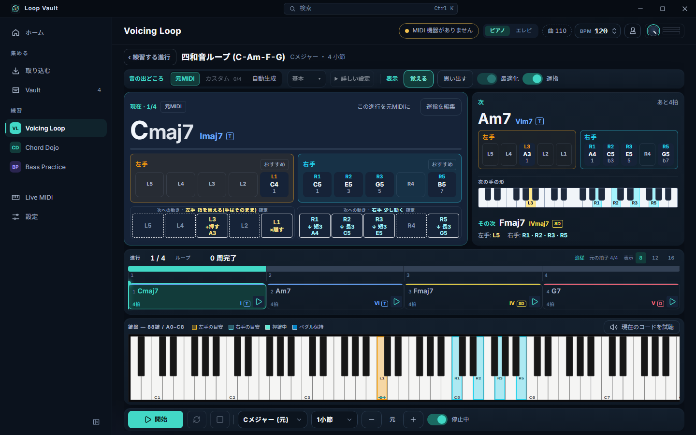
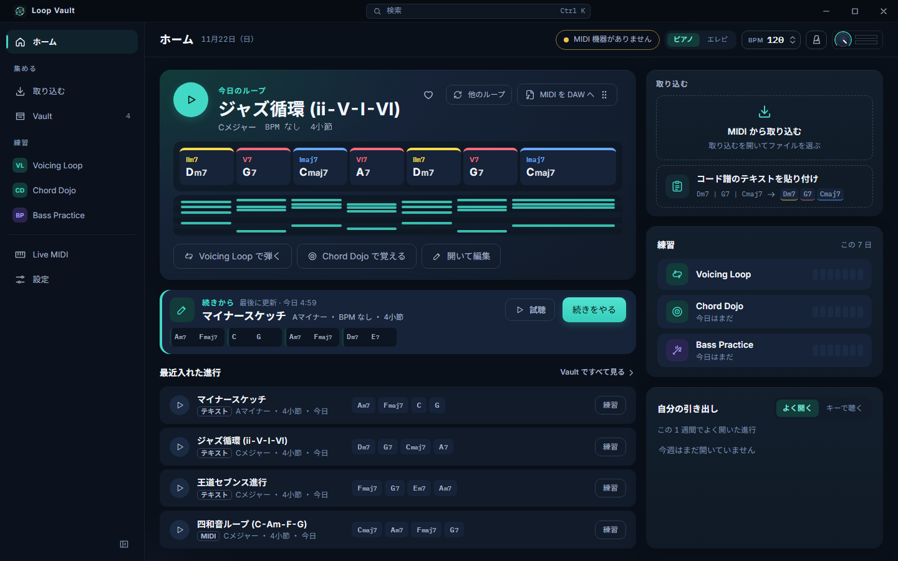
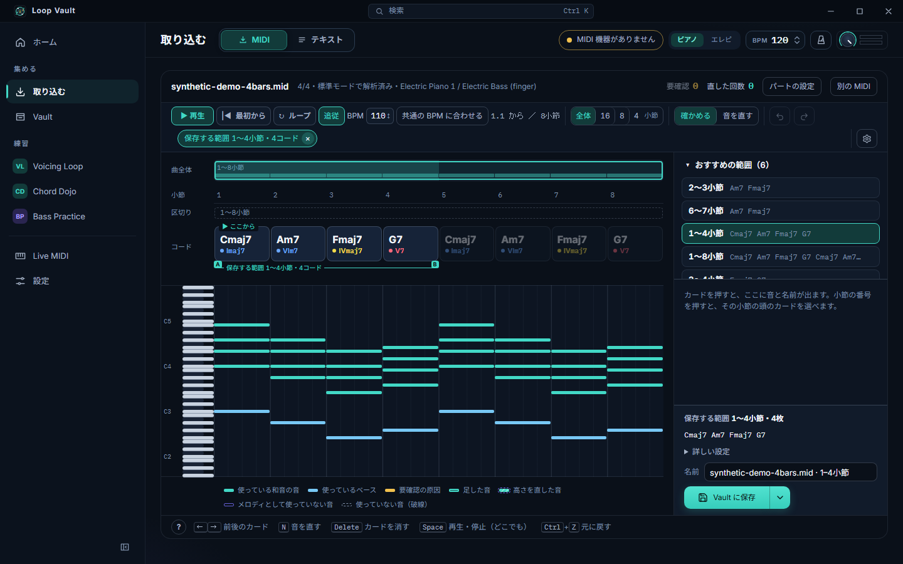
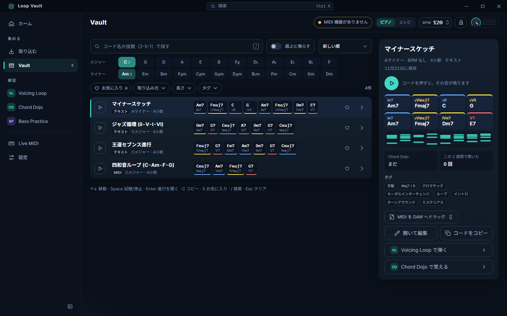
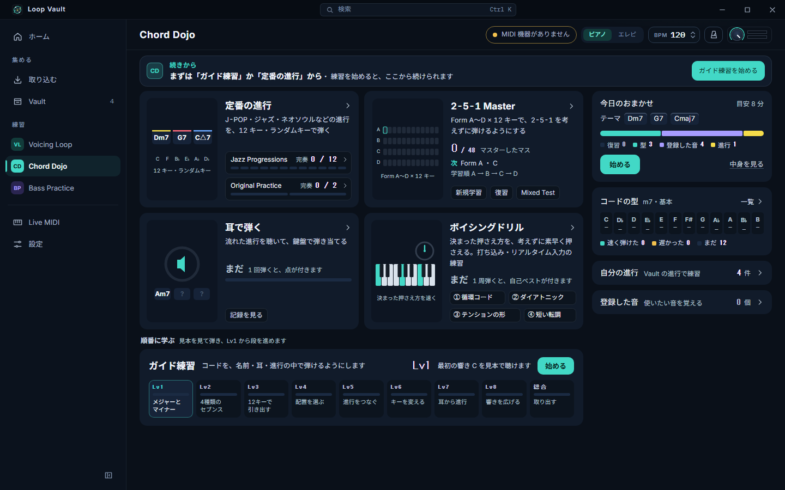
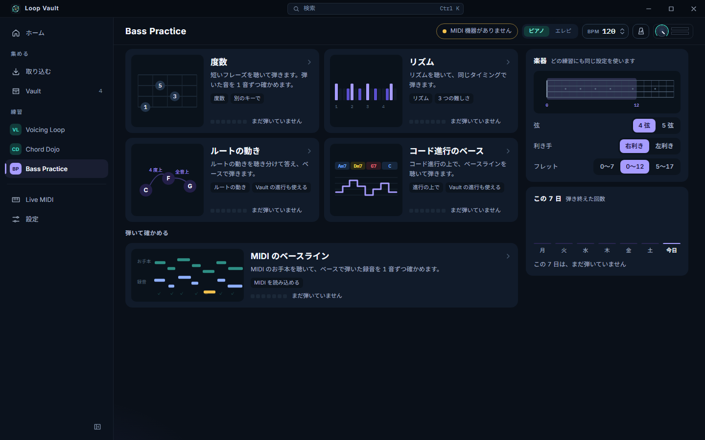

# Loop Vault

[日本語](README.md) | English

**A Windows app that turns chord progressions you love into your own vocabulary.**

Loop Vault is a Windows desktop songwriting companion for collecting and refining chord progressions from MIDI or text, internalising them through keyboard, bass and ear practice, and keeping them ready for your own tracks. All data stays on your PC.

[Download for Windows](https://github.com/Takuyakou/loop-vault/releases/latest)



*Screenshots were captured with synthetic data created for this README. No personal Vault, MIDI or recordings are included.*

---

## What you can do

- **Collect & refine**: Import MIDI files or chord progression text, then audition and fix notes, chord names and bar boundaries on the spot
- **Store & search (Vault)**: Organise progressions by key, chord name, degree, tag and favourite so you can hear and recall them anytime
- **Internalise by hand & ear (Practice)**: Loop saved progressions with fingerings (**Voicing Loop**), build chord fluency from fundamentals to jazz and ear playing (**Chord Dojo**), and practise bass with take-by-take feedback (**Bass Practice**)
- **Bring into your DAW**: Export saved progressions as MIDI or drag and drop them straight into your DAW

## Getting started

1. Open the [latest release](https://github.com/Takuyakou/loop-vault/releases/latest), download `Loop.Vault_<version>_x64-setup.exe` from **Assets**, and run the installer
2. Once launched, start from whichever fits you best:
   - **Start with your own MIDI or chords**: Open **取り込む** (Capture), drop a MIDI file or type chord names, review the notes, save to **Vault**, and practise in **Voicing Loop**
   - **Start playing right away without MIDI**: Even with an empty Vault, open **Chord Dojo** and jump straight into **ガイド練習** (Guided Course) or **定番の進行** (Standard Progressions). You can also add three sample progressions from the empty Vault and play them in **Voicing Loop**
3. Connect a MIDI keyboard from the **MIDI** button in the header (it reconnects automatically next time). Every practice screen also works without a MIDI keyboard

---

## Screens & features

### Home

Your daily hub for Loop Vault.

- **Today's Loop (今日のループ)**: Highlights a progression from your Vault with a mini piano roll and playable chord cards, with direct links to practise, edit or drag MIDI to a DAW
- **Continue (続きから)**: Jump back into your most recent practice session or edited progression in one click
- **Recent progressions, practice activity & drawer**: Audition chords directly or browse your collection by key



### Capture & Correction Workspace

Supports Standard MIDI Files (`.mid` / `.midi`) and text chord progressions.

- **MIDI import**: Drag and drop one or multiple files, choose part roles (bass, harmony, melody) before analysis, and detect keys automatically
- **Correction Workspace**: Exclude/restore notes, add or adjust pitches, rename chords, split/merge boundaries, and cut whole bars while listening. Original MIDI files are never modified
- **Text import**: Type progressions such as `| Dm7 G7 | Cmaj7 | Am7 | F G |` or paste a chord sheet as it is, and audition them before saving. Lyric lines are skipped; meters, `%` re-attack, `_` rest, `=` hold and jazz notation such as `Cm(maj7)` and `G7alt` are supported. You can also add chords one at a time by playing them on a MIDI keyboard



### Vault

Your local library of saved progressions.

- **Search & filter**: Filter by key band (major / minor), chord name or degree (e.g. `2-5-1`), favourites, source type, length and tags
- **Audition & edit**: Preview individual chords in the side panel, or open the detail page to adjust chords and voicings and overwrite or save as a new copy
- **Use in production**: Drag and drop MIDI straight into your DAW, or send any progression directly to Voicing Loop or Chord Dojo



### Voicing Loop

Loop a saved progression while watching the voicings and hand movement (shown in the top screenshot).

- **Everything in one view**: Large current chord, upcoming chords, left/right finger numbers, movement to the next chord, progression timeline and an 88-key keyboard
- **Four voicing sources**: Switch between Saved, Source MIDI, Custom (your own registered notes) and Generated (Basic / Core or detailed shapes)
- **Flexible looping**: Adjust BPM, key, octave and count-in, and set chord-level A–B section loops on the timeline. Pick progressions sorted by favourites and recent use

### Chord Dojo

Structured keyboard and ear training so progressions become second nature—works even with an empty Vault.

- **Guided Course (ガイド練習)**: 9 progressive stages from Lv1 (major & minor) to Lv8 (expanding harmonic vocabulary) plus a capstone check, connecting chord names, ear and progressions
- **Standard Progressions (定番の進行)**: J-POP, jazz, neo-soul and more in 12 keys or random keys (includes **Jazz Progressions** and **Original Practice**)
- **2-5-1 Master**: Drill Forms A–D across all 12 keys
- **Play by Ear (耳で弾く)**: Hear a progression and play it back on the keyboard, with scores and history
- **Voicing Drill (ボイシングドリル)**: Timed drills across turnarounds, diatonic chains, tension shapes and short modulations
- **Today's mix, Chord Shapes, Saved Progressions & Registered Voicings**: Practise your own Vault progressions and saved voicings alongside built-in drills
- Judges your playing automatically with a MIDI keyboard, or lets you self-mark when practising without one



### Bass Practice

Dedicated ear and playing practice for bass.

- **Listen & echo (4 modes)**: Degrees, Rhythm, Root Motion and Basslines over Chord Progressions (supports your Vault progressions)
- **Play & check**: Import **MIDI basslines** and practise along with the reference
- Record your take and review pitch and timing note by note. Supports 4-string / 5-string, right / left handedness and fret-range settings



### Live MIDI & global controls

- **Live MIDI**: Displays pressed notes and chord candidates in real time, lets you select a range from your played history to save into the Vault, and offers a compact mini window
- **Header controls**: Switch preview sound (piano / electric piano), global BPM, metronome and master volume from any screen
- **Command palette**: Press `Ctrl+K` to jump quickly to any screen or saved progression

---

## Download files

Available under **Assets** on the [latest release](https://github.com/Takuyakou/loop-vault/releases/latest). Most users should choose the setup installer.

| File | Use |
| --- | --- |
| `Loop.Vault_<version>_x64-setup.exe` | **Recommended.** Standard Windows installer |
| `Loop.Vault_<version>_x64_en-US.msi` | Windows Installer package |
| `loop-vault.exe` | Portable executable (run without installing) |
| `SHA256SUMS` | SHA-256 checksums for verifying downloads |

## Data & privacy

- Your Vault, settings, practice history and recordings stay entirely on your PC
- Loop Vault does not send MIDI files or recordings to external servers or external AI services
- Under **設定** (Settings) → **データ** (Data), you can inspect the storage folder, export/import your Vault and restore from automatic backups
- All screenshots in this README were captured with synthetic data; no personal Vault, MIDI or recordings are used

## Requirements & notes

- **Platform**: Windows (x64). Requires [Microsoft Edge WebView2 Runtime](https://developer.microsoft.com/en-us/microsoft-edge/webview2/) (included in Windows 11)
- **Unsigned binaries**: Release executables are currently unsigned. If Windows shows a warning, confirm the download came from this repository's Releases page and verify against `SHA256SUMS`
- **MIDI analysis**: Analysis is not a perfect automatic transcription; melodies, ornaments and dense harmonies may need review and adjustment in the Correction Workspace
- **Fingering & meter limits**: Finger numbers are practice guidance and can be customised per progression. Voicing Loop supports constant meters from 1/4 to 12/4

---

## Development & build

<details>
<summary>Tech stack and local setup / build / test commands</summary>

### Stack & prerequisites

Built with Tauri 2 / Rust, React 18 / TypeScript, Vite 7, Tone.js, Zustand and Zod.

- [Node.js](https://nodejs.org/en/download) 22.x and npm
- [Rust / Cargo](https://rustup.rs/) (MSVC toolchain on Windows)
- [Tauri 2 prerequisites](https://v2.tauri.app/start/prerequisites/) (C++ Build Tools, WebView2, etc.)

### Development

```bash
npm ci
npm run dev          # Browser dev view (http://localhost:1420, in-memory Vault)
npm run tauri -- dev # Run as Windows desktop app
```

### Build

```bash
npm run build                        # Build web frontend
npm run tauri -- build               # Build Windows executable and installers
npm run tauri -- build --no-bundle   # Build executable only without installers
```

### Tests & checks

```bash
npm run lint
npm test
npm run test:e2e
npm run security:scan
cargo test --manifest-path src-tauri/Cargo.toml --locked
```

Use `npm run test:fast` during development, `npm run test:feature` for targeted areas, and `npm run test:full -- --fresh` for an uncached full run.

</details>

- [CHANGELOG](CHANGELOG.md)

## License

**This repository is not open source.** Source code is published for review and evaluation only.
See [LICENSE](LICENSE) for terms covering use, execution, modification and redistribution. Commercial use, modification and redistribution require the copyright holder's written permission.

Bundled third-party audio and fonts keep their respective licences:

- **FreePats Bass Guitar YR** (bass samples): CC0-1.0 (`src/features/bass-practice/assets/freepats-bass-yr/`)
- **Salamander Grand Piano V3** (piano samples, Alexander Holm): CC BY 3.0 (`src/audio/assets/salamander-piano/`)
- **Bundled fonts** (Inter, Noto Sans JP, Noto Sans Symbols subset, IBM Plex Mono): SIL Open Font License 1.1 (`src/assets/fonts/`)
