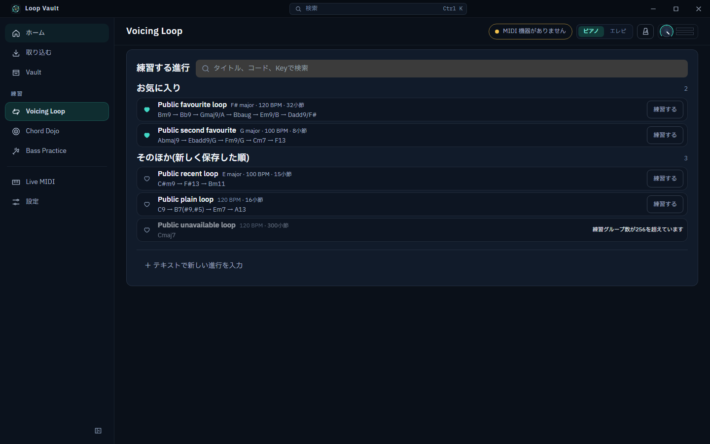
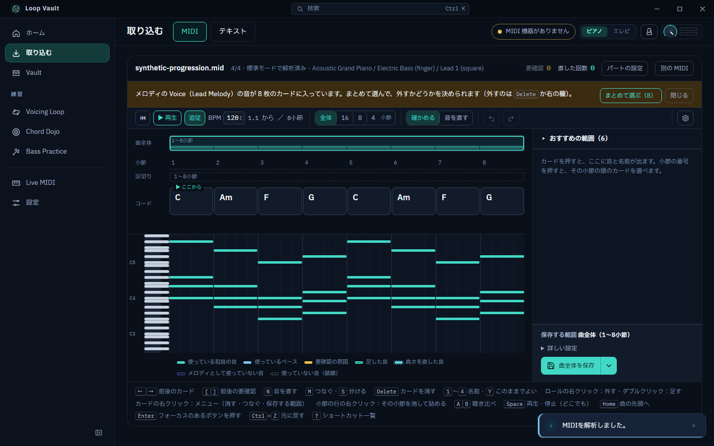
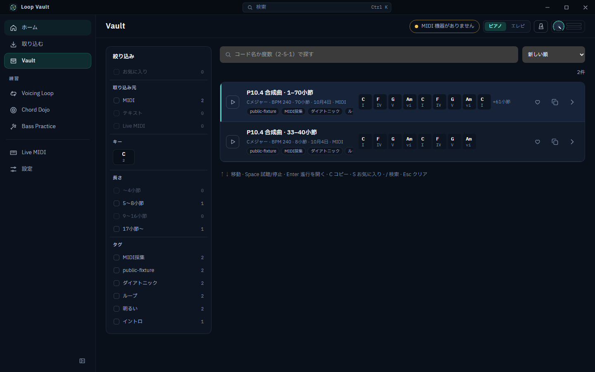
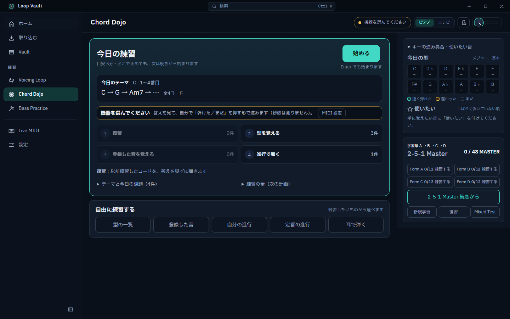

# Loop Vault

A Windows app that collects MIDI and chord progressions, stores them, and lets you practise them at the keyboard until you can play them.

**[Download for Windows (latest)](https://github.com/Takuyakou/loop-vault/releases/latest)** · [日本語](README.md) | [English](README.en.md)

*The screenshots use synthetic data made for this README. No personal Vault or MIDI is shown.*

## What you can do

| | |
|---|---|
| **Collect** | Import a MIDI file or type chord names, and get the progression plus the notes that actually sound. Fix mistakes on the spot while listening |
| **Keep** | Save a progression to the Vault, find it by key, tag or chord name, and export it as MIDI for your DAW |
| **Practise** | Loop a saved progression at the keyboard with fingerings (Voicing Loop), memorise chords and progressions (Chord Dojo), and practise the bass (Bass Practice) |

## Getting started

1. Open the [latest release](https://github.com/Takuyakou/loop-vault/releases/latest), download `Loop.Vault_<version>_x64-setup.exe` from "Assets" and run it
2. Choose a MIDI file under "取り込む" (or drag and drop it). Without MIDI, type the chord names
3. Listen to the analysis, fix anything wrong and press "Vaultに保存"
4. Pick the progression in "Voicing Loop" and press "開始"

Connect a MIDI keyboard from the MIDI button in the header; it reconnects automatically next time.

## A tour of the screens

### 取り込む (Capture)

Reads a MIDI file (.mid / .midi) or chord names typed as text.

- Before analysis you can choose which parts are bass, harmony or melody
- The correction workspace edits notes, chord names and boundaries. Delete code cards, or cut whole bars and close the gap
- The original MIDI file is never rewritten

Text looks like `| Dm7 G7 | Cmaj7 | Am7 | F G |`. Jazz notation such as `Cm(maj7)` and `G7alt` is supported.

### Vault

Where saved progressions live.

- Organise with title, key, BPM, tags and a memo; search by chord name or degree
- On a progression page you can change chords and notes, then overwrite or save as another version
- Export as MIDI, or drag it into a DAW

### Voicing Loop

Check a saved progression while it loops.

- The current chord large, with the next chords, the flow of the progression and an 88-key keyboard
- Finger numbers for both hands and the movement to the next chord
- Choose the notes from saved tones, the source MIDI, your own custom voicing, or generated voicings
- Change BPM, key and count-in; loop only a section
- Progressions are listed as favourites, recently used, then the rest. The star is the same favourite as the Vault, and favourites move to the top the next time you open the screen
- Search by title, chord or key

### Chord Dojo

Memorise chords and progressions without looking. One entry point ("今日の練習") puts the next thing to do in front of you.

- **定番の進行**: J-POP, jazz, bossa nova and neo-soul progressions across keys; works with an empty Vault
- **Jazz Progressions**: 21 standard jazz progressions in 12 keys, stage ① (play while looking) then ② (play from memory), repeatable
- **保存した進行**: your own Vault progressions
- Wrong notes never stop you; a clean lap clears the round
- A MIDI keyboard judges your playing; without one, press "弾けた" yourself

### Bass Practice

Listen and copy degrees, rhythms, basslines and root motion; record yourself and compare.
A bassline imported from MIDI can be practised with automatic judging.

## Data and privacy

- The Vault, settings, practice records and recordings stay on this PC. No MIDI or recording is sent anywhere
- "設定" → "データ" shows the storage location, export/import and backup restore
- Take a backup before upgrading or making big changes
- The images in this README use synthetic data; no real Vault, MIDI or recording

## Upgrading from v2.0.0

- **On first launch, your existing records are copied into the new folders and used. The originals stay.**
- **Do not use v2.0.0 after moving.** Changes made in v2.1.0 are not reflected in v2.0.0, and changes made in v2.0.0 are not reflected in v2.1.0
- **An export containing `alt` chords cannot be opened by v2.0.0.** Export your Vault before upgrading if you might go back
- See the [release notes](docs/release/v2.1.0/release-notes.md) (Japanese) for details

## Notes and limitations

- MIDI analysis is not perfect transcription. Melody, ornaments and complex chords may need checking on screen
- Finger numbers are guidance; hand size can make some shapes hard
- Windows (x64). [Microsoft Edge WebView2 Runtime](https://developer.microsoft.com/en-us/microsoft-edge/webview2/) is required (included in Windows 11)
- The builds are unsigned. If Windows warns, confirm the download came from this page and check the `SHA256SUMS` checksum

## Which file to download

From "Assets" on the [latest release](https://github.com/Takuyakou/loop-vault/releases/latest). Usually the setup file.

| File | Use |
|---|---|
| `Loop.Vault_<version>_x64-setup.exe` | **Usually this one.** Run it and follow the installer |
| `Loop.Vault_<version>_x64_en-US.msi` | If you prefer Windows Installer |
| `loop-vault.exe` | Run without installing |
| `SHA256SUMS` | Check the downloaded files |

## More

- [Usage guide (Japanese)](docs/guide.md): choosing notes, text notation, section loops, keyboard control
- [CHANGELOG](CHANGELOG.md)
- [Developer information](docs/development.md): building and testing

## Licence

**This repository is not open source.** The source is published for review and evaluation.
See [LICENSE](LICENSE) for the terms of use, running, modification and redistribution. Commercial use, modification and redistribution require the copyright holder's written permission.

The bundled FreePats bass sounds are CC0-1.0. Other audio and libraries keep their own licences.
