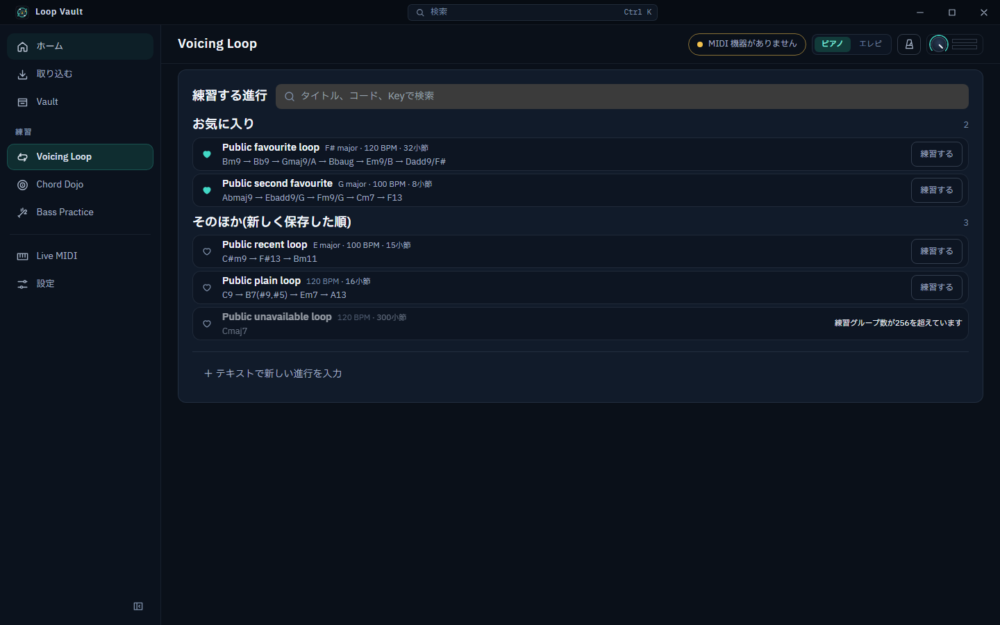
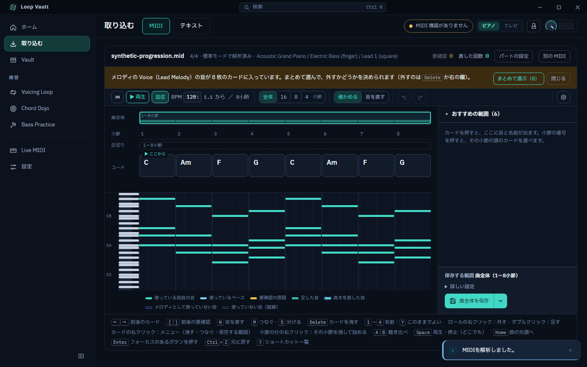
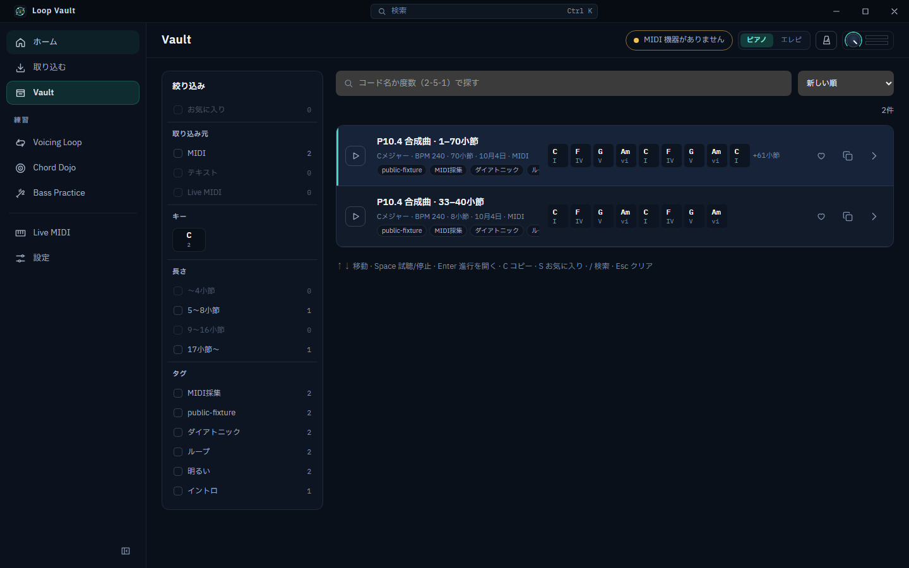
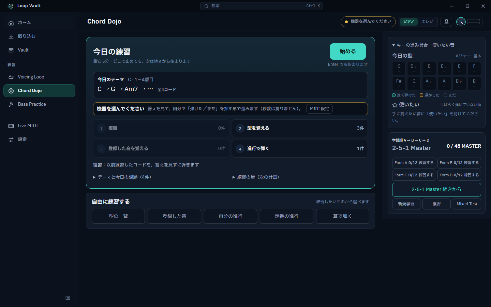

# Loop Vault

コード進行を集めて保存し、聴いて直せる。聴いて弾ける。MIDI で取り出せる。

コード進行を自分の語彙として残す 楽曲制作補助 Windows アプリです。

**[Windows 版をダウンロード(最新版)](https://github.com/Takuyakou/loop-vault/releases/latest)** ・ [日本語](README.md) | [English](README.en.md)

*画像は自作の合成データで撮ったものです。個人の Vault や MIDI は写っていません。*

## できること

- **集める**:MIDI ファイルやコード名のテキストから、コード進行と鳴っている音を取り込みます。解析のまちがいは、音を聴きながらその場で直せます
- **しまう**:気に入った進行を「Vault」に保存します。キー・タグ・コード名で探せて、MIDI として書き出して DAW でも使えます
- **練習する**:保存した進行を、鍵盤と指の番号を見ながらくり返し弾けます(Voicing Loop)。覚えるための練習(Chord Dojo)と、ベースの練習(Bass Practice)もあります

## はじめかた

1. [最新版のページ](https://github.com/Takuyakou/loop-vault/releases/latest)の「Assets」から、`Loop.Vault_<版>_x64-setup.exe` をダウンロードして起動します
2. 左の「取り込む」で MIDI ファイルを選びます(ドラッグ&ドロップでも可)。MIDI が無ければ、コード名をテキストで入力します
3. 解析の結果を聴いて確かめ、「Vaultに保存」を押します
4. 「Voicing Loop」で保存した進行を選び、「開始」を押します

MIDI 鍵盤は、上の MIDI のボタンからつなげます。次からは起動時に自動でつながります。

## 画面の紹介

### 取り込む

MIDI ファイル(.mid / .midi)か、コード名のテキストを読み込みます。

- 解析の前に、どのパートがベース・和音・メロディかを選べます
- 解析のあとは「修正作業場」で、音・コード名・区切りを直せます。いらないコードカードを消したり、小節ごと消して詰めたりもできます
- 元の MIDI ファイルは書き換えません

テキストは、たとえば `| Dm7 G7 | Cmaj7 | Am7 | F G |` のように入力します。`Cm(maj7)` や `G7alt` のようなジャズの表記も読めます。

### Vault

保存した進行の置き場所です。

- タイトル・キー・BPM・タグ・メモで整理し、コード名や度数で探せます
- 進行のページで、コードや鳴らす音を変えて試せます。上書き保存も、別の版としての保存もできます
- MIDI として書き出し、DAW へドラッグ&ドロップできます

### Voicing Loop

保存した進行を、ループしながら確かめる画面です。

- 今のコードを大きく表示し、次のコード・進行の流れ・88 鍵の鍵盤を一度に見られます
- 左右の指の番号と、次のコードへの指の動きを表示します
- 鳴らす音は「保存した音」「元の MIDI」「自分で登録した音」「自動で作った音」から選べます
- BPM・キー・カウントインを変えられます。一部分だけのくり返し(区間ループ)もできます
- 進行は「お気に入り → 最近使った → そのほか」の順に並びます。星を押すと、Vault と同じお気に入りになります(次に開いたとき、一番上に並びます)
- 検索はタイトル・コード・キーで絞れます

### Chord Dojo

コードや進行を、見なくても弾けるように覚える画面です。入口は「今日の練習」の 1 つだけで、やることを順に出します。

- **定番の進行**:J-POP・ジャズ・ボサノバ・ネオソウルなどの進行を、いろいろなキーで練習します。Vault に何も保存していなくても使えます
- **Jazz Progressions**:ジャズの定番の進行を 12 のキーで。「① 見て弾く」「② 覚えて弾く」の順に進み、同じ段階を何度でもくり返せます
- **保存した進行**:自分の Vault の進行を覚えます
- まちがえても止まらず最後まで進み、まちがいの無い 1 周でクリアです
- MIDI 鍵盤で正しく弾けたかを自動で判定します。鍵盤が無いときは、自分で「弾けた」を押して進めます

### Bass Practice

ベースの練習です。度数・リズム・ベースライン・ルートの動きを聴いてまねし、録音して聴き比べます。
MIDI で読み込んだベースラインを、正しく弾けたか判定しながら練習することもできます。

## データとプライバシー

- Vault・設定・練習の記録・録音は、すべてこのパソコンの中に保存します。MIDI や録音を外に送ることはありません
- 「設定」→「データ」から、保存場所の確認・書き出し・読み込み・バックアップからの復元ができます
- 版を上げる前や大きく直す前は、バックアップを取っておくと安心です
- この README の画像は合成データで撮ったもので、実際の Vault・MIDI・録音は使っていません

## v2.0.0 から上げるとき

- **初回起動で、これまでの記録を新しいフォルダへ写して使います。元のデータは残ります。**
- **移ったあとは v2.0.0 を使わないでください。** v2.1.0 で付けた変更は v2.0.0 に反映されず、v2.0.0 で付けた変更も v2.1.0 には反映されません
- **alt を含む書き出しは v2.0.0 で開けません。** 戻すかもしれないときは、上げる前に Vault を書き出しておいてください
- くわしくは [リリースノート](docs/release/v2.1.0/release-notes.md) を見てください

## 気をつけること

- MIDI の解析は、完全な自動採譜ではありません。メロディ・装飾音・複雑な和音などは、画面で確かめて直す必要があることがあります
- 指の番号は練習の目安です。手の大きさによっては弾きにくい場合があります
- Windows(x64)用です。[Microsoft Edge WebView2 Runtime](https://developer.microsoft.com/en-us/microsoft-edge/webview2/) が必要です(Windows 11 には入っています)
- 配布物には署名がありません。Windows の警告が出たら、ダウンロード元がこのページであることと、`SHA256SUMS` のチェックサムを確かめてください

## ダウンロードするファイル

[最新版のページ](https://github.com/Takuyakou/loop-vault/releases/latest)の「Assets」にあります。ふつうはセットアップ版を選んでください。

| ファイル | 使い方 |
|---|---|
| `Loop.Vault_<版>_x64-setup.exe` | **ふつうはこれ。** 起動して案内どおりにインストール |
| `Loop.Vault_<版>_x64_en-US.msi` | Windows Installer の形式を使いたいとき |
| `loop-vault.exe` | インストールせずに起動したいとき |
| `SHA256SUMS` | ダウンロードしたファイルが正しいかを確かめるため |

## もっと詳しく

- [使い方ガイド](docs/guide.md):音の選び方、テキストの書き方、区間ループ、キーボードでの操作など
- [変更の記録(CHANGELOG)](CHANGELOG.md)
- [開発者向けの情報](docs/development.md):ビルドとテストの方法

## ライセンス

**このリポジトリはオープンソースではありません。** ソースコードは、見て評価するために公開しています。
使う・動かす・改変する・再配布する条件は [LICENSE](LICENSE) を見てください。著作権者の書面の許可なく、商用利用・改変・再配布はできません。

同梱しているベースの音色(FreePats)は CC0-1.0 です。そのほかの音源やライブラリには、それぞれのライセンスが適用されます。
