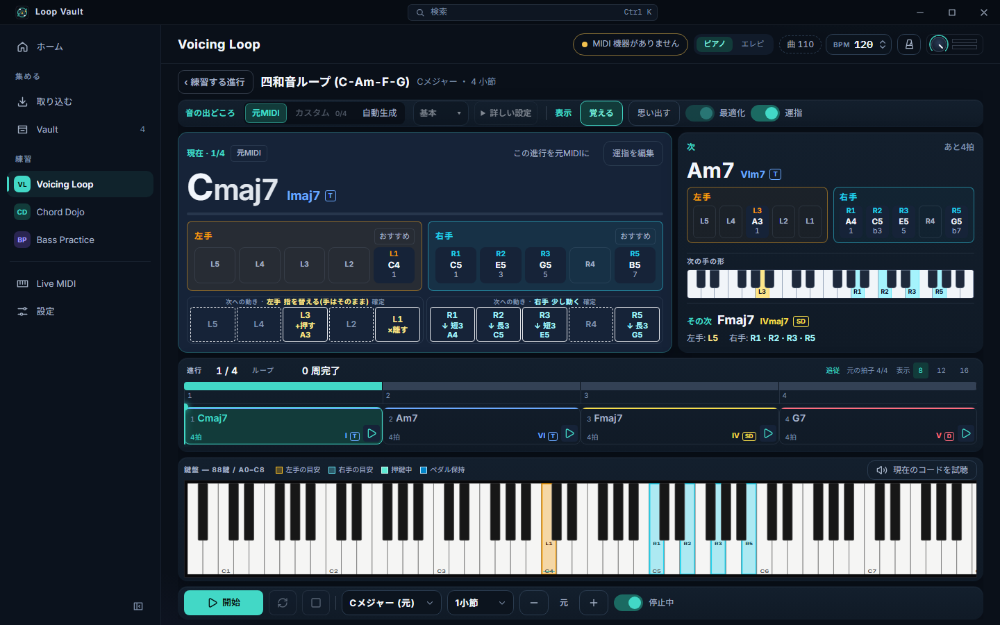
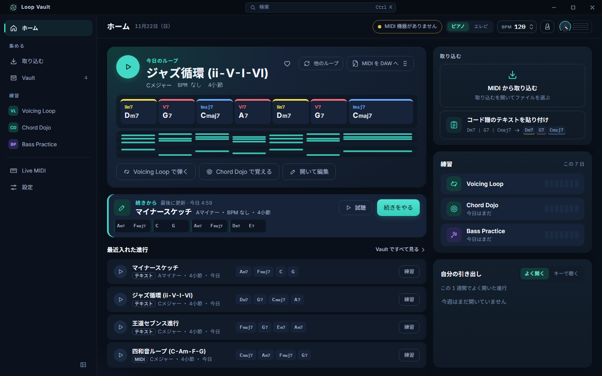
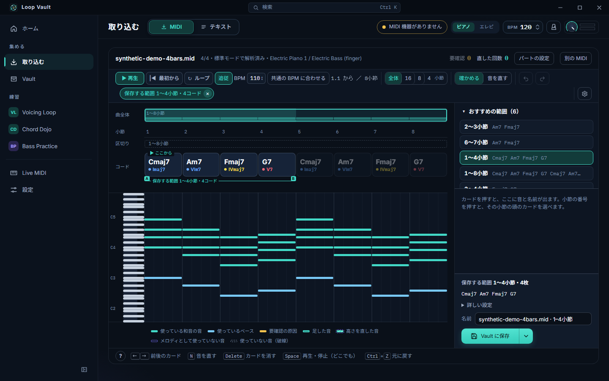
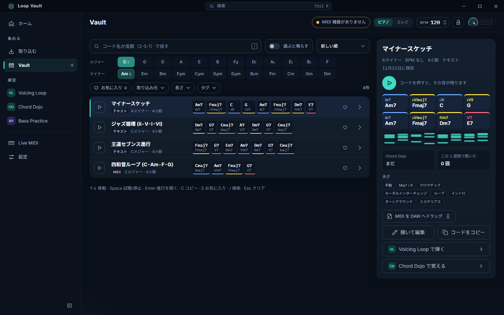
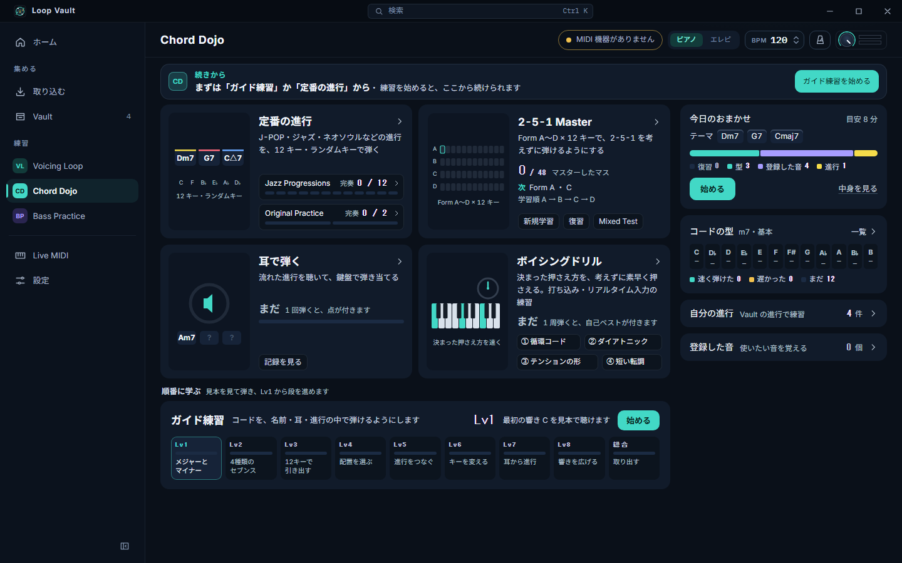
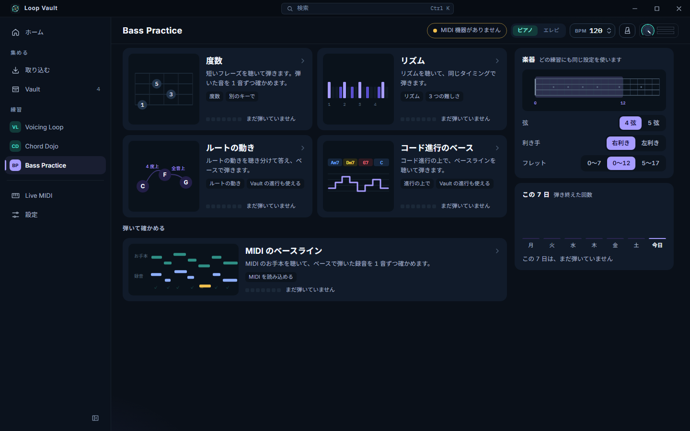

# Loop Vault

日本語 | [English](README.en.md)

**「いいな」で終わるコード進行を、自分の引き出しに変えるWindowsアプリ。**

Loop Vaultは、MIDIやテキストからコード進行を集めて整え、鍵盤・ベース・耳で反復練習しながら、制作に使える自分の引き出しとして蓄える、作曲補助用のWindowsデスクトップアプリです。データは手元のPCに保存します。

[Windows版をダウンロード](https://github.com/Takuyakou/loop-vault/releases/latest)



*画像は撮影用に作成した合成データで表示しています。個人の Vault・MIDI・録音は含みません。*

---

## できること

- **集めて整える**：MIDI ファイルやコード進行のテキストを取り込み、音を聴きながら不要な音・コード名・区切りをその場で直せます
- **蓄えて探す（Vault）**：気に入った進行をキー・コード名・度数・タグ・お気に入りで整理し、いつでも聴き返せます
- **指と耳に入れる（練習）**：保存した進行を鍵盤で反復練習する **Voicing Loop**、ガイドに沿って基礎から耳コピ・ジャズまで覚える **Chord Dojo**、録音して確かめる **Bass Practice** で身体に染み込ませられます
- **制作に持ち出す**：Vault の進行を MIDI として書き出し、そのまま DAW へドラッグ＆ドロップできます

## はじめかた

1. [最新版のリリースページ](https://github.com/Takuyakou/loop-vault/releases/latest)の「Assets」から `Loop.Vault_<version>_x64-setup.exe` をダウンロードしてインストールします
2. 起動したら、目的に合わせて次のどちらかから始めてみてください
   - **手元の MIDI や好きな進行から始めたいとき**：左の「取り込む」から MIDI ファイルをドラッグ＆ドロップ（またはテキストでコード名を入力）→ 音を確認して「Vault に保存」→「Voicing Loop」で練習します
   - **まずは定番や基礎から弾いてみたいとき**：Vault が空のままでも、左の「Chord Dojo」から「ガイド練習」や「定番の進行」をすぐ始められます。Vault の「サンプル進行を 3 件入れて試す」で、王道進行などを入れて Voicing Loop で弾いてみることもできます
3. MIDI 鍵盤を使う場合は、画面上部の「MIDI」ボタンから接続します（一度つなぐと次回から自動で再接続します）。鍵盤がなくても画面操作だけで練習できます

---

## 主な画面と機能

### ホーム

日々の入口となる画面です。

- **今日のループ**：Vault から 1 つ進行をピックアップし、ミニピアノロールとコードカードで即座に試聴・練習・DAW 書き出しができます
- **続きから**：直前に取り組んでいた練習や編集へワンクリックで戻れます
- **最近入れた進行・練習の記録・自分の引き出し**：コードを押して音を鳴らしたり、キーや履歴から進行を探したりできます



### 取り込む ＆ 修正作業場

MIDI ファイル（`.mid` / `.midi`）とコード進行のテキストに対応しています。

- **MIDI 取り込み**：ドラッグ＆ドロップや複数ファイルの読み込みに対応。解析前にベース・和音・メロディなどのパート役割を確認でき、キーも自動推定されます
- **修正作業場**：解析結果を聴きながら、音の除外・追加・高さ変更、コード名の修正、分割・結合、小節ごとの削除と詰め直しができます。読み込んだ元の MIDI ファイルは書き換えません
- **テキスト取り込み**：`| Dm7 G7 | Cmaj7 | Am7 | F G |` のように入力するか、コード譜をそのまま貼り付けて、プレビュー試聴しながら保存できます。歌詞の行は読み飛ばし、拍子・`%` 再発音・`_` 休符・`=` 保持・`Cm(maj7)`・`G7alt` などに対応しています。MIDI 鍵盤で和音を弾いて、1 コードずつ入れることもできます



### Vault

集めたコード進行を蓄えておくライブラリです。

- **探す・絞る**：キー帯（メジャー／マイナー）、コード名・度数検索（例：`2-5-1`）、お気に入り、取り込み元、長さ、タグで絞り込めます
- **聴く・直す**：右のプレビューでコードごとの響きを確認でき、詳細画面ではコードやボイシングを編集して上書き保存・別版保存ができます
- **制作に使う**：進行をそのまま MIDI として DAW へドラッグ＆ドロップしたり、Voicing Loop や Chord Dojo へ送ったりできます



### Voicing Loop

Vault の進行を、鍵盤と運指を見ながら反復練習する画面です（ページ上部の画像）。

- **ひと目で把握**：現在のコード、次のコード・その次のコード、左右の指番号と「次への動き」、進行タイムライン、88 鍵盤を同時に表示します
- **4 つの音の出どころ**：「保存した音」「元 MIDI」「カスタム（自分で登録した音）」「自動生成（基本／骨組みや詳細形）」を切り替えられます
- **練習しやすい制御**：BPM・キー・オクターブ・カウントインの調整に加え、タイムライン上でコード単位の A–B 区間ループができます。進行一覧はお気に入り・最近使った順で探せます

### Chord Dojo

コードや進行を「見ずに弾ける・聴いて弾ける」状態へ鍛える練習画面です。Vault が空でもすぐ使えます。

- **ガイド練習**：Lv1（メジャーとマイナー）〜 Lv8（響きの語彙を広げる）＋総合確認の 9 段階で、名前・耳・進行の中で順番に学べます
- **定番の進行**：J-POP・ジャズ・ネオソウルなどの進行を 12 キー・ランダムキーで練習できます（`Jazz Progressions` / `Original Practice` を収録）
- **2-5-1 Master**：Form A〜D × 12 キーでツーファイブワンを身体に入れます
- **耳で弾く**：流れた進行を聴いて鍵盤で弾き当て、スコアと履歴を残せます
- **ボイシングドリル**：①循環コード / ②ダイアトニック / ③テンションの形 / ④短い転調をテンポよく反復します
- **今日のおまかせ・コードの型・自分の進行・登録した音**：Vault に保存した進行や登録したボイシングもそのまま練習対象になります
- MIDI 鍵盤をつなぐと自動で正誤判定します。鍵盤がないときは「弾けた / まだ」の自己判定で進められます



### Bass Practice

ベースの耳と演奏を鍛える練習画面です。

- **聴いてまねる（4 種類）**：**度数**・**リズム**・**ルートの動き**・**コード進行のベース**（Vault の進行も利用可能）
- **弾いて確かめる**：**MIDI のベースライン**を読み込んでお手本に合わせて練習できます
- どの練習も録音して 1 音ずつタイミングと音程を確かめられます。4 弦／5 弦、右利き／左利き、フレット範囲の設定にも対応しています



### Live MIDI と共通操作

- **Live MIDI**：接続した MIDI 鍵盤の押鍵とコード候補をリアルタイム表示します。演奏履歴から範囲を選んで Vault へ保存したり、小さなミニウィンドウで手元に置いたりできます
- **ヘッダー共通コントロール**：どの画面でもピアノ／エレピのプレビュー音色、共通 BPM、メトロノーム、マスター音量を切り替えられます
- **コマンドパレット**：`Ctrl+K` で画面移動や保存した進行へ素早くジャンプできます

---

## ダウンロードするファイル

[最新版のリリースページ](https://github.com/Takuyakou/loop-vault/releases/latest)の「Assets」から選んでください。通常はセットアップ版をおすすめします。

| ファイル | 使い方 |
| --- | --- |
| `Loop.Vault_<version>_x64-setup.exe` | **通常はこちら。** 起動して案内に従ってインストール |
| `Loop.Vault_<version>_x64_en-US.msi` | Windows Installer 形式を使いたい場合 |
| `loop-vault.exe` | インストールせず単体で起動したい場合 |
| `SHA256SUMS` | ダウンロードしたファイルの SHA-256 照合用 |

## データとプライバシー

- Vault・設定・練習記録・録音データは、すべて手元の PC 内に保存します
- MIDI ファイルや録音を外部サーバーや外部 AI へ送信する機能はありません
- 「設定」→「データ」から、保存場所の確認、Vault の書き出し・読み込み、自動バックアップからの復元ができます。大きな編集やバージョン更新の前はバックアップを取っておくと安心です
- この README のスクリーンショットはすべて合成データで撮影しており、個人の Vault・MIDI・録音は含まれていません

## 動作環境と気をつけること

- **対応 OS**：Windows（x64）。[Microsoft Edge WebView2 Runtime](https://developer.microsoft.com/en-us/microsoft-edge/webview2/) が必要です（Windows 11 には標準で含まれています）
- **配布物の署名**：配布ファイルにはコード署名がまだありません。Windows の警告が表示された場合は、配布元がこのリポジトリの Releases であることと `SHA256SUMS` を確認してください
- **MIDI 解析**：完全な自動採譜ではありません。メロディ・装飾音・複雑な和声などは、修正作業場で音を聴きながら確認・調整する前提で設計しています
- **運指・拍子の範囲**：表示される運指は練習の目安です（手の大きさ等に合わせて編集・固定できます）。Voicing Loop の対応拍子は一定の 1/4〜12/4 です

---

## 開発・ビルド（開発者向け）

<details>
<summary>技術構成とローカルでの起動・ビルド・テスト手順を開く</summary>

### 技術構成と前提条件

Tauri 2 / Rust、React 18 / TypeScript、Vite 7、Tone.js、Zustand、Zod を使用しています。

- [Node.js](https://nodejs.org/en/download) 22 系と npm
- [Rust / Cargo](https://rustup.rs/)（Windows は MSVC toolchain）
- [Tauri 2 の前提条件](https://v2.tauri.app/start/prerequisites/)（C++ Build Tools、WebView2 など）

### 開発起動

```bash
npm ci
npm run dev          # ブラウザ開発画面 (http://localhost:1420 / メモリ内 Vault)
npm run tauri -- dev # Windows デスクトップアプリとして起動
```

### ビルド

```bash
npm run build                        # Web フロントエンドのビルド
npm run tauri -- build               # Windows 実行ファイル・配布物のビルド
npm run tauri -- build --no-bundle   # インストーラーを作らず exe のみビルド
```

### テストと検査

```bash
npm run lint
npm test
npm run test:e2e
npm run security:scan
cargo test --manifest-path src-tauri/Cargo.toml --locked
```

作業中の確認には `npm run test:fast`、機能単位は `npm run test:feature`、全件検証は `npm run test:full -- --fresh` を用意しています。

</details>

- [変更の記録（CHANGELOG）](CHANGELOG.md)

## ライセンス

**本リポジトリはオープンソースではありません。** ソースコードは閲覧・評価目的で公開しています。
利用・実行・改変・再配布等の条件は [LICENSE](LICENSE) を確認してください。著作権者の書面による許可なく、商用利用・改変・再配布はできません。

同梱する音源・書体のライセンスは以下のとおりです。

- **FreePats Bass Guitar YR**（ベース音色）：CC0-1.0（`src/features/bass-practice/assets/freepats-bass-yr/`）
- **Salamander Grand Piano V3**（ピアノ音色、Alexander Holm）：CC BY 3.0（`src/audio/assets/salamander-piano/`）
- **同梱書体**（Inter・Noto Sans JP・Noto Sans Symbols 切り出し・IBM Plex Mono）：SIL Open Font License 1.1（`src/assets/fonts/`）
