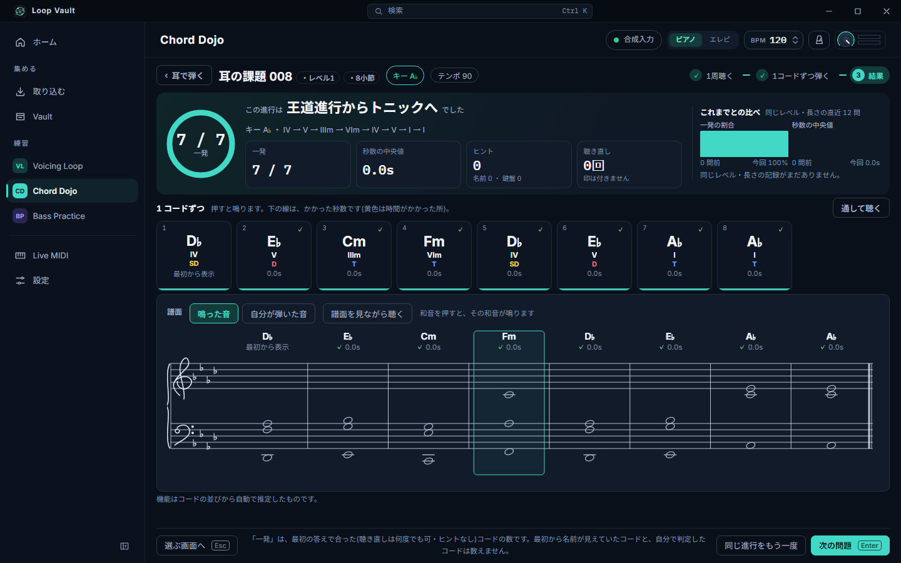
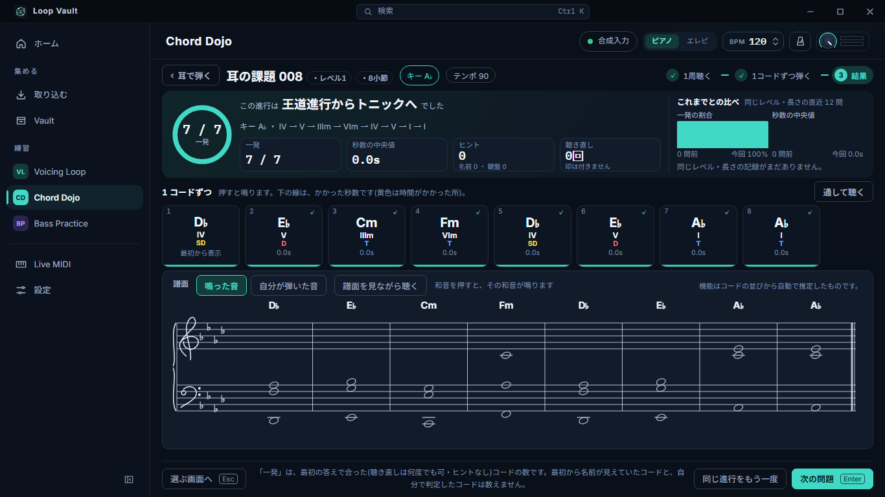
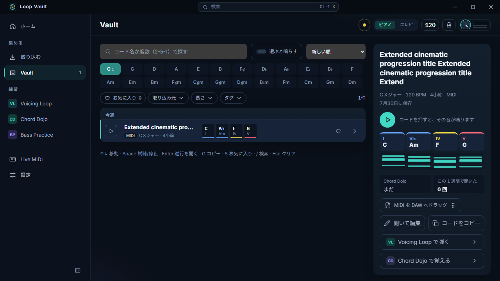
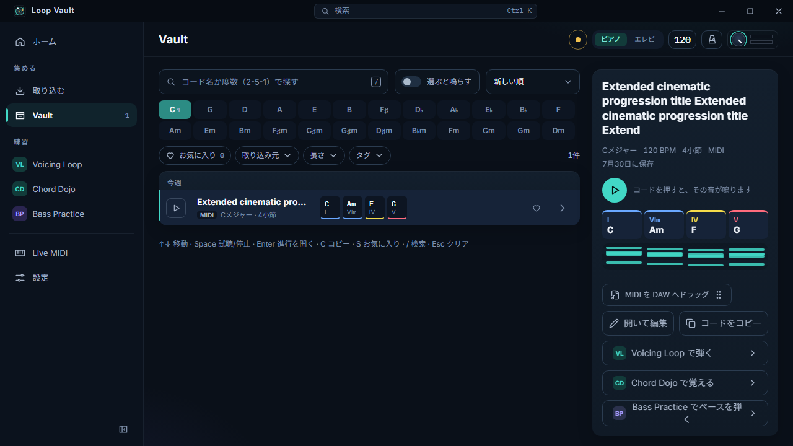
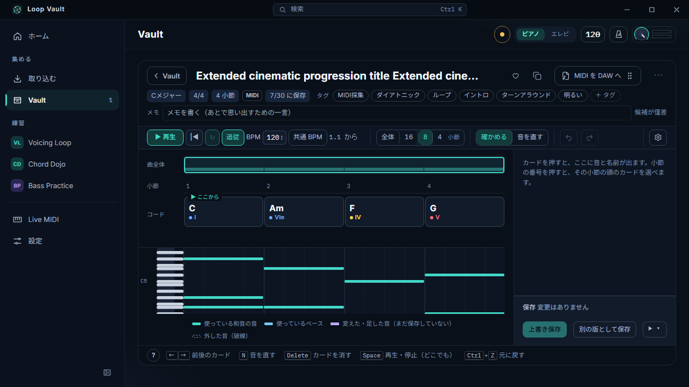
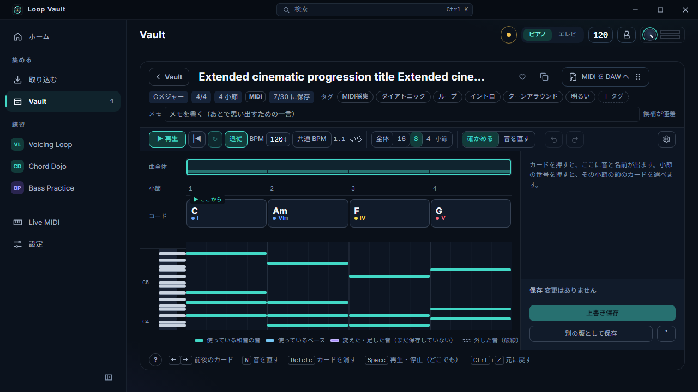
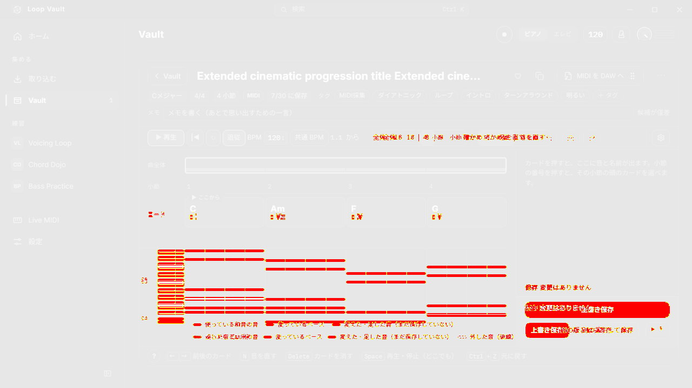

# P23-58-fix-1 レポート (2026-11-20)

- **状態**: **完了**（`16:35 追記 4` のとおり **案 A** で直し、`npm run test:full:all` → local master へ `--no-ff` でマージ）
- **ブランチ / HEAD**: `feat/p23-57-58-finishing` @ `a4413d9b`（修正のコミット）→ local `master`
- **前回の停止**: `1f902a62` の `npm run test:full:all` で `e2e/p16-ear-degrees.spec.ts` の `{ width: 1280, height: 800 }` だけ FAIL（結果カードの高さ 期待 `112` / 実際 `96`）

---

## 0. `16:35 追記 4`（1280×800 の結果カードの高さ）の対応

**決めたこと（追記 4 の 1）**: `ear-practice.css` の結果カード（`.ear-cards-result .ear-card`）の 96px の条件を `min-width: 1200px` かつ `max-height: 780px` に絞り、B の 1〜4 と D2 は `max-height: 800px` のまま（`shortWide` は B1・B2 を受け持つので 800px のまま）。→ 1280×800 でカードが 112px になることを確かめた。

**確かめ（追記 4 の 2）**: 1280×800 の 8 小節の結果で `.ear-result-body` の `scrollHeight - clientHeight` を測った。

| 画面サイズ | カード 112px（追記 4 の 1 の直後） | カード 96px（案 A・最終） |
|---|---|---|
| `1440×900` | `0px`（`684 / 684`） | `0px`（`684 / 684`） |
| `1366×768` | `0px`（`564 / 564`） | `0px`（`564 / 564`） |
| `1280×800` | **`94px`（`690 / 596`）** | **`78px`（`674 / 596`）** |

**0 にならなかったので、追記 4 の 3 のとおり案 A に戻した**（`max-height: 800px` の線はそのまま＝詰める方を使い、期待をそれに合わせる）。

- `e2e/p16-ear-degrees.spec.ts`: 期待を `112` から `size.width >= 1200 && size.height <= 800 ? 96 : 112` へ（**どのテストの何を何から何へ**: `P16-06` の結果カードの高さの期待を `112` → 条件付き `96`/`112`。1280×800 は `96`、768×640 と 1440×900 は `112`）。
- X14（`e2e/p23-23b-ear-result.spec.ts`）は `1440×900`・`1366×768` の `overflow <= 1` のまま（1280×800 は `78px` はみ出すので、追記 4 の 2 の「通れば 1280×800 も足す」の枝ではないため足していない。値は上表のとおり報告）。

### 参照: 前回まで（`15:55 追記 3` まで）の値

| 画面サイズ | P23-58 後（修正前） | 14:40 追記適用後（D2 前） | D2 適用後（`1f902a62`） |
|---|---|---|---|
| `1440×900` | `232px`（`916 / 684`） | `0px`（`684 / 684`） | `0px`（`684 / 684`） |
| `1366×768` | `322px`（`886 / 564`） | `9px`（`573 / 564`） | `0px`（`564 / 564`） |

---

## 1. 実装・確認済み項目（`15:55 追記 3` まで）

### §1 + 14:40 追記 + D2: B6（耳の結果 8 小節）
- **実装**:
  - `src/views/ear-practice/EarRun.tsx`, `ResultScore.tsx`, `ProgressionScore.tsx`, `src/views/ear-practice/ear-practice.css`:
    - `1200px` 以上（`wideTrend`）で `aside.ear-result-trend` を `.ear-result-top` の 3 列目へ移動（幅 300px、左線 1px `var(--dojo-border)`、左余白 12px、背景なし、棒グラフ高さ 44px）、`.ear-result-row` を 1 列化、`.ear-compare-line` を sr-only 化（`e2e/p16-ear-score.spec.ts` の `ear-compare` 可視確認を維持しつつレイアウト高さを 0px 化）、2 つ目見出しを `秒数の中央値` + `title="秒数の中央値(低いほど速い)"` へ。
    - `1200px` 以上かつ高さ `800px` 以下（`shortWide`）で `.ear-cards-result .ear-card` 高さを `112 → 96px`、リング `.ear-rate` を `110 → 92px`、4 箱 `.ear-summary-card` の上下余白圧縮、楽譜上のコード注記 2 行目非表示＋コード名 `y=32`＋SVG 上部 16px トリム（五線と音符の縮尺・位置は不変）、機能注記を `.ear-score-bar-head` 右端へ移動（11px）。
    - **D2 追加直し**: `ear-practice.css` line 361 の `@media (min-width: 1200px) and (max-height: 800px)` 内 `.ear-score-card` が後続 line 527 の `.ear-score-card { gap: 10px }` に負けていた点と下余白を `.ear-result .ear-score-card { padding-top: 6px; padding-bottom: 4px; gap: 4px; }` へ詳細度引き上げで解消。
- `e2e/p23-23b-ear-result.spec.ts` X14 に 8 小節結果（`1440×900`・`1366×768` の `overflow <= 1`）を追加。
- 写真（8 小節結果・1440×900 / 1366×768。レイアウトは今回の案 A でも同じなので前回の物をそのまま使う）:
  - 
  - 

### §2: B2（タグ入力欄の丸み）
- `src/styles/correction-workspace.css`: `.lv-tags-editor .lv-tags-input`（および `:focus-visible`）へ詳細度を上げ、`border-radius: 999px`・高さ `34px` を確認（`e2e/p23-58-motion.spec.ts` で実測 `34px`・丸半径 `>= 100px` 通過）。

### 追記 3 D1: 進行ページの保存ボタン 2 段グリッド
- `src/components/correction-workspace/WorkspaceSaveForm.tsx` (`ProgressionSaveForm`): `<section className="lv-cw-save" data-mode="progression" ...>` を追加（取り込み作業場の `CaptureWorkspaceSaveForm` は無変更）。
- `src/styles/correction-workspace.css`: `.lv-cw-save[data-mode="progression"] .lv-cw-save-actions` に指示どおりの 5 ルールを適用し、`details` 内の `.lv-cw-delete-menu` が開いた際に `details` 右端（`▾` の右端）へ揃って上方向へ開くよう配置を追加。
- `e2e/p23-58-motion.spec.ts` にて 1 段目「上書き保存」全幅・2 段目「別の版として保存」＋ 34px「▾」整列・`▾` メニュー右端揃え・A3 保存ボタン幅不変（テキスト取込 `busy`/`done` 前後差 `<= 1px`・進行上書き保存後幅差 `<= 1px`）を確認し 7/7 PASS。

### §3 + D3: 承認済み基準写真 2 枚の更新
- 更新した基準写真（許可された 2 枚のみ、`e2e/visual.spec.ts` 全 6 テスト PASS）:
  1. `e2e/visual.spec.ts-snapshots/vault-chromium-desktop-win32.png`（B3「Bass Practice でベースを弾く」＋ A5 スイッチ）
     - 前: 
     - 後: 
  2. `e2e/visual.spec.ts-snapshots/progression-detail-default-chromium-desktop-win32.png`（B1 ロール拡大・凡例 1 行＋ B4 ツールバー＋ D1 保存グリッド）
     - 前: 
     - 後: 
     - 差: 

---

## 2. `npm run test:full:all` の結果（`a4413d9b` で 1 回）

| ステップ | 結果 |
|---|---|
| 静的検査（Source contracts / AI handoff / Class lint / Phase docs / Runner contracts 44/44 / Privacy scan / E2E TypeScript / Production build / Repository ESLint / App TypeScript） | **PASS** |
| Vitest (`npm test`) | **PASS** `7108/7110`（`82.6s`） |
| Playwright full (all light) | **PASS** `1194/1196`（既存の条件付き skip 2 件）（`697.1s`） |
| Playwright heavy pass | **PASS** `134/134`（`456.4s`） |
| Git diff check / Tracked PNG check | **PASS**（FULL の間に tracked PNG は 1 枚も変わっていない） |

**FULL-ALL: PASS（`1260.8s`）** — ログ `.local-evaluation/test-logs/2026-11-20T07-52-37-160Z-full-all.log`
（前回 FAIL した `e2e/p16-ear-degrees.spec.ts` の `1280×800` は、直した後に単独 3 回続けて PASS も確認済み: `8 passed` × 3）

## 2b. local master へのマージと master 上の `npm run test:fast`

- `git merge --no-ff feat/p23-57-58-finishing` → **local master `16f0dbeb`**（push していない）。
- master で `npm run test:fast` → **PASS**（`App TypeScript` / `Source contracts` / `Changed ESLint` / `Changed Node tests` 44/44、`30.5s`）。
- `origin/master` とは前から分かれている（local が 833、origin が 4）。push も rebase もしない（決まりどおり）。

---

## 3. 自分で決めた所

| 何を | なぜ | 確かめ方 |
|---|---|---|
| `shortWide`（`EarRun.tsx`）の高さの条件を `max-height: 800px` のままにした | 追記 4 の 1 の「B の 1〜4 と D2 は今のまま（高さ 800px 以下）」。`shortWide` は B1（コード注記の 2 行目を出さない・上部 16px トリム）と B2（機能注記の移動）を受け持つ。カードの高さは CSS の `.ear-cards-result .ear-card` だけで決まるので、絞るのはそちらの条件だけにした | 1280×800 の 8 小節の結果でカードの高さを実測（案 A 適用後 `96px`）。`p16-ear-degrees.spec.ts` の 1280×800 が PASS |
| 追記 4 の 2 の「X14 に 1280×800 も足す」を、案 A（はみ出す枝）では足さなかった | 追記 4 の 2 の文は「通れば … X14 に 1280×800 も足す」と、0 になった枝の決まり。1280×800 は案 A でも `78px` はみ出すため `overflow <= 1` の確かめにはできず、値を報告に書く形にした | 上表の実測値 |
| 報告用の写真（`p23-58-fix-1-assets/b6-ear-8bar-*.png`）は前回の物をそのまま使った | 案 A は CSS の条件を戻すだけで、1440×900・1366×768 の見た目は `1f902a62` と同一。撮り直すと差分だけが出る | 写真の撮り直しで 1440/1366 の PNG に差が出たが、レイアウトの変更ではないため HEAD の物へ戻した |
