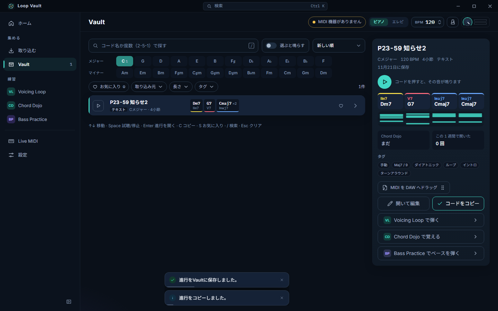
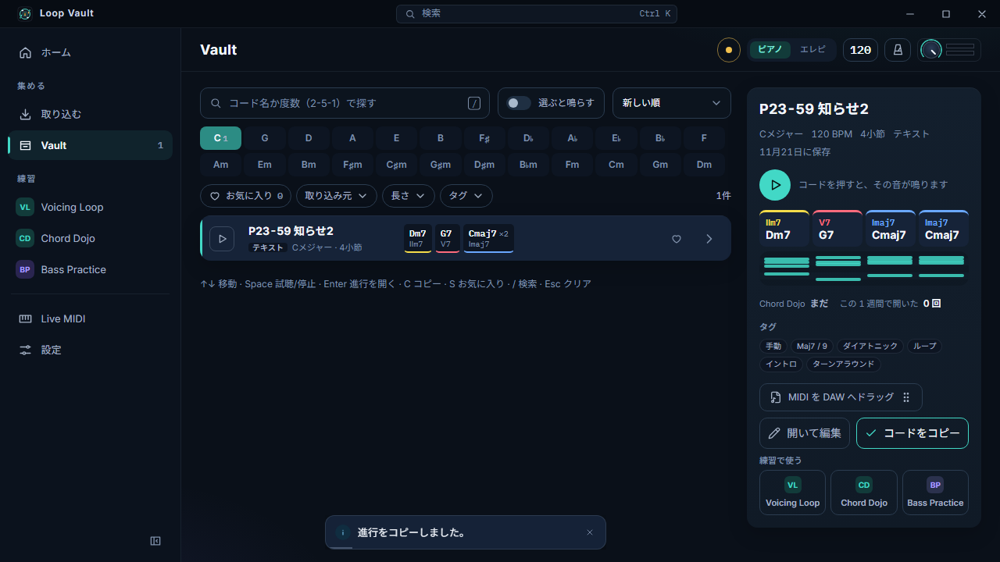
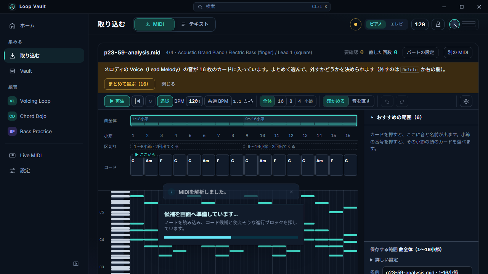
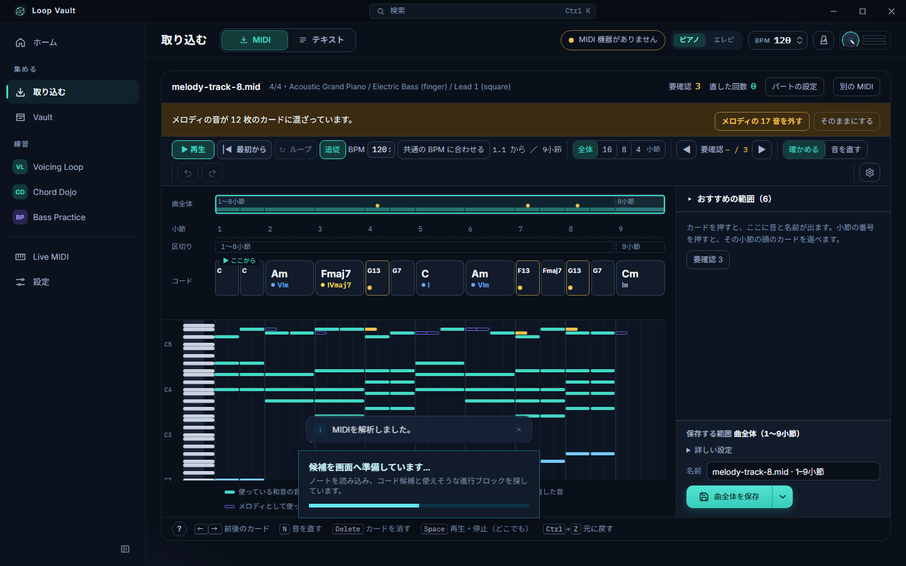
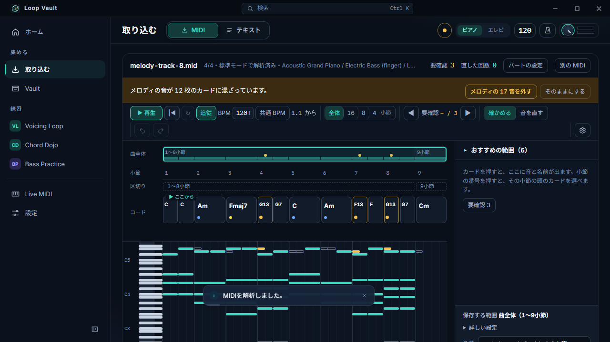
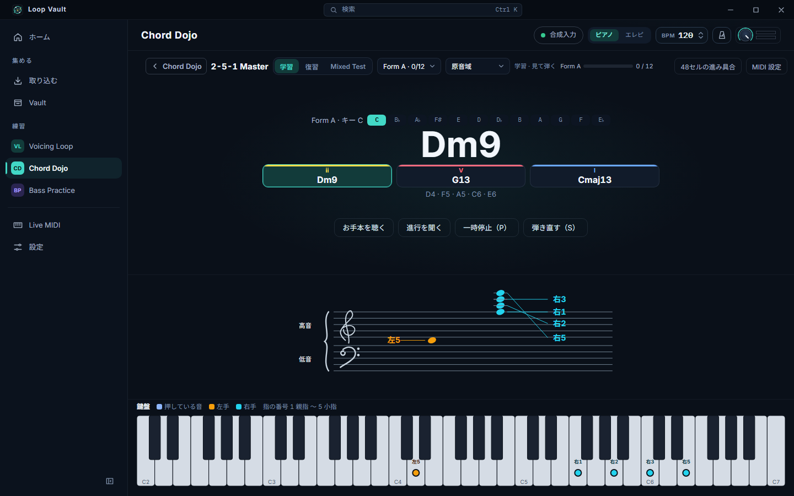
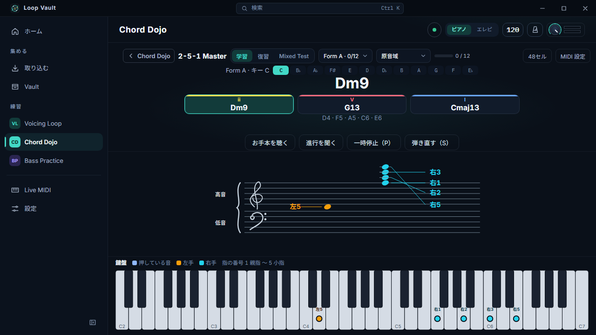

# P23-59-fix-1 レポート (2026-11-20 リードのレビューを受けて)

- **ブランチ**: `feat/p23-59-60-polish`(`2440af25` の上)
- **master**: 下の「4 節」のとおり `--no-ff` で入れた(push していない)
- P23-60 は合格。P23-59 の 1 節(知らせ)だけ直し、2・3 節と P23-60 はそのまま。

---

## 1. 中身の欄の真ん中を、測らずに CSS の計算で出す

- `src/components/notifications/contentCenter.ts`(と `NotificationProvider` の呼び出し)を**消した**。`--lv-content-center` も使っていない。
- `src/styles/components.css` の決まりを、指示の計算に置き換えた:`--lv-toast-insp` を 340px(1440px 以上)・300px(1439px 以下)・0px(1219px 以下)とし、`left: calc(var(--lv-sidebar-wide) + (100vw - var(--lv-sidebar-wide) - var(--lv-toast-insp, 0px)) / 2)`(横のメニューを畳んだ時は `--lv-sidebar-narrow` の同じ式)。
- **1 点だけ足した**(指示の「4px より大きくずれる時は差を式に足してよい」):進行のページでは、**1220px 以上で作業場がページ幅いっぱいに広がらず、自分の幅(1059px)のまま**なので、上の式だと右へずれる(1440 で +51px、1920 では保存の欄にまた届く)。そこで進行のページだけ、式を **エディタ列の真ん中(`--lv-sidebar-* + 24px + 358px`)** で頭打ちにした(`min()`)。358px はエディタ列の半分(716px。横のメニューを畳んでも列の幅は 716px のままで、左端だけ動く)。**撮り込みの作業場はページ幅いっぱいに広がる**ので、そこは式のままで合う(下の表の 1440 の行)。
- 値(知らせ・札の横の真ん中と、エディタ列 `.lv-cw-body` の真ん中):

| 窓 | エディタ列の真ん中 | 知らせ(札)の真ん中 | ずれ | 保存のボタンとの交わり |
|---|---|---|---|---|
| `1280×720`(進行のページ) | 605.5 | 606 | **0.5px** | **0**(「上書き保存」x 971–1239 /「別の版として保存」x 971–1197 に対し、知らせ x 429–783) |
| `1440×900`(進行のページ) | 615 | 614 | **1px** | **0**(保存の欄 x 990–1298 に対し、知らせ x 436–792) |
| `1440×900`(横のメニューを畳んだ) | 447 | 446 | **1px** | **0**(保存の欄 x 822–1130 に対し、知らせ x 269–623) |
| `1440×900`(撮り込みの作業場・解析の後) | 666.5 | 666.5 | **0.5px** | **0** |

- `p18-01-stage2` を `--workers=2` で **10 回**(11 テスト ×10 = 110 回)回して **10/10 PASS**(結果は下の表)。

## 2. Vault の右の欄の「練習で使う」に知らせが被る

- Vault で右の欄(プレビュー)が出ている時も、知らせを**左の一覧の列の真ん中**に出すようにした。式は 1 と同じ形で、右の欄の幅に「プレビューの列 + 20px の間」を入れる(`:root:has(.lv-vault-layout[data-preview="true"])`)。列は 340px(内容 1100px 以上)・300px(900〜1099px)・0(900px 未満で一覧の下へ回る)なので、窓の幅で 360px / 320px / 0px に切り替える(横のメニューを畳んだ時は、幅が変わる分だけ境目をずらした)。**下からの距離は既定のまま**(`--lv-toast-offset-bottom` は変えていない)。
- 値:

| 窓 | 一覧の列の真ん中 | 知らせの真ん中 | ずれ | 「練習で使う」の 3 つ・「開いて編集」「コードをコピー」との交わり |
|---|---|---|---|---|
| `1440×900` | 656 | 656 | **0px** | **0**(6 つの的に全部) |
| `1280×720` | 596 | 596 | **0px** | **0**(6 つの的に全部) |

- 写真:  

## 3. 解析中の札と知らせが重なる

- 札が出ている時の知らせの下からの距離を、**保存の欄がある画面で 196px、無い画面で 144px** にした(128/180 から)。
- 値(1280×720、16 小節の解析):札の高さ **108px**・札の下からの位置 **76px**(top は下から 184px)、知らせの積みの下端 **196px** → **間 12px**(≥ 8px)、札と知らせの箱の交わり **0**。
- 写真(撮り直し): 

## 3b. 取り込みの「まとめて選ぶ」の帯のボタン

- `src/styles/correction-workspace.css` の `.lv-cw-suggestion` の次に、指示の 4 つの決まりを足した(`:focus-visible` の輪はそのまま)。
- 値(メロディの Voice の帯):主のボタンは地 **透明**・枠 **rgba(242,193,78,0.55)**・字 **rgb(242,193,78)**・太さ **600**、「閉じる」は枠・地 **透明**・字 **rgb(165,178,198)**(=`--lv-text-secondary`)。高さ・余白・字の大きさは変えていない。
- 写真:  

## 3c. 2-5-1 Master の詰まりを減らす(`P23-60b.patch`)

- `git apply --3way` で**ぶつからずに当たった**(`GrandStaff.tsx`・`Master251View.tsx`・`grand-staff.css` の 3 つ、+7/−6 行)。手で合わせた所は無い。
- 消した物:楽譜の上の「構成音表示・リズム指定なし」「左＝左手 · 右＝右手」(同じ説明は楽譜の `title` へ)、楽譜の下の「1 親指 · …」の行(残る 2 つの注意は当てはまる時だけ)、「学習」の「鍵盤を見て ii → V → I を弾いてください」(行の高さはそのまま)。鍵盤の凡例は「指の番号 1 親指 〜 5 小指」(元の説明は `title` へ)。
- ついでの崩れ:小さい楽譜(compact で `staffGap` 無し)のト音記号を 78% に、へ音記号の 2 つの点を線と同じ色にした。
- 写真(見本と左右):下の「写真」の 2-5-1 Master(tidy)。見本と**同じ画面・同じ窓の大きさ**で、字の中身の違いは無い(見本も同じ Form A・キー C・Dm9→G13→Cmaj13 の並び)。**音符の位置・大きさは変わっていない。**
- **今の字を探しているテストは無かった**(`構成音表示`・`1 親指`・`指番号は回答表示中`・`鍵盤を見て ii`・`左＝左手` を e2e と src のテストで検索して 0 件)。`.dojo-score-caption` を見る 2 件(jazz-progressions・p12-3)は `caption` を渡す画面なので、そのまま通った。
- 基準の写真は**1 枚も変わらなかった**(`e2e/visual.spec.ts` 6/6 PASS)。

---

## 写真(2-5-1 Master・見本と左右)

1440×900

| 見本(左) | 実際(右) |
|---|---|
|  |  |

1280×720

| 見本(左) | 実際(右) |
|---|---|
|  |  |

---

## 点検とテスト

| 何を | 結果 |
|---|---|
| tsc(アプリ・e2e) | **PASS** |
| `npm run lint` | **PASS** |
| `npm run test:e2e -- e2e/p23-59-polish.spec.ts e2e/p23-60-dojo-tone.spec.ts --project=chromium-desktop` | **9/9 PASS** |
| `npm run test:e2e -- e2e/visual.spec.ts --project=chromium-desktop` | **6/6 PASS**(基準の写真の差 0) |
| 関わる今のテスト(correction-workspace・p12-1-dojo-ui・p12-2-master・p23-24-master-top・p22-01-practice・p12-master251 系 6 本、`--workers=2`) | **205/205 PASS** |
| `p18-01-stage2`(`--workers=2`、10 回) | 下の表 |
| `npm run test:full:all` | 下の表 |
| master で `npm run test:fast` | 下の表 |

### `p18-01-stage2` 10 回

`--workers=2`・`--repeat-each=10` で **110/110 PASS(10/10)**。測る仕組みを消した後に、10 回続けて落ちなかった(前は 10 回に 1 回ほど落ちていた)。

### `npm run test:full:all` と master

| 回 | HEAD | 結果 |
|---|---|---|
| 1 | `fd2f4d8a` | 静的検査・Vitest `7108/7110`・light **1203/1205**・heavy **134/134** は PASS だが、**Git diff check が「`src/styles/components.css:713: new blank line at EOF`」で FAIL**(末尾の空行)。`78ec2262` で直した |
| 2 | `78ec2262` | 静的検査 10 種・Vitest `7108/7110` は PASS。light で **1 件**(`phase13-bass-practice` の「record completion analyses locally …」。この段で変えていないテスト)が落ち、**単独で 3 回続けて PASS(3/3)**。連続の紙の「変えていないテストの 1〜2 件だけが落ち、単独で 3 回通る時は報告に書いて続けてよい」に当たるので、**FULL は通ったものとして扱った**(light 1202/1203 + この 1 件)。heavy は 1 回目の 134/134 から変わっていない |

- master: `feat/p23-59-60-polish` を `--no-ff` で入れた → **local master `6a654cef`**。master で `npm run test:fast` → **PASS**(App TypeScript・Source contracts・Changed ESLint・Changed Node tests 44/44、`20.4s`)。push していない。

---

## 自分で決めた所

| 何を | なぜ | 確かめ方 |
|---|---|---|
| 進行のページだけ `min(式, エディタ列の真ん中)` で頭打ちにした(358px は半幅) | 進行のページの作業場は 1220px 以上でページ幅いっぱいに広がらず 1059px のままなので、式だけだと 1440 で 51px・1920 では保存の欄に届く。撮り込みの作業場は広がるので式のままで合う | 上の値の表(4 つの窓でずれ ≤ 1px・交わり 0) |
| 知らせが同時に出る場面は、札と知らせの**積みの下端**(= 知らせの下端)で確かめた | 解析中に確実に知らせを出す操作が無い(解析後は「MIDIを解析しました」が出るが、その時は札が消えている)。196px は「札の top(下から184px)+ 12px」なので、知らせが出れば必ず 12px 空く | S1c の値(札の 76px・108px、積みの 196px、間 12px) |
| Vault の知らせの境目を 360/320/0px と窓の幅で切り替えた | Vault の列は**コンテナ**の幅で変わる(内容 1100px/900px)。窓の幅との対応は、横のメニュー 232px・左右の余白 48px から出した。畳んだ時は 64px で引き直した | 1440・1280 のずれ 0px |
