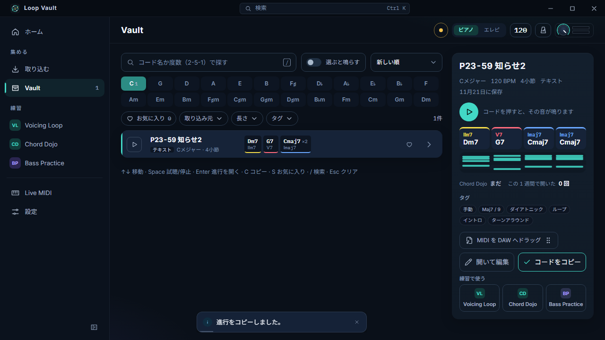
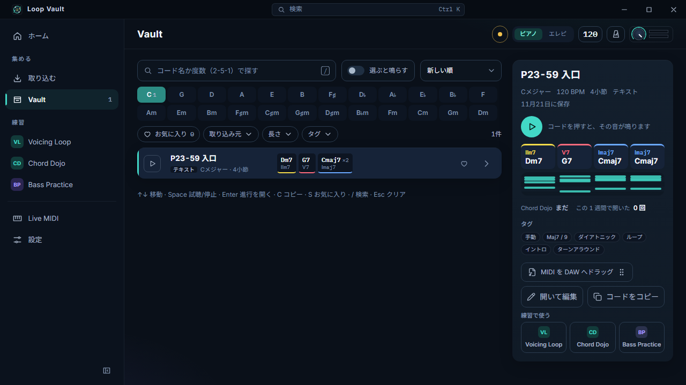
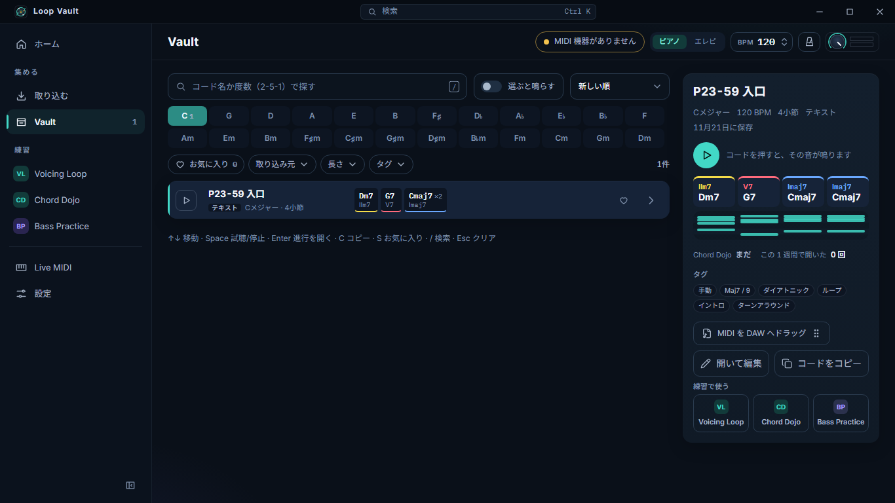
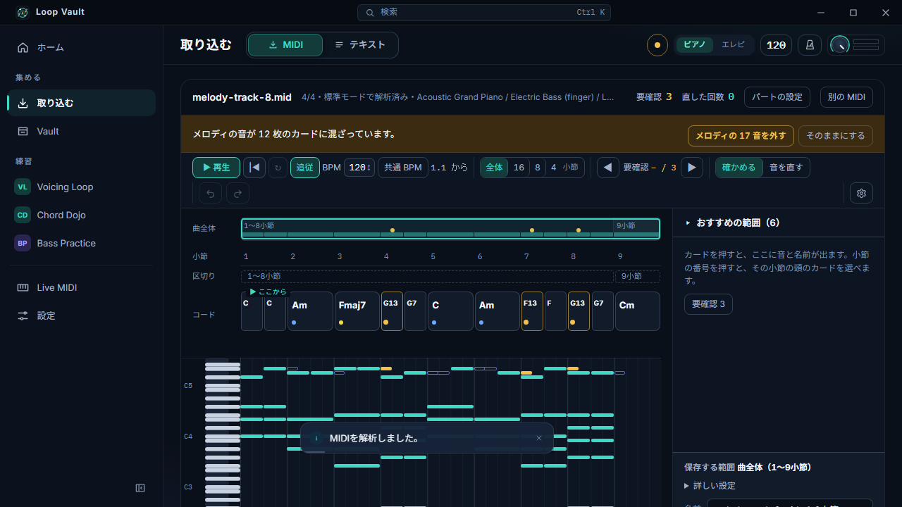
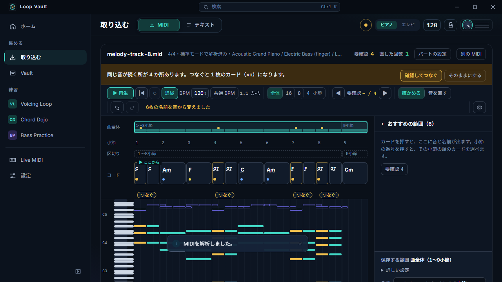

# P23-59-fix-2 レポート — Vault の右の欄の下が切れる・メロディの帯・DEP-01 の控え

- ブランチ:`fix/p23-59-fix-2`(`e6d8b901` = DEP-01 の後の master から)
- **この段では `test:full:all` を回さない**(リードの決定)。`test:fast` を 1 回。
- push していない。

## 1. Vault の右の欄(1280×720):「練習で使う」の 3 つのボタンの下が切れる

- `src/styles/vault.css` の `@media (max-height: 800px)` に、指示の 4 行を足した(2 つの箱 → 1 行。字はそのまま、dt 11px・dd 12px の静かな行)。クラス名は今の `.lv-vault-preview-facts` のままで効いた。
- 値(1280×720、タグ 6 個が 2 行の進行):

| 何を | 前(箱 2 つ) | 後(1 行) |
|---|---|---|
| 右の欄の高さ / 上限 | 592px(= 上限 `calc(100dvh - 128px)` に**張り付いていた**) | **558px**(上限まで **34px** の余り) |
| 右の欄の中の下の端(パディングの内側) | — | 654px |
| 3 つのボタンの下の端 | — | **654px**(中に収まる。はみ出し 0) |
| 本文の `scrollHeight - clientHeight` | 0 | **0** |

- 1366×768 でも同じ(右の欄 558px、上限 640px なので **82px** の余り、ボタンは 654px で中)。
- 1440×900 は**何も変わらない**(箱 2 つのまま `display: grid`、3 行 40px、はみ出し 0)。
- 写真:知らせが出ている時  / 出ていない時  / 1366 
- **基準の写真 `vault-chromium-desktop-win32.png` は変わらなかった**(あの写真は右の欄を開いていない)。変えたのは下の §1b の `capture-analysis-results` だけ。

## 1b. 取り込みの「メロディ」の帯:1 回で外す

- `CorrectionWorkspace.tsx` の `melody-voice` の帯を指示どおりにした:文は「メロディの音が {カード数} 枚のカードに混ざっています。」、ボタンは **「メロディの {音数} 音を外す」**(`data-testid="correction-exclude-melody"`、`deleteNotes`)と **「そのままにする」**。トラック名(`voiceLabel`)は出さない(作る所は残す。ほかで使っている)。
- 同じ帯の `same-notes-run` も字を揃えた:「同じ音が続く所が {n} か所あります。つなぐと 1 枚のカード（×n）になります。」+「確認してつなぐ」+「そのままにする」。
- 帯・ボタンの形と色は P23-59-fix-1 の 3b のまま(琥珀)。`selectNotes` はほかで使っているので残した。
- **押した後**:帯は消え(同じ音が続く所があればその帯に替わる)、「直した回数」が 1 増え、履歴は「…を外した」。外した音は破線(メロディの音は紫の実線)で残り、Ctrl+Z で帯が戻る。
- 写真:帯  / 押した後 
- テスト:`e2e/correction-workspace.spec.ts` の P10.0-03 を「the melody suggestion excludes every melody-voice note in one press」に書き替えた(ボタンの数字を読み、押す → 帯 0・直した回数 1・履歴「を外した」・**外した音が数字だけ増える**(破線 + メロディの線の両方で数える)→ Ctrl+Z で帯が戻る)。「閉じる」を探していた 3 か所(P10.0-02・P10.0-04・P10.2)は「そのままにする」に、`p23-59-polish` の S1d は新しい字に合わせ、押した後まで確かめるようにした。
- 帯の字を探しているほかのテストは無かった(探して 0 件)。

## 2. DEP-01 の控え:tauri-plugin-opener

- `cargo update --manifest-path src-tauri/Cargo.toml -p tauri-plugin-opener --precise 2.6.0` を試した。**解けはした**が、次が付いてきた(そのまま):

```
    Updating window-vibrancy v0.6.0 -> v0.8.1
      Adding windows v0.62.2
      Adding windows-collections v0.3.2
      Adding windows-core v0.62.2
      Adding windows-future v0.3.2
      Adding windows-numerics v0.3.1
      Adding windows-result v0.4.1
      Adding windows-strings v0.5.1
      Adding windows-threading v0.2.1
    Removing winnow v0.7.15
      Updating wry v0.55.1 -> v0.57.3
```

- crates.io の manifest(2.6.0)では **`tauri "^2.12"`** を要求する(このアプリは 2.11.5)。つまり **Tauri 本体の上げ**で、DEP-01 で「入れない」と決めた `windows` 0.62 も一緒に入る。
- 指示の「Tauri 本体などの上げが要るなら上げない」に当たるので、**入れない**。`git restore src-tauri/Cargo.lock` で 2.5.5 に戻した(ほかの差分は無し)。
- 控えを直した:`docs/reports/dep-01.md` の 3 節は「serde / serde_json / async-trait = 入れた」「tauri-plugin-opener 2.6.0 = **入れない**(2.5.5 までの上げだけ)」に分け、理由の節を足した。`done/DEP-01.md` も「入れた 6 件 / 入れない 6 件」に直した。
- PR を閉じる時の 1 行:「**入れない**:2.6.0 は `tauri ^2.12` が要るため。次の Tauri の更新でまとめて。」

## 点検・テスト

| 何を | 結果 |
|---|---|
| tsc(アプリ・e2e) | 0 / 0 |
| `npm run lint` | 0 |
| `npm run test:e2e -- e2e/p23-59-polish.spec.ts e2e/visual.spec.ts e2e/p23-10-vault-list.spec.ts e2e/correction-workspace.spec.ts --project=chromium-desktop` | **67/67 PASS** |
| `npm run test:fast` | 2 回。静的検査・lint・Vitest(**7125/7127**)は PASS。「Playwright selected」だけが、**この段で変えていない** `p18-01-stage2` の 4 件 / 3 件を落とした(1333/1337・1334/1336。並列の負荷)。その spec は**単独で 3 回続けて 11/11 PASS(33/33)** なので、連続の紙の「変えていないテストが単独で 3 回通れば報告して続ける」で通ったものとして扱った |
| `test:full:all` | **回していない**(この段の指示) |
| Rust(`cargo test --locked`・`tauri build --no-bundle`) | **回していない**(Rust は上げていない。lock は 2.5.5 のまま) |

## 自分で決めた所

| 何を | なぜ | どうした |
|---|---|---|
| 右の欄の確かめに「上限まで 8px 以上の余り」も足した | 前の状態は上限 592px に**張り付いて**いて、字の違いで 1px でも増えるとボタンが欄の外へ出る(それがリードの写真の「切れ」)。はみ出し 0 だけでは再発を止められない | 高さ ≤ 上限 − 8px・ボタンの下 ≤ 内側の下 + 1px(丸め)・`scrollHeight - clientHeight ≤ 1` の 3 つにした |
| `capture-analysis-results` の基準の写真を更新した | 帯が 1 行短くなり、その下が ~20px 上へ動く(帯の字とボタンだけの差。他の画面の要素は動いていない) | 更新して 6/6 PASS。`vault` の基準は変わらず |
| 変わっていない写真は戻した | 撮り直しでバイトだけ変わる物を混ぜない | `s1-analysis-1280`・`s1-capture-result-1440`・`s1-toast-1280`・`s1-vault-toast-1440`・`s3-vault-1440` は `git restore` |
