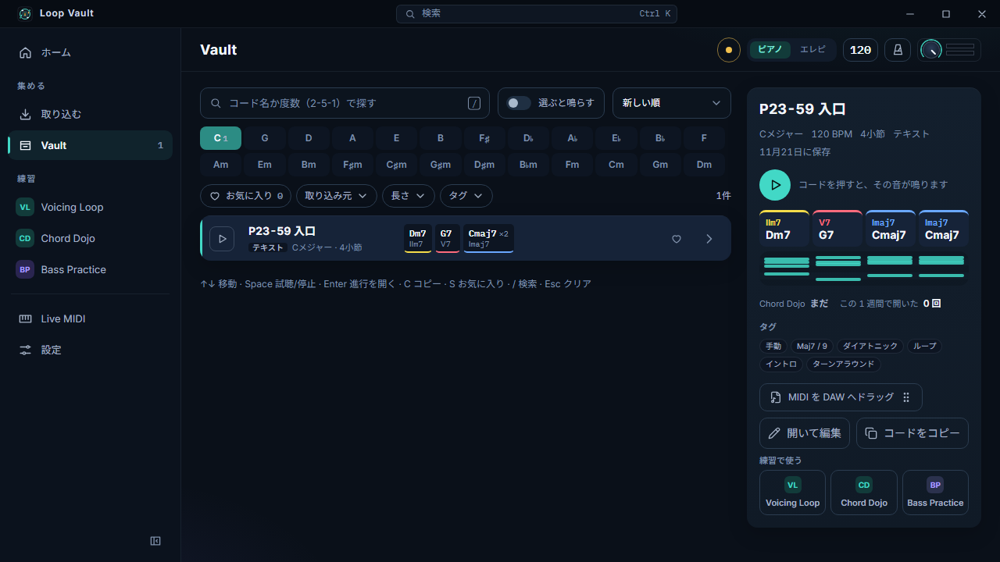
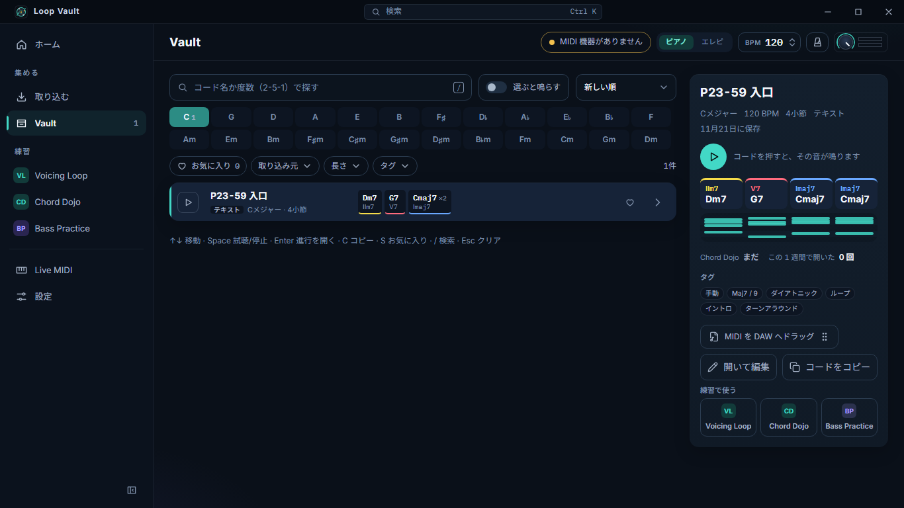
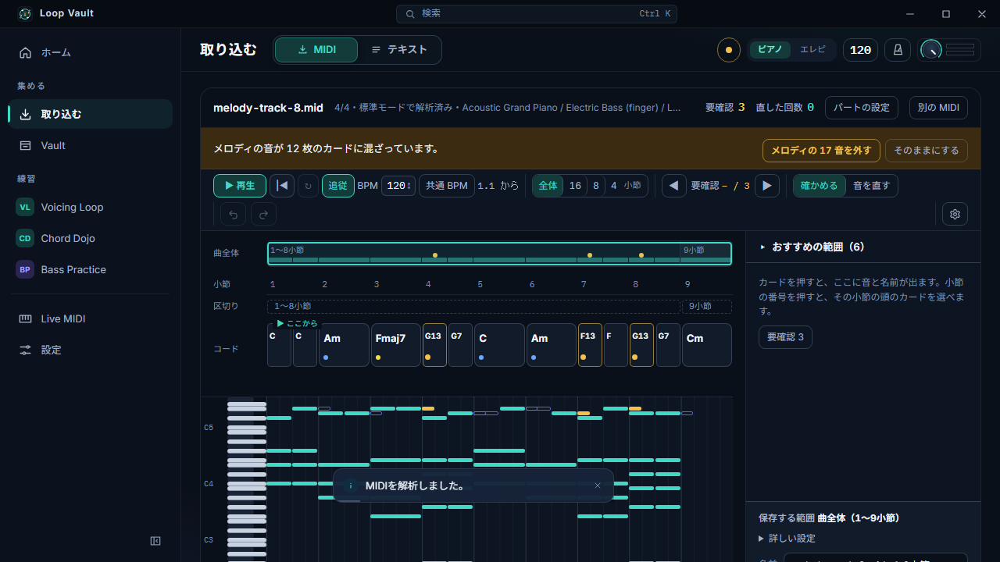
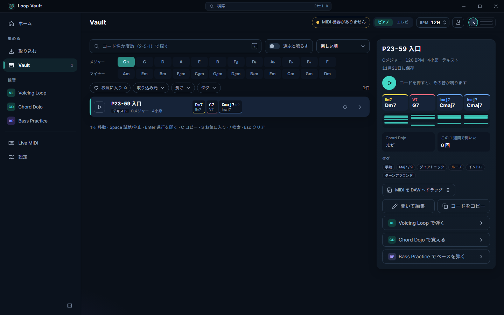

# P23-59-fix-3 レポート — Vault の練習の入口の名前・帯の控えめなボタン・日付の見出し・p18-01-stage2 の揺れ

- ブランチ:`fix/p23-59-fix-3`(local master `58a13684` から。指示書の `edf774ca` はその親)
- 2 節は製品の側の原因を直した(リードの 04:20 追記のとおり)。`test:full:all` を通したうえで local master に入れた。
- コミット:`03b819a2`(1・1b・1c)、`4bc7c096`(2 の製品の直しと単体テスト)、そのあとの報告のコミット(この紙)。

## 1. Vault の「練習で使う」の名前の下が切れる・「Bass Practi…」

- `src/styles/vault.css` の `@media (max-height: 800px)` の 2 か所:ボタンの高さ **52 → 58px**(上下の余白 6px はそのまま)、名前 **11.5px → 11px・行の高さ 16px・太さ 600**(省略の決まりは残す)。
- 値(1280×720、タグ 6 個が 2 行の進行):

| 何を | 前 | 後 |
|---|---|---|
| ボタンの高さ | 52px | **58px** |
| 名前の `scrollWidth / clientWidth` | 「Bass Practi…」で切れていた | **69/69・60/60・72/72**(3 つとも省略なし) |
| 名前の下の端 / ボタンの中の下の端 | — | **652 / 654px**(中に収まる) |
| 右の欄の高さ / 上限 | 558px / 592px | **564px / 592px**(余り 28px) |
| 右の欄のはみ出し | 0 | **0** |

- 1366×768 も同じ(564px / 上限 640px)。1440×900 は今のまま(40px の 3 行)。
- `p23-59-polish.spec.ts` の S3 に、**3 つの名前の `scrollWidth <= clientWidth`・名前の下の端 <= ボタンの中の下の端・11px/16px** を足した。写真:`s3-vault-1280`・`s3-vault-1366`・`s3-vault-1440`。

## 1b. 帯の「そのままにする」を枠のある控えめなボタンに

- `src/styles/correction-workspace.css` の 3b の 2 行を指示どおりに:枠 **rgb(255 255 255 / 16%)**、ホバーで **28%** + 地 6%。高さ・角・字は隣と同じ。
- 写真:`s3b-suggestion-1280`(取り込みの結果の帯)。`s3b-suggestion-1440` と `s3b-suggestion-excluded-1280` も撮り直した。
- **基準の写真 `capture-analysis-results` は更新していない**(差が許す範囲に収まり、visual は 6/6 のまま)。§1b の前の値は、報告の P23-59-fix-2 の写真と見比べられるように `s3b-suggestion-1280` を撮り直してある。

## 1c. Vault の一覧の日付の見出しをやめる

- `src/views/VaultView.tsx`:`ProgressionRows` の `headings`・`now`、`listItems` の見出しの分かれ道、仮想の一覧の見出しの高さ(`HEADING_HEIGHT`)を消し、**行だけ**を並べる(`type ListItem` は行だけ)。`HEADING_HEIGHT`・`now`・使わなくなった import も消した。
- `src/views/vault/vaultShape.ts`:`DateGroup`・`dateGroupOf` を消した(ほかに使っていないことを確認)。
- `src/styles/vault.css`:`.lv-vault-date` を消した。
- テスト:
  - `vaultShape.test.ts` の「P23-10 date headings (V5)」の `describe` を消した。
  - `VaultViewP2310.test.tsx` の C2 は、見出しを確かめる 1 行を **`vault-date-heading` が null** に替え、200 件で見えている行だけ描く確かめは残した(通った)。
  - `e2e/p23-10-vault-list.spec.ts` の V5 を「**並び順がどちらでも見出し 0**」に書き替えた。
- **確かめ:** 「新しい順」でも `vault-date-heading` が 0(V5 と C2)。200 件の仮想の一覧のテストはそのまま通った。基準の写真 `vault-chromium-desktop-win32.png` は**見出しの行が消えて、その下の行が 30px 上がった差**だけだったので更新した(写真の下の、preview が少し上に見えるのは、full-page の写真でページが 30px 短くなったため)。写真:`s3-vault-1280`・`s3-vault-1440`。

## 2. `e2e/p18-01-stage2.spec.ts` が並列で落ちる — **製品を直した**

### 落ちたテスト(2 回分、そのまま)

`npm run test:fast` の「Playwright selected」で、2 回とも `p18-01-stage2` が落ちた。

**1 回目(2026-11-20T15-21-20、4 failed / 1333 passed・18.9m)**

| テスト | 落ちた所 | 期待 | 実際 |
|---|---|---|---|
| `p18-01-stage2.spec.ts:158:1` › A ②: a clean pass stops before the finish (もう一度 ② / 終わる) and the repeats record nothing | 103:54 `expect(getByTestId('dojo-again-recall')).toBeVisible({timeout:15000})` | visible | element(s) not found |
| `:194:1` › A: from the ② end back to ① and a clean ② again still records only once (くり返す off)… | 125:54(同じ) | visible | element(s) not found |
| `:270:1` › A: leaving with Esc mid-way after the recorded pass records nothing more | 172:54(同じ) | visible | element(s) not found |
| `:393:1` › R does nothing while typing, or while a dialog is open | 229:54(同じ) | visible | element(s) not found |

**2 回目(2026-11-20T15-47-38、3 failed / 1334 passed・14.9m)**

| テスト | 落ちた所 | 期待 | 実際 |
|---|---|---|---|
| `p18-01-stage2.spec.ts:194:1` | 125:54 | visible | element(s) not found |
| `p18-01-stage2.spec.ts:393:1` | 229:54 | visible | element(s) not found |
| `jazz-progressions.spec.ts:665:1` › the tempo of the listening… | 497 | `data-listening='true'` | (別件。この段の対象外) |

落ちた時の写真は**「今日、自分の語彙に増えたもの」(終わる画面)**で、「もう一度 ② / 終わる」の問いが出ていない。

### 原因(製品の側)

CPU を 8 倍に遅くするだけで**必ず再現**した(6/6・4/4)。問いは**一瞬だけ描かれ**(MutationObserver で `ask` → `finish` を記録)、**誰も押していないのに終わる画面へ進む**。

`src/views/chord-dojo/ChordDojoView.tsx` の並び:

1. 最後のコードが通ると `next()`(エラーかどうかの分岐の後、245 行〜)が `f=advance(...)` を作り、`fromList && recall の最後 && f.today.finished` の時、くり返す off なら **`recallStopRef.current=true` にして `await commit(f)`**(250〜255 行)。まだ `setResult(undefined)` はしていない(256 行は commit の後)。
2. その間、**自動で次へ進む所(317 行の `setInterval(20ms)`)が `result` をまだ見ている**ので、もう一度 `next()` を呼ぶ。
3. `next()` の先頭近く、**227 行の「② の終わりで Enter なら終わる画面へ」**が `recallStopRef.current` を見て `setScreen('finish')` する。
4. 二重に呼ばれた事を見分ける `consumedResult` の見張りは **231 行**(227 行より後)なので、この 2 回目を止められない。

つまり「同じ結果で `next()` が 2 回呼ばれると、2 回目が利用者の Enter と同じ道を通る」という**状態の更新の順**の問題。遅い機械・並列の負荷で commit が長引くほど起きやすい(修正前の P23-59-fix-1 で消した揺れとは別の、製品側の残り)。

### 直し方(リードの 04:20 追記のとおり)

- `next()` の頭の 1 行を、`recallStopRef` だけでなく **`!result` も見る**形にした(1 か所):

  ```ts
  if(recallStopRef.current&&!result){recallStopRef.current=false;writeRecallStop(false);setScreen('finish');return;}
  ```

  問いが出ている時は `result` が消えているので、利用者の Enter(問いの上の操作)だけが終わる画面へ進む。`result` がある呼び出し(自動で次へ進む所・同じ結果での二度目)は、この行を通らず、下の「同じ結果の二度目は捨てる」の見張り(`consumedResult`)で止まる。
- 単体テスト `src/views/chord-dojo/ChordDojoView.recallStop.test.tsx` を 1 本足した(jsdom):最後のコードで正解 → 1 回目の `next` の保存(`commit`)を止めておき、その間に同じ結果で `next` をもう一度呼ぶ → 保存を進めると、終わる画面ではなく**問いが出ている**(そのあと Enter で終わる画面へ進むことも確かめる)。
- **修正前の行に戻すとこのテストは落ちる**ことを確かめた(`expected 'finish' to be 'practice'`)。

### 確かめ

| 何を | 結果 |
|---|---|
| CPU を 8 倍に遅くした `p18-01-stage2`(11 テスト × 10 回 = 110) | **100/110 PASS**。**② の問いの 4 テスト(前は 6/6・4/4 で落ちた所)は 10/10 PASS**。落ちた 10 はすべて別の「the practice begun from today's plan keeps its own flow」で、下記のとおりこの段の直した行を通らない |
| その 10 の落ち方 | `.dojo-result` が「合いました」にならない(最初のコードから)。画面が出て 5 秒待ってから送っても同じ。**今日のプランから始めた練習は `fromList` ではないので `recallStopRef` が立たず、この段で変えた行を通らない**。8 倍の時だけの、テストの入力待ち側の問題(この段の対象外) |
| `p18-01-stage2` を `--workers=4 --repeat-each=10`(通常の速さ) | **110/110 PASS**(5.0 分) |
| `npm run test:fast` 3 回続けて(10:33・10:49・11:05) | 3 回とも `p18-01-stage2` は**全部 PASS**。全体では 10:33 に `jazz-progressions` 1 件、11:05 に 5 件(この段で触っていないテスト)が落ちたため、FULL で確かめ直した |

## 点検・テスト

| 何を | 結果 |
|---|---|
| tsc(アプリ・e2e) | 0 / 0 |
| `npm run lint` | 0 |
| `npm run test:e2e -- e2e/p23-59-polish.spec.ts e2e/visual.spec.ts e2e/p23-10-vault-list.spec.ts e2e/correction-workspace.spec.ts --project=chromium-desktop` | **67/67 PASS**(visual は `vault.png` を更新して 6/6) |
| 変えた unit(`ChordDojoView.recallStop`) | **1/1 PASS**(直す前の行では落ちる) |
| `npm run test:fast` | 3 回続けて `p18-01-stage2` は全部 PASS。2 回はこの段で触っていないテストだけが落ちた |
| `test:full:all`(`c9b30914`、この紙の下書き込み) | Static 10/10・Vitest **7125/7127**・PW light **1202 pass / 2 skip / 1 fail**・PW heavy **134/134**(下記) |

### `test:full:all` の 1 件(この段で変えていないテスト)

- 落ちたのは `e2e/p23-23b-ear-result.spec.ts:220`「C6/C7: the twelve-question bars, and the bottom row inside the window (X10-X14)」の 1440×900(期待 `<= 1`、実際 352)。**この段では触っていない**テストで、P23-58 の FULL でも同じ所が単独 3/3 で通ったと記録されている既知の揺れ。
- 連続の紙の決まりで、**このテストを単独 3 回**(`--workers=1 --repeat-each=3`、spec 全体で 24 件)回して **24/24 PASS** を確かめた(7.1 分)。
- そのため FULL は「この 1 件だけを既知の揺れとして除いて通った」ものとして扱う。heavy は light の失敗で走らなかったので、同じ 12 spec を `--workers=2` で別に回して **134/134 PASS**(9.6 分)。

## 写真

- §1: 
- §1b:
- §1c(見出しなし・1440):
