# P23-61 小さい直し 11 個(2026-11-21)

- ブランチ:`fix/p23-61-small`(local master `82084e2f` = P23-59-fix-3 を入れた後 から)
- 見本:`handoff/mocks/p23-61/` の `vl61-strip.png`・`vl61-1668.png`・`vl61-1920.png`・`mini-before.png`・`mini-after.png`
- 写真は `docs/reports/p23-61-assets/`(`UPDATE_REPORT_SCREENSHOTS=1` で `e2e/p23-61-small.spec.ts` を回して撮った物)。

## 1. ホームの「続きから」(Chord Dojo・Bass Practice):下の空きを無くした

- `HomeView.tsx` の `RecentContinueCard` から空の箱 `
` と、その説明の行を消した。`home.css` の `.lv-home-strip[data-empty="true"] { min-height: 30px; }` と説明も消した。
- カードは **1 行**(**38px = 30px の箱 + 8px のすき間** だけ低くなる)。下の「今日のおすすめ」などは 38px 上がる。Vault の進行の「続きから」(帯がある方)は変わらない。
- テスト:`e2e/p22-03-home.spec.ts` の 1 行を `await expect(card.locator(".lv-home-strip")).toHaveCount(0);` に(説明も「no empty strip under the row」に)。Bass Practice の時の同じ行は無かった。
- 写真: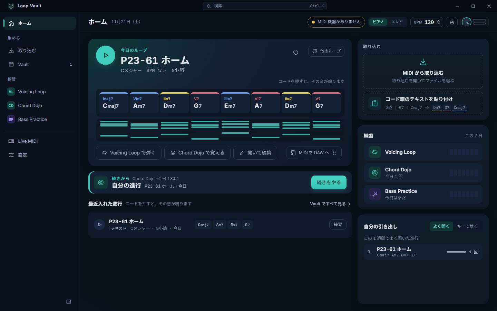

## 2. Vault の「選ぶと鳴らす」:入れた瞬間は鳴らさない

- `VaultView.tsx` の V6 を、指示のコードに替えた(スイッチを入れた時は、その時の行を「もう聞いた」として覚え、**その後に別の行を選んだ時だけ**鳴る)。
- テスト:`e2e/p23-10-vault-list.spec.ts` の V6 を「V6: with 選ぶと鳴らす on, a new selection plays; switching on does not」に(入れた後 400ms 待って鳴らない → `↓` で次の行が鳴る → 切って `↓` でも鳴らない)。

## 3. Voicing Loop の進行を選ぶ画面:「＋ テキストで新しい進行」を外した

- `VoicingLoopPicker.tsx` の検索の右のボタンを消した(検索は `min-w-[220px] flex-1` のまま、行いっぱい)。字 `newText`・`enterText` はどこにも使われなくなったので消した(`enterTextShort` = 空の画面の「テキストで入力」は残す)。
- **空の画面の「テキストで入力」「MIDI から取り込む」はそのまま。**
- テスト:
  - `e2e/p22-02-vl-picker.spec.ts` の「the text entry is at the right of the search …」→「with progressions, the picker has no text entry; the search takes the row」。進行がある時に `/テキストで新しい進行/` のボタンが 0、検索の右の端が**道具の行**(`voicing-loop-picker-tools`)の右の端から 24px 以内。※ 指示の「一覧の箱」は、この画面では検索の行(道具の行)のことで、一覧は 2 列の左なので右の端が 415px ほど左になる。行の右端で確かめた。
  - `/テキストで新しい進行を入力/` を押していた `phase5.28`・`phase5.30`・`phase5.31` は、**進行が無い状態**の画面なので、空の画面の `getByRole("button", { name: "テキストで入力" })` を押す形に替えた。
  - `ProgressionVoicingPracticeView.test.tsx` の 146 行あたりは同じく「テキストで入力」に。2147 行あたりは「進行がある時にそのボタンが無い」「検索の箱が行の最後」に替えた。
- 写真: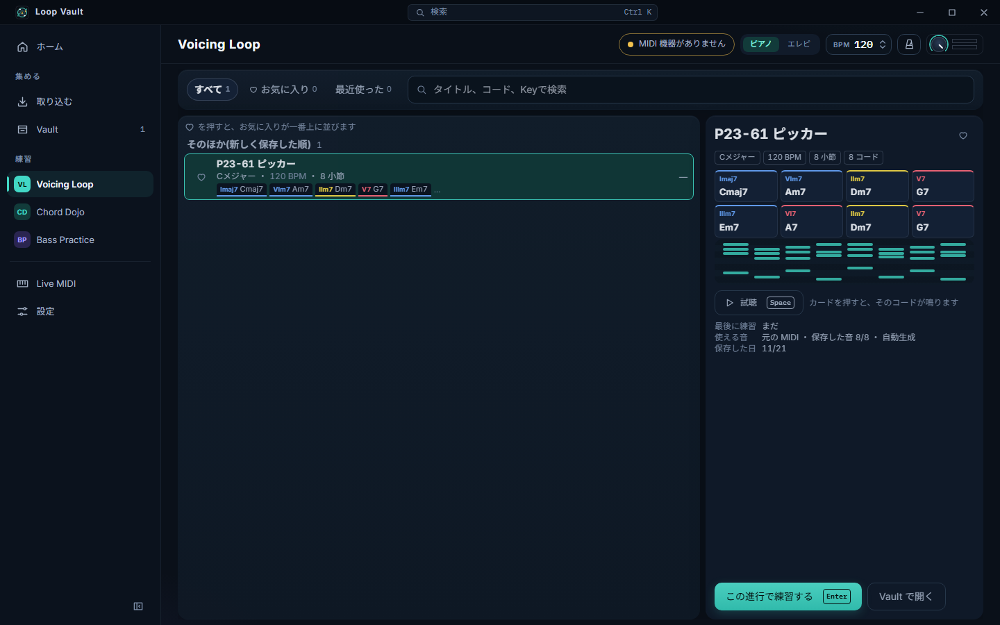

## 4. Voicing Loop の進行の帯のカード:役割の色と札

- `ProgressionVoicingPracticeView.tsx`:帯の `snapshot.spans.map` の中で `role` を出し、カードに `data-fn={role || undefined}` を付けた。右下の度数を `DegreeTag`(度数の字 + 役割の札)に替え、**カード幅 132px 未満は札を出さない**(`data-badge="off"`)。
- `voicing-loop.css`:役割ごとの `--lv-vl-row-fn`、**カードの中の上端に 2px の役割の線**(`::before`)、度数の字 10.5px・札 8.5px。
  - **1 つだけ書き足した:** 指示の `.lv-vl-event-degree .lv-vl-degree-text { font-size: 10.5px }` は、`DegreeTag` の `data-size="xs"` の決まり(`.lv-vl-degree[data-size="xs"] .lv-vl-degree-text` = 0,3,0)に負けて **12px のまま**だった(測って確認)。同じ値を `.lv-vl-event-degree .lv-vl-degree[data-size="xs"] .lv-vl-degree-text` でも書いて、見本の 10.5px にした(テストで 10.5px / 8.5px を確かめる)。
- 幅のしきい値は **132px のまま**(8 コードの進行で、1440×900 は約 148px で札あり・1280×720 は約 120px で札なし。拍数の「4拍」や試聴の ▶ と重ならない)。
- テスト(`e2e/p23-61-small.spec.ts` §4、C メジャーの Cmaj7 → Dm7):1 枚目 `data-fn="T"`・2 枚目 `data-fn="SD"`、`voicing-loop-event-role` の字が `T`/`SD`、2 枚目の `::before` の地の色と度数の字の色が `--lv-fn-sd` と同じ、字 10.5px・札 8.5px。今の `voicing-loop-event-degree` の確かめ(字が `["Ⅰ","Ⅱ"]`、切った時とキーが無い時は 0)はそのまま通る。
- 指示のテストは `phase5.32-suggested-fingering.spec.ts`(同じ `both-hands`)にあるので、この spec では同じ進行で色と札を確かめている。
- 写真:§5 の 4 枚(帯の線・度数の色・札が写る)。

## 5. Voicing Loop の鍵盤:大きい窓で伸びすぎない

- `voicing-loop.css` に指示の決まりを足した(`@media (min-height: 761px)` で、鍵盤の箱を `min(210px, 10px + 12.5cqw)` まで)。余った高さは下に空く。
- 測った値(鍵盤の箱 / 再生の帯の下から窓の下まで):**1920×1080 = 210 / 119**、**1668×1040 = 183.5 / 106**(指示の表の 210/119・184/106 と同じ)。**1440×900 = 141(変わらない)**、**1280×720 = 80(変わらない)**。
- テスト(`e2e/p23-61-small.spec.ts` §5):1920・1668 で箱が 210px 以下、`(高さ − 10) / (幅 / 52)` が 6.6 以下(幅は CSS と同じく画面の欄の幅。鍵盤の箱の内側で測ると 6.63 なので、そちらは 6.7 以下も確かめる)、再生の帯の下が窓の下から 16px 以上上。1440×900 で 141px(±1.5)、1280×720 で 80px(±1.5)。
- 写真: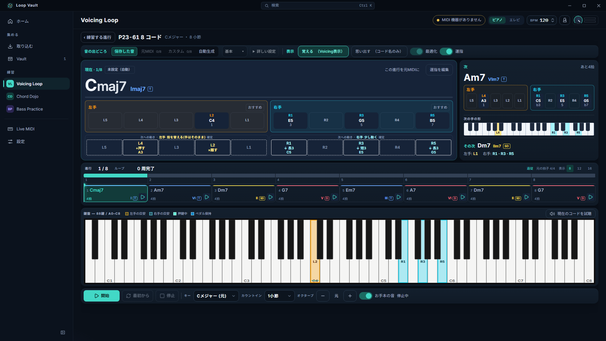 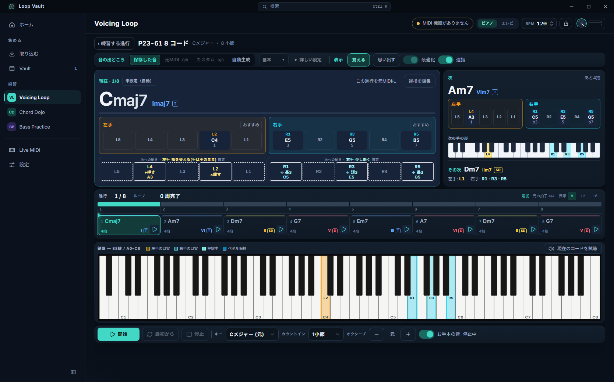 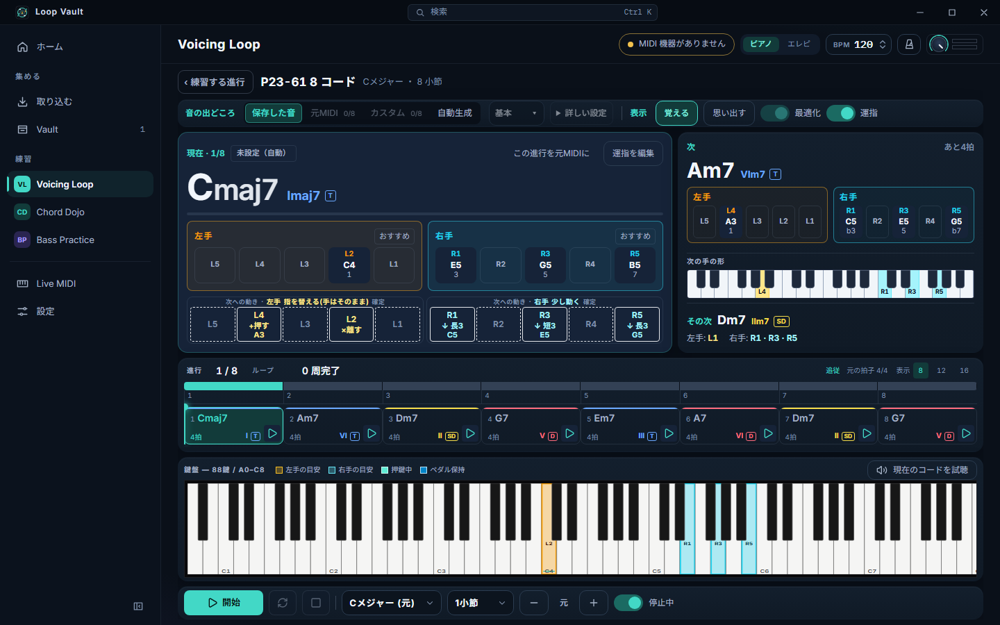 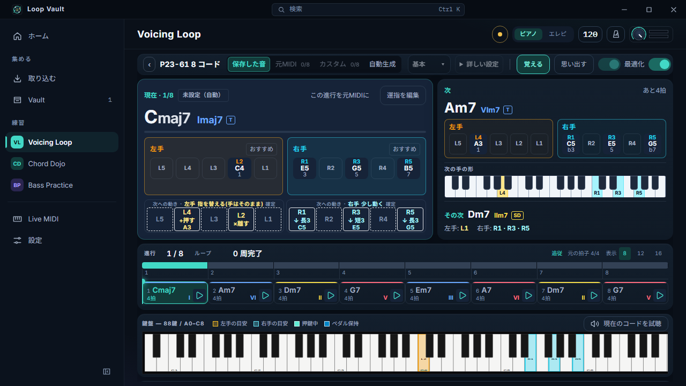(8 コードの進行・見本と同じ窓)

## 6. Live MIDI の小さい窓:機器の欄の枠が二重

- `live-midi.css` を指示どおり `.lv-live-mini-device > select` → `.lv-live-mini-device .lv-select select` に(`.lv-select` の包み、`> svg` の位置、`option` も)。大きい時の決まり(34px)も同じに。
- テスト(`e2e/p23-61-small.spec.ts` §6):機器の `select` の `border-top-width` が `0px`・地が透明、`.lv-live-mini-device` の中で枠か影を持つ箱は **1 つだけ**。
- 写真: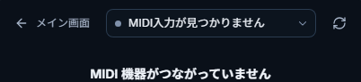(見本 `mini-after.png` と同じ 1 本の枠)
- **ほかに同じ崩れが無いか**(`rg "> select" src/styles src/views src/features`):2 つ見つけたが、**どちらも直していない**(報告)。
  - `settings.css` の `.lv-settings-row-control > select { min-width: 230px }`:中身は `Select`(設定の Live MIDI の機器と録音の入力)に替わっていて当たらない。ただし外の箱は枠を描かないので**二重枠にはなっていない**。直すと今より広く見える(見た目が変わる)ため。
  - `correction-workspace.css` の `.lv-progression-selector > select { min-width: 120px; max-width: 100% }`:同じく当たらないが、外の箱は枠を描かない。直すと今より広く見えるため。
  - どちらも「枠が二重」ではなく「最小の幅の決まりが効かない」だけなので、見た目を変えない指示の範囲外と判断した。

## 7. 左のメニューの「今日弾きました」の点:やめた

- `AppShell.tsx`:`TodayDot`・`NavItem` の `today`・狭い時の `aria-label` の「(今日弾きました)」・`practisedToday` の受け口を消した(`aria-label` は `collapsed ? label : undefined`)。
- `App.tsx`:`practisedToday` と `useTodayPractised` の呼び出し・渡している所・`navNow` を消した。`practiceWeek.ts` の `useTodayPractised` を消した(ホームの週の記録 `practiceWeek` はそのまま)。`shell.css` の `.lv-nav-today` の 2 つの決まりを消した。
- テスト:`src/components/AppShellTodayDot.test.tsx` を無くした。`AppShellTodayLabel.test.tsx` は「狭いメニューの行は名前だけで読まれる・どこにも『今日弾きました』が無い」に書き替えた。`HomeViewP2309.test.tsx` の X2(`useTodayPractised` だけを確かめる物)を消した。`e2e/p23-08-home-records.spec.ts` は**記録の確かめをそのまま残し**、点の行を `await expect(page.getByTestId("nav-today-dot")).toHaveCount(0);` に、E6 は点の位置の代わりに「点が 0・横はみ出し 0・axe」に。`e2e/p23-09-home.spec.ts` の X1(狭い時の読み上げ)も「ラベルだけ」に替えた。
- 写真: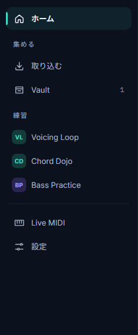

## 8. Chord Dojo の知らせ:「(秒数は測りません)」を外した

- `ChordDojoEndlessView.tsx` の `SELF_NOTICE`、`DojoHome.tsx` の MIDI の知らせから外した。`e2e/p20-dojo-home.spec.ts` の同じ字も合わせた。
- 写真: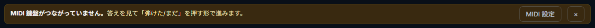

## 9. Voicing Loop の下の「キー」の欄:字が切れる

- `ProgressionVoicingPracticeView.tsx` の `#voicing-loop-key` の `wrapperClassName` を `w-32` → **`w-36`**(128 → 144px)。
- **指示の「入らない時」の枝から 1 つ変えた:**
  - 1440×900 では 144px でも**足りなかった**(「F♯マイナー (元)」が 100.5px、字の入る幅が 100.0px)。そこで `.lv-vl-transport .lv-vl-key-select { padding-right: 24px }` を足した(右の余白 32 → 24、「∨」の右は 6px のまま)。144px − 24 − 10 = **110px** で収まる。
  - 1280×720 では、狭い時の決まり `.lv-vl-transport .lv-vl-key-select { width: 7rem }`(112px)が `w-full` に勝っていて、**幅そのものが 112px** だった。これを **9rem(144px)** に(同じ決まりが 2 か所)。`@container (max-width: 720px)` の 5rem はそのまま(768×640 の配置はこの段の対象外)。
  - つまり **`w-32` には戻していない**(戻すと 128px − 24 − 10 = 94px で、かえって切れる)。
- テスト(`e2e/p23-61-small.spec.ts` §9):1440×900 と 1280×720 で、キーが「F♯マイナー (元)」「F♯メジャー (元)」の時、選んでいる字の幅(同じ字の大きさで測る)が `select` の中の幅 − 左右の余白 以下。再生の帯は 2 行にならず、横はみ出しも 0。
- 写真:(キー「Cメジャー (元)」が見本と同じ幅で出ている)

## 10. 上の帯の機器の札:「○○ が見つかりま…」と切れる

- `src/liveMidi/connectionView.ts` を `` `${preferred.name} 未接続` `` に。`connectionView.test.ts` の同じ字も合わせた。札を押した時の説明・設定の長い文は変えていない。
- テスト(`e2e/p23-61-small.spec.ts` §10):前の機器(「Digital Piano」)が無い時、札(`.lv-midi-chip`)が `data-midi-kind="missing"` で、字が **「Digital Piano 未接続」**。
- 写真: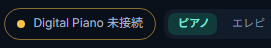

## 11. 「この進行をSOURCEに」:内部の言葉をやめた

- `ProgressionVoicingPracticeView.tsx` の 4 か所を、**この進行を元MIDIに**・**元MIDIへの一括切り替え**・**この進行のカードをまとめて元MIDIにする**・**対象 n・変更 n・カスタムはそのまま n・元の音なし n** に。`ProgressionVoicingPracticeView.test.tsx` の字も合わせた。
- 画面の「元MIDI」「カスタム」「自動生成」の呼び方と揃った(再生方法の値 `SOURCE` は内部のまま)。

## 基準の写真(`visual.spec.ts`)

差が出たのは **`practice-chromium-desktop-win32.png` の 1 枚だけ**で、差は §8 の知らせの字(820 画素、`(721,180)-(837,193)`)だけだったので更新した。`vault.png` は 7 画素(文字の描画の揺れ)だけだったので**更新していない**(元に戻した)。ほか 4 枚は差なし。

- 前: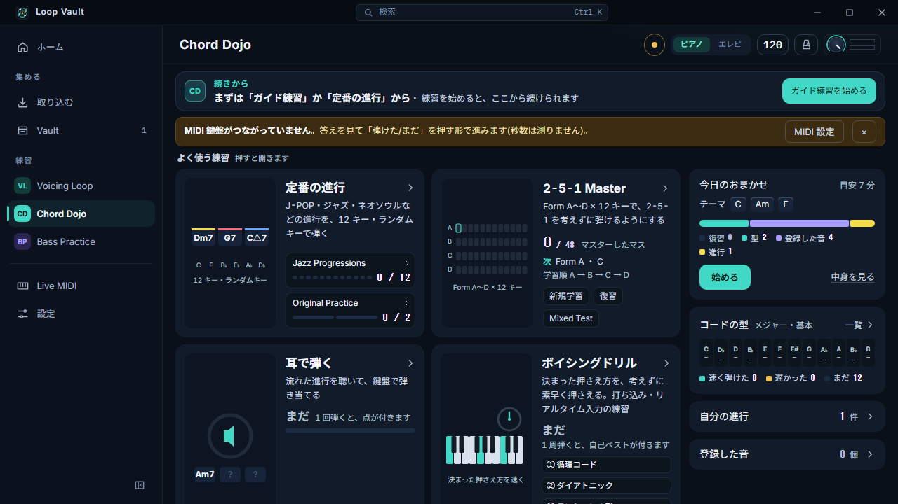
- 後: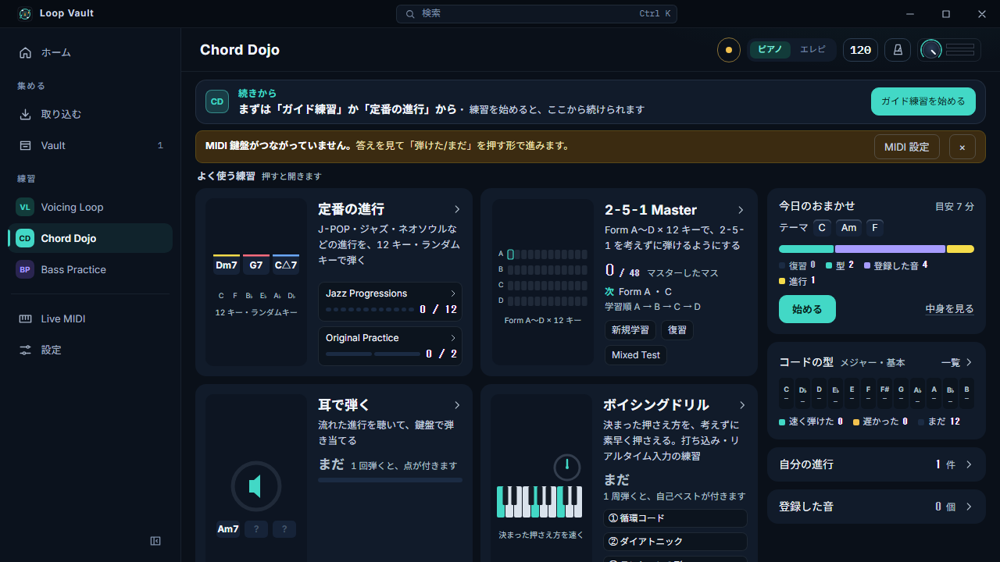
- 差: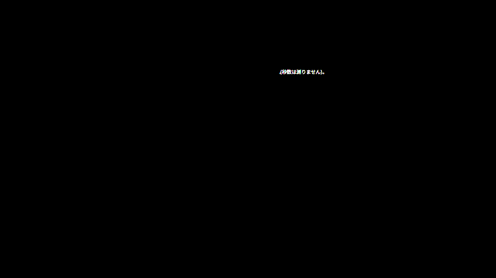

## 点検・テスト

| 何を | 結果 |
|---|---|
| tsc(アプリ)・`typecheck:e2e` | 0 / 0 |
| `npm run lint` | 0(ESLint・class・source-contract) |
| 変えた unit(`ProgressionVoicingPracticeView`・`AppShellTodayLabel`・`connectionView`・`home`・`chord-dojo`・`vault`) | **557/557 PASS** |
| `e2e/p23-61-small.spec.ts`(足した 8 本) | **8/8 PASS** |
| `p22-03-home`・`p23-10-vault-list`・`p22-02-vl-picker`・`p20-dojo-home`・`p23-08-home-records`・`p23-09-home` | **53/53 PASS** |
| `p22-02`・`phase5.28`・`phase5.30`・`phase5.31`・`phase5.32` | **24/24 PASS** |
| `p23-20`・`p23-30`・`p23-32`・`p23-33-fix-1`・`phase5.27`・`voicing-loop-v2`・`vl-13`・`vl-15` | **56/56 PASS** |
| `p22-01-home`・`p89-home-continue`・`p23-41`・`p23-43`・`p23-27`・`p23-36` | **42/42 PASS** |
| `visual.spec.ts` | **6/6 PASS**(`practice.png` を更新) |
| `test:full:all`(`3cd73e50`) | **PASS — 1392.3s**:Static 10/10・Vitest **7120/7122**・PW light **1211/1213**(2 は前からの skip)・PW heavy **134/134** |
