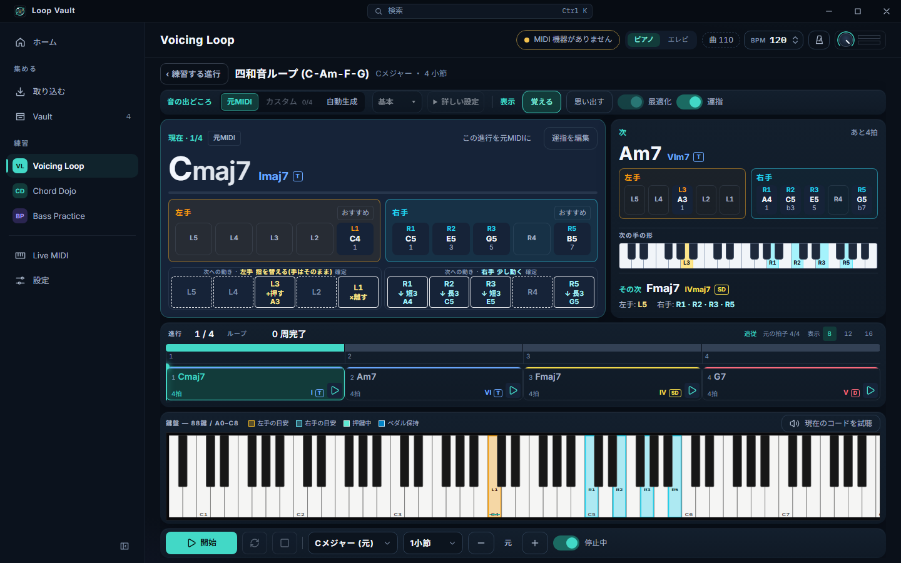
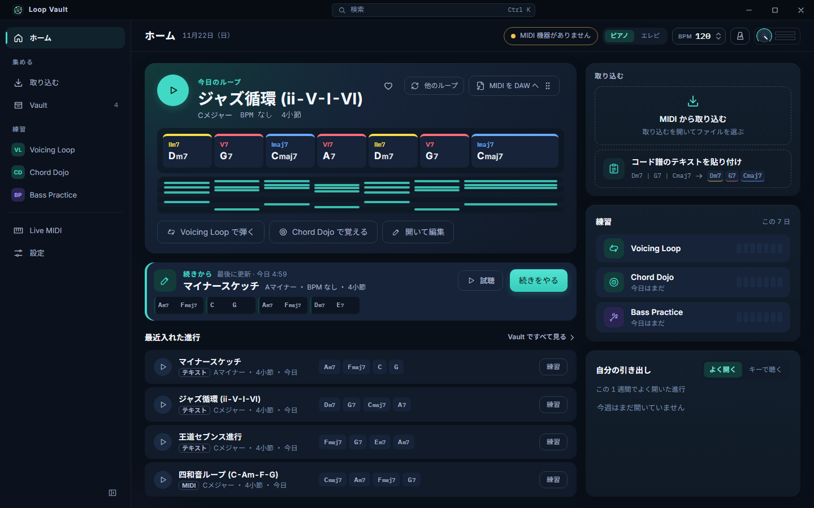
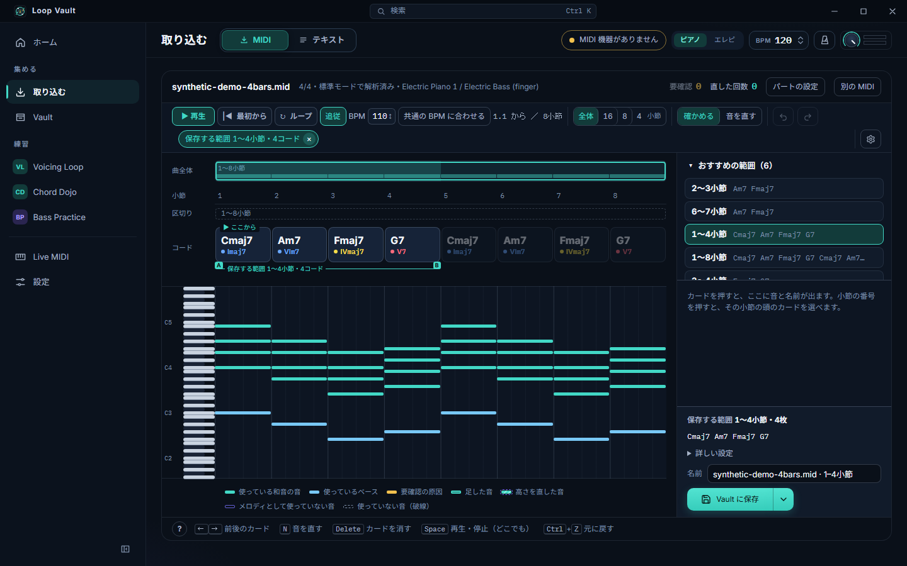
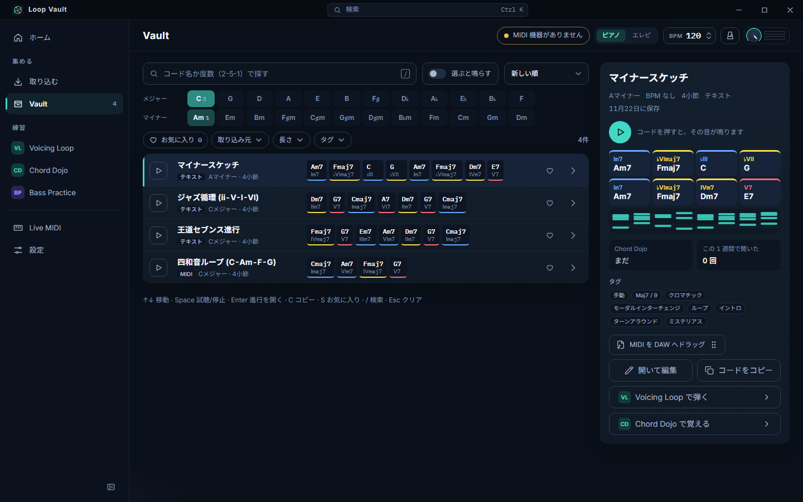
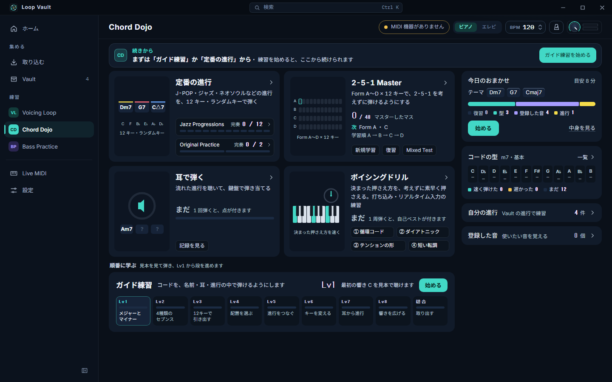
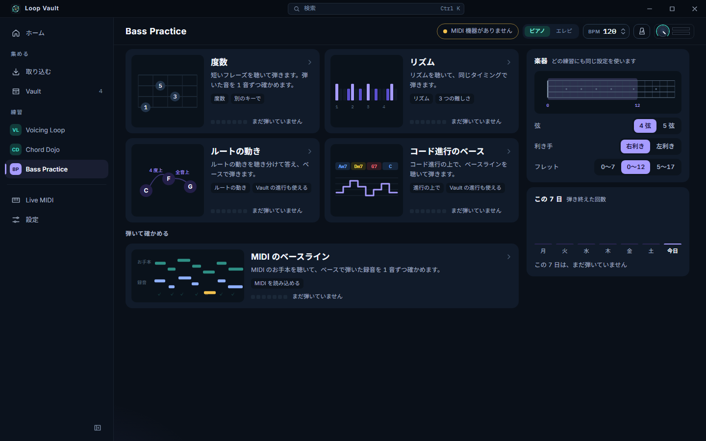

# REL-01 — 試す exe 作成と README（日英）一新（報告）

- 指示：`<作業フォルダ>\lv-handoff\inbox\REL-01\REL-01.md` およびチャットでの利用者方針（冒頭構成・キャッチコピー・過去バージョン比較を載せない方針を利用者指示優先で適用）
- 基点：local `master`（`6370fb72`）
- 作業ブランチ：`docs/rel-01-readme`
- 備考：`origin/master` は v2.1.0 系（`142b3877`）で local `master` と乖離した状態だが、指示どおり触れず push もしていない。

---

## 0. 試す exe

- ビルド元：local `master`（`6370fb72`）にて `npx tauri build --no-bundle`
  - 備考：作業開始時点で既存の `<作業フォルダ>\Loop Vault-dev\src-tauri\target\release\loop-vault.exe` が実行中（`os error 5`）だったため、実行中プロセスには一切触れず、D ドライブ上の一時 `CARGO_TARGET_DIR` でクリーンビルドして出力した（コピー後に一時ビルドフォルダは削除済み）。
- 写した先：`<作業フォルダ>\lv-handoff\try\loop-vault-v3-trial-6370fb72.exe`
- 大きさ：`26,855,424` bytes（約 25.61 MB）
- ビルド時刻：`2026-11-22 03:24:43 +09:00`
- SHA256：`BC913410D9C6B8731B7FF583F7EDE6131783C8633193184D6976E9F08F00F15A`
- 起動有無：**未起動**（指示どおり AppData に触れないため起動していない）

---

## 1. README の変更内容

- 対象ファイル：
  - [README.md](../../../README.md)（日本語）
  - [README.en.md](../../../README.en.md)（英語）
  - [docs/images/README.md](../../images/README.md)（v3 撮影条件の追記。既存 v2 記録および既存画像はすべて保持）
- 主な変更点：
  - 利用者決定の冒頭 5 段構成を採用（タイトル → 言語切替 → 太字キャッチコピー「**「いいな」で終わるコード進行を、自分の引き出しに変えるWindowsアプリ。**」→ 作曲補助用・ローカル保存の要約文 → `releases/latest` ダウンロードリンク）。英語版も同構成・日本語準拠で一新。
  - 利用者要望どおり、過去バージョンとの比較や「v3.0 での変更点」といった差分前提の記述を外し、初見ユーザー向けに現在のアプリでできることを一貫して紹介する構成へ再編成。
  - 現行実装（`6370fb72`）で確認した事実のみを記載：
    - ホーム（今日のループ＋ミニピアノロール・続きから・最近入れた進行・自分の引き出し）
    - 取り込む＆修正作業場（MIDI ドラッグ＆ドロップ・パート役割・自動キー推定・小節削除含む修正・テキスト標準/拡張）
    - Vault（キー帯・コード/度数検索・右プレビュー・DAW ドラッグ）
    - Voicing Loop（4 音の出どころ・左右運指・次への動き・88 鍵盤・A–B 区間ループ）
    - Chord Dojo（ガイド練習 Lv1〜Lv8＋総合・定番の進行 Jazz Progressions / Original Practice・2-5-1 Master・耳で弾く・ボイシングドリル①〜④・今日のおまかせ・自分の進行）
    - Bass Practice（聴いてまねる 4 種＋MIDI のベースライン、全 5 種で録音して 1 音ずつ確認・4/5 弦・左右利き手・フレット範囲）
    - Live MIDI・ヘッダー共通コントロール・コマンドパレット（`Ctrl+K`）
    - ダウンロード資産表・ローカル保存とプライバシー・動作環境と制約・折りたたみ式の開発者向け手順・ライセンス（FreePats CC0-1.0 / Salamander Grand Piano V3 CC BY 3.0 / 同梱フォント SIL OFL 1.1）
  - local `master` に存在しないファイル（`docs/guide.md` 等）へのリンクは張らず、実在する `CHANGELOG.md` / `LICENSE` のみリンク。
  - 古い画像ファイル（`hero.png`・`v2-*.png` 等）は一切削除せず保持。

---

## 2. 撮影した写真（合成データのみ・`1440×900`）

`6370fb72` の production frontend（`dist/`）を Playwright の新規ブラウザコンテキスト（メモリ内 Vault・ダークテーマ・`ja-JP`）で開き、自作の合成 MIDI（`synthetic-demo-4bars.mid`：8 小節 Cmaj7–Am7–Fmaj7–G7、和音＋ベース 2 パート）と汎用テキスト進行 3 件のみを使って通常の UI 操作で撮影しました。実 Vault・個人 MIDI・録音・機器名・個人パスは一切写っていません。

| 画像 | 画面 | 確認した内容 |
| --- | --- | --- |
| [v3-voicing-loop.png](../../images/v3-voicing-loop.png) | Voicing Loop | 4 小節進行（Cmaj7–Am7–Fmaj7–G7）、元 MIDI、左右運指、次への動き、タイムライン、88 鍵盤、通知なし |
| [v3-home.png](../../images/v3-home.png) | ホーム | 今日のループ、ミニピアノロール、続きから、最近入れた進行、取り込み・練習・自分の引き出し、通知なし |
| [v3-correction-workspace.png](../../images/v3-correction-workspace.png) | 修正作業場 | 1〜4 小節 4 コード選択、ピアノロール、おすすめの範囲、Vault 保存欄、通知なし |
| [v3-vault.png](../../images/v3-vault.png) | Vault | 4 件一覧、キー帯、検索・絞り込み、右プレビュー、DAW ドラッグ、通知なし |
| [v3-chord-dojo.png](../../images/v3-chord-dojo.png) | Chord Dojo | 定番の進行、2-5-1 Master、耳で弾く、ボイシングドリル、ガイド練習 Lv1〜総合、今日のおまかせ |
| [v3-bass-practice.png](../../images/v3-bass-practice.png) | Bass Practice | 聴いてまねる 4 種、MIDI のベースライン、楽器・指板設定 |

---

## 3. 検証結果

- コード変更なし（ドキュメント・新規合成画像のみ）。指示どおり FULL と `test:fast` は未実行。
- `npm run check:staged`：コミット前に実行・PASS を確認（最終コミット前チェック記録）。
- `git diff --cached --check`：PASS（空白エラーなし）。
- 6 枚の PNG をすべて目視確認し、通知残り・レイアウト崩れ・個人情報混入がないことを確認。
