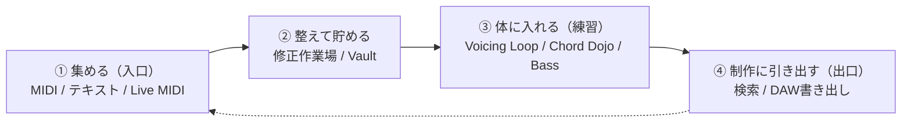
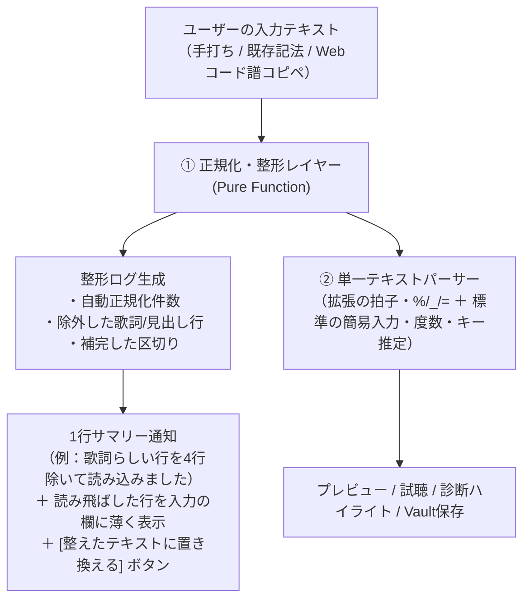

# v3.1.0 設計書:入口と初見体験(P24)

2026-11-22 確定(改訂 4)。v3.1.0 で入れた。文中の `P24-01`〜`P24-07` は作業の指示書で、リポジトリの外にある。

> [!NOTE]
> 本ドキュメントは Phase 24（v3.1 候補）のレビュー・検討用設計書ドラフトです。
> **改訂2での変更**：P24-A（試聴キー統一）・P24-B（引き出し検索）・P24-C（DAW 書き出し拡張）と、P24-E の画面鍵盤での和音入力を見送り、v3.1 を「入口」と「初見体験」の 2 本柱に絞りました。レビューで出た指摘を各機能の仕様に反映し、未決だった箇所はすべて確定させています。また、ガイド練習後半（Lv4〜Lv8・総合確認）の 5 問区切りフィードバックを強化する小規模補強（**P24-G**）に加え、v3.0 公開後の実使用フィードバックとして Voicing Loop の不具合・再生体験修正（**P24-H**）とホーム・サイドバー・ガイド練習の細部改善（**P24-I**）を追記しています。
> **改訂3での変更**：レビューの結果を反映しました。テキスト取り込みの画面の決まり（P24-D「画面」）を足し、読み飛ばした行を出す場所を「入力の欄」に改めました。I-4 の転回形の許容は「1 つのコードを聴いて弾く問題」に限り、進行を聴いて弾く問題（Lv7・総合確認の耳 4 コード）は最低音の判定を残します。H-3 は一時停止（Space）だけをカードの頭に戻し、停止ボタンは今のままとします。H-2 は症状を再現して原因を確定してから直す形にしました。

## 改訂4：P24-00 の調査で変えた所(この節が本文より優先)

2026-11-22。P24-00 の調査の報告のうち、設計の担当がコードで確かめた事実だけで直した。各段の詳しい決まりは `P24-01`〜`P24-06` の指示書にある(指示書が最優先)。

| 項目 | 本文(改訂3)の書き方 | 改訂4 |
|---|---|---|
| 進める順番(§5) | F → D → E → G → H → I | **H → I → F → G → D → E**(小さく効く直しを先に。E は D の上に作る) |
| P24-D の土台 | 単一パーサー | **拡張の読み方を土台**にし、標準から度数・休符だけの進行を移す。古い 2 つの読み方のファイルとテストは残す |
| P24-D の上限 | 生テキスト 64 KB・整形後は今の上限 | **全部、拡張の今の値**(65,536 文字・256 小節・4,096 トークン) |
| P24-D の注記 | 単独の `-` を許可する注記に含める | **含めない**(今は両方の読み方で `C -` が Cm。意味を変えない) |
| P24-D の見出し | 見出しを読み飛ばす | 見出しは**小節を食わない**(今の標準は 1 小節を食う)。プレビューの区切りとして出す |
| P24-D の答えが割れる入力 | 調査で決める | 決めた(`P24-05` の表)。1 小節 3・5 個は読める・`Cadd9(#9,#5)` は誤り・休符だけは読める・枠の中の改行は 2 小節 |
| P24-D の誤り | 箇所ハイライト | 波線・一覧・「ここへ移動」。候補が 1 つに決まる物(`H` → `B`・小文字のルート)だけ「〇〇に直す」 |
| P24-D の空のとき | 貼り付けのボタン | ボタンは置かない。**押せない理由の説明文(「コードを入れると聴けます」など)は出さない** |
| P24-E の作り方 | 空の進行のページに作る | **テキスト取り込みの上に作る**(進行のページにはカードを足す関数・長さの操作が無く、0 コードでは保存できないため)。入口はテキストの入力の欄の見出しの右の「鍵盤で入れる」。「取り込む」の 3 つ目のタブは作らない |
| P24-E の長くなった時 | — | 画面全体ではなく、入力の欄とプレビューの欄がそれぞれスクロール。足すたびに一番下へ付いていき、利用者が上へ戻している間は動かさず「最新へ」を出す |
| P24-F のベースライン | 1 件に `SourceBassline` を含める | **含めない**(`SourceBassline` は MIDI の実際のベースの声部の音専用。作り物を入れると「鳴っていた音のまま」に反する) |
| P24-F の印 | 既存の欄、無ければタイトル | **タグ `サンプル`**(手動のタグとして付ける。`origin` は 1 値の enum で使えない) |
| P24-F の進行 | 例:王道・シティポップ 7th・ジャズ 2-5-1 | `ouudou`(C)・`marusa`(F)・`circle`(B♭)。音はそのキーで `buildBuiltin` した物 |
| P24-G の診断 | `bassOk` などから | `bassOk` は保存されていないので、**弾いた音(`sealedNotes`・`steps[].notes`)と問題のコードから**診断する |
| P24-H の H-2 | 「戻しても下がったまま」を直す | 調査では再現せず、逆向き(再生中・一時停止中にオクターブや詳しい設定を変えても音に届かない)を再現。`isCompatiblePlan` を直す。直した後、利用者が実機で元の症状を確かめる |
| P24-I の I-1 | 色以外を Bass Practice に合わせる | **1 つの部品(`ResumeGoButton`)にし、各画面の上書きを消す**。値は `P24-02` の表。3 つの窓の大きさとマウスを乗せた時の写真を設計の担当が見て決める |
| P24-I の I-3 | 足りない音も緑に | 緑に加えて、**点線の輪の色を変える**(今の `#42d8c6` は白鍵の上で 1.28 : 1 で見えない)。白鍵 `#0b5546`・黒鍵 `#e9fff8` |
| P24-I の I-4 | 1 コードを聴く問題で転回形を許す | 対象は **Lv1・Lv2 の耳問題(36 問)だけ**。Lv7・Lv8・総合確認の耳は今も最低音を見ていない(変えない)。総合確認に 1 コードの耳問題は無い。`policy.json` と凍結の契約ファイルを同時に直す |

---

## 1. 背景と目的

Loop Vault は「**『いいな』で終わるコード進行を、自分の引き出しに変える**」作曲補助用 Windows デスクトップアプリです。アプリ全体の体験は、以下の 4 段階の循環で成り立っています。

v3.0（Phase 23）までの開発により、**② 整えて貯める** と **③ 体に入れる（練習）** は全画面の設計言語と導線が揃いました。**④ 出口** は v3.0 の機能（Vault 一覧・右の中身からの MIDI ドラッグ＆ドロップなど）のまま据え置きます。

Phase 24（v3.1）では、次の 2 本柱に加え、ガイド練習の補強と v3.0 実使用フィードバックの修正・磨き込みを行います。

1. **入口の摩擦削減**：MIDI ファイルが手元にない場面でも、「いいな」と思った進行を迷わず・素早く Vault に入れられるようにする（テキスト取り込みの 1 本化、MIDI 鍵盤でのステップ入力）
2. **初見体験の補強**：初めてアプリを開いたユーザーが、手元に MIDI がなくても 30 秒で Loop Vault の一連の価値を体験できるようにする
3. **ガイド練習後半の「ひとこと」補強（小規模）**：Lv1〜3 に比べて抽象的だった Lv4〜Lv8・総合確認の区切りフィードバックを具体化し、後半でも「直してもらっている手応え」を維持する
4. **v3.0 実使用フィードバックの修正・磨き込み（P24-H / P24-I）**：Voicing Loop の表示・オクターブ・停止挙動と音のクリックノイズ、各ホーム画面の「続ける Enter」ボタン統一、サイドバーの誤選択防止、ガイド練習の誤答鍵盤色・1 つのコードを聴いて弾く問題の転回形判定を直す

---

## 2. 設計原則と非目標（スコープ境界）

### 守るべき原則（既存契約との整合）
* **Vault v2 スキーマ（`fileVersion`）は変更しない**：既存ユーザーの Vault データを 100% 後方互換のまま維持する。
* **ローカル完結・プライバシー優先**：v3.1 の新機能はすべて手元の PC 内で完結させ、外部 API 送信やクラウド同期は行わない。
* **Source Truth と一時状態の分離**：テキストの整形結果やステップ入力の途中状態は、保存を確定するまで既存の保存済みデータに触れない。
* **透明な自動化**：テキストの自動整形などを行う場合でも「裏で勝手に誤変換する」挙動を避け、解釈や除外が発生した箇所はユーザーに明示する。
* **新しい編集画面を増やさない**：カードの編集は既存の進行ページ（修正作業場の部品）に集約する。

### 非目標（Phase 24 ではやらないこと）
* **AI によるコード自動生成・自動作曲**：Loop Vault の核である「自分で集め、自分の手と耳で体に入れ、自分の引き出しから選ぶ」体験を守るため導入しない。
* **WAV / MP3 からの完全自動オーディオ採譜**：精度・サイズ・誤検出のコストが大きいため対象外とし、MIDI・テキスト・手弾きの精度と快適さに集中する。
* **DAW 化の方向性（マルチトラック作曲エディタ化）**：制作本体は DAW に任せ、Loop Vault は「引き出しの育成と受け渡し」に徹する。

### 見送り（v3.1 を 1 本にまとめるため）

| 項目 | 内容 | 扱い |
| --- | --- | --- |
| P24-A | Vault 試聴キー統一（仮移調プレビュー） | 見送り。P23 のホーム「キーで聴く」は現状のまま |
| P24-B | 似ている進行・次コード引き出し検索 | 見送り |
| P24-C | 移調・ボイシング・ベース反映の DAW 書き出し拡張 | 見送り。書き出しは現行のまま |
| P24-E の一部 | 画面鍵盤での和音入力 | 見送り。ステップ入力は MIDI 鍵盤のみ |

---

## 3. 機能設計

### 柱 1：入口の摩擦削減

#### P24-D：テキスト取り込みの単一化（「標準 / 拡張」の廃止 → 1つの入力＋透明な整形）

* **解決する課題**
  現在「標準」と「拡張」の 2 モードが併存しているが、機能重複が大きく、ユーザーに「入力前にモードを選ばせる」負担が発生している。「ゆるく / かたく」の 2 モードに名前を変えても、結局ほとんどの人が「ゆるく」を使い、UI と実装の二重化が残る。
* **設計方針：モード切替を廃止し、「1つの入力 ＋ 2段パイプライン」に統一する**

* **着手前の調査（必須）：答えが割れる入力の一覧**
  標準と拡張は別の文法として作られているため、同じ入力に違う答えを期待しているテストがある前提で進める。
  1. 現行の標準パーサーと拡張パーサーの両方に、両方のテストスイートの入力をすべて流す。
  2. 結果が食い違う入力を一覧にする（入力・標準の結果・拡張の結果）。
  3. 食い違いごとに、どちらを正とするかを設計の担当が決め、単一パーサーの仕様として指示書に書き切る。
  4. 変換の透明性ルール（下表 A 分類）の正規化が、拡張記法で別の意味を持つ記号（`-`、`△` など）とぶつからないかも、この一覧で確認する。

* **変換の透明性ルール（3 段階の境界）**

| 分類 | 対象の例 | 振る舞い |
| --- | --- | --- |
| **A. 安全な自動正規化** （意味が変わらない） | 全角→半角（`｜` `／` `＃` `♭` `Ｃｍ７`、全角空白）、連続空白、`CM7`/`C△7`→`Cmaj7`、`ConG`→`C/G`、`C-7`→`Cm7`、行全体が `[Intro]`/`[サビ]` 1つだけの見出し行 | 黙ってそのまま通す。エラーにしない。そろえた所は入力の欄に点線の下線で示すだけで、A だけのときは整形の帯を出さない。見出しはプレビューの区切りとして出し、保存する中身には入れない。 |
| **B. 解釈を伴う整形** （入力の掃除・補完） | コード譜サイト等からのコピペに含まれる**歌詞行の除外**、「歌詞の上にコード行」の形からのコード行の抜き出し（位置＝タイミング情報は失われる）、未対応記号のスキップ | 読み取りは通しつつ、入力とプレビューの上に **「何をしたか」を 1 行で明示**（A の件数も一緒に書く）。読み飛ばした行は**入力の欄**に薄く表示する。ワンクリックで整えたテキストに置き換えて手直しでき、置き換えた後は「元に戻す」で戻せる。 |
| **C. 曖昧・解釈不能** （誤変換リスクあり） | 存在しないコード名、拍子とセル数の矛盾、解釈が複数に割れる連結文字列 | 勝手に推測して保存可能にせず、**入力の誤りの所に波線＋入力の欄の下に直す所の一覧**でユーザー確認を求める。候補が対応表で 1 つに決まる誤りだけ「〇〇に直す」を出し、押すまで何も変えない（「画面」の 7）。 |

* **歌詞行の判定ルール**
  * 「コードの割合」ではなく、**行を空白で区切った語のほぼすべてがコード・小節線・許可された注記として読める行だけをコード行**とする。それ以外は歌詞行として除外する。
    * 理由：英語の歌詞の `A` などは単体ならコードとして読めてしまうため、割合では誤判定が起きる。迷ったら「コードを落とす側」に倒し、落とした行は入力の欄に薄く出して、その行の「コードとして読む」で戻せるようにする（歌詞をコードとして読む誤りのほうが直しにくい）。
  * 許可する注記の例：`x2` `×2` `(x2)` `N.C.` `-`（区切りとしての単独の記号）。一覧は指示書で確定させる。
  * コード名は大文字・小文字を区別して読む（`am` はコードとして読まない）。
  * 歌詞の中にコードを埋め込む形（`[C]歌詞` のようなインライン形式）は v3.1 では対象外。歌詞行として扱い、除外件数に数える。
* **小節線なしの羅列**
  新しい規則は作らず、**既存の空白記法（Phase 5.20）の規則をそのまま正とする**。
* **入力の上限**
  コピペされたコード譜は歌詞を含むため、現行の上限（Phase 5.20 当時は 4096 文字 / 12 小節 / 48 語。現在値は着手前に確認）をすぐ超える。上限を 2 段に分ける。
  * **整形前の生テキスト**：コピペを受け付けられる大きさに広げる（目安 64 KB）。
  * **整形後のコード**：現行の小節数・語数の上限を維持する。
* **厳密派への配慮**
  現行の標準記法（`| Dm7 G7 | Cmaj7 |`、度数、`%` `_` `=`）および拡張記法（拍子指定、細かい区切り、コメント）をきっちり書いた場合は、A/B の補正が介入せずそのまま厳密に解釈される。
* **互換性**
  既存の `textProgression` と `extendedTextProgression` のテストケースを単一パーサーの回帰テストスイートとして引き継ぐ。答えが割れる入力は、調査で決めた側の期待値に統一したうえで引き継ぐ。
* **画面（見本：デザインのキャンバス「Loop Vault v3.1 テキスト取り込みの案」の 3 枚）**
  今の形（上の帯の 2 つのかたまり「読み方の設定」「試聴」・左が入力・右が 1 小節 1 枚の大きなカードのプレビュー・下が保存の 1 行）は変えない。変えるのは次の 7 つだけ。
  1. **読み方の切り替えを無くす**：「読み方の設定」は拍子・キー・BPM・「共通の BPM に合わせる」・「?」だけにする。「拡張記法の形式に見えます／拡張で読む」の案内も無くす。
  2. **整形の帯**：B 分類の整形があったとき、入力とプレビューの上に 1 行の帯を出す（例「コード譜として読みました。歌詞らしい 5 行を読み飛ばし、表記を 5 か所そろえています。」）。右に「読み飛ばした行を隠す」（押すと「読み飛ばした行を見せる」に変わる）と、主のボタン「整えたテキストに置き換える」。置き換えた後は「整えたテキストに置き換えました。12 行 → 5 行。音は変わっていません。」と「元に戻す」に変わる。「元に戻す」は置き換える前の入力をそのまま戻す。A 分類だけのときは帯を出さない。
  3. **入力の欄で行の扱いを見せる**：行番号の右に細い縦線を置き、コードの行 = アクセント色、読み飛ばした行 = 灰、見出しの行 = 紫にする。読み飛ばした行は薄い字にして「歌詞」の札を付け、マウスを乗せた行にだけ「コードとして読む」を出す。押すとその行を読む対象に戻す（入力の文字は変えない。戻した行は行の中身で覚え、同じ中身の行がある間は有効）。A 分類でそろえた所は点線の下線にし、マウスを乗せると「読むときは Fmaj7」のように出す。見出しの行は紫の字に「見出し」の札。
  4. **選択の連動**：プレビューのカードを押すと鳴り、入力の欄の同じコードにも枠が付く。入力のコードを押しても、同じカードが選ばれて鳴る。
  5. **見出しをプレビューの区切りにする**：見出しの行があるとき、プレビューをその見出しで区切り、小節の並びの上に見出しの札と細い線を置く。表示だけで、保存する中身は今のまま。見出しが無いときは区切りを出さない。
  6. **空のとき**：入力の 1 行目に薄い字の例（`例: | Fmaj7 | Em7 A7 | Dm7 G7 | Cmaj7 |`）。入力の欄の真ん中に「書く、または貼り付ける」・説明「コード譜をそのまま貼っても読めます。歌詞の行は自動で読み飛ばします。」。貼り付けのボタンは置かない（Ctrl V で貼れるため）。プレビューには点線の空の小節 4 つと「書き方の早見」（`|` の区切り・1 小節に 2 つ・`%`・`=`・`_`・度数・歌詞つきのコード譜）。早見は空のときだけ出す。「例を入れる」のボタンは置かない。「?」の中身は今のまま残す。
  7. **誤りがあるとき**：入力の誤りの所に赤い波線、その行の縦線と行番号を赤にする。入力の欄の下に「直す所が n か所あります」と一覧を出す（1 件 = 「n 行目 · m 小節目」・理由・「ここへ移動」）。候補が対応表で 1 つに決まる誤り（ドイツ式の `H` → `B`、大文字・小文字の違いなど。一覧は指示書で確定させ、似た綴りからの推測はしない）だけ「〇〇に直す」を出し、押すと入力のその文字だけを書き換える。プレビューは読めないコードのカードだけを赤い点線にし、読めたコードは普通に出して鳴らせる。小節全体が読めない（コードの数が合わないなど）ときは、その小節を赤い点線にして中に元の文字を出す。保存の行に「直す所が n か所あります」と出し、「Vault に保存」は押せない。

---

#### P24-E：Live MIDI ステップ入力（MIDI 鍵盤で 1 コードずつ積んで進行を作る）

* **既存の Live MIDI 履歴取り込みとの違い**
  * 既存（`LiveMidiImportDialog`）：自由に弾いた履歴から「ここからここまで」を切り出して保存する（ジャム・即興向き）。
  * 新規（**ステップ入力**）：MIDI 鍵盤で 1 コードずつ押して確認しながら、進行を組み立てていく（耳コピ・作曲スケッチ向き）。
* **作り方：新しい編集画面を作らない**
  * カードの並び・試聴・差し替え・削除は、既存の**進行ページ（修正作業場の部品）を空の状態で開いて**使う。
  * 和音の確定には、Phase 5.20 の **Live MIDI からのボイシング取り込み（段階的な note-off に対する候補ラッチ）** を流用する。
  * 押した音からのコード名付けは既存の判定を流用する。表記の違い（`C6` / `Am7` など）は問わない（鳴る音が正）。
* **体験フロー**
  1. 「取り込む」画面の 3 つ目の入口 **「鍵盤で組む」**（`MIDIファイル / テキスト / 鍵盤で組む`）を開く。
  2. MIDI 鍵盤で和音を押さえて離すと、押したそのままのボイシング（`source: "live-played"`）で末尾に 1 カード追加される。
  3. 追加直後に、コード長（1 拍 / 2 拍 / 1 小節、デフォルトは 1 小節）、休符、1 つ戻す（Undo）、特定カードの差し替え・試聴ができる。
  4. 組み上がったらキー（自動推定＋変更可）・タイトルを確認し、そのまま Vault へ保存する。
* **MIDI 鍵盤が未接続のとき**
  入口は表示したまま、ヘッダーの共通 MIDI 接続パネル（Phase 14）を開く案内を出す。画面鍵盤での入力は提供しない。
* **価値**
  MIDI ファイルが手元になくても、「曲に合わせて耳コピしながら弾いたボイシング」をそのまま `sourceVoicing` 付きで Vault と Voicing Loop に直行させられる。

---

### 柱 2：初見体験の補強

#### P24-F：任意導入のサンプル進行セット（初回オンボーディング）

* **解決する課題**
  初回起動時は Vault が空のため、MIDI ファイルを用意しないと「Vault で聴く → Voicing Loop・Chord Dojo で弾く → DAW へドラッグ」という Loop Vault の一番気持ちいい循環を体験できない。
* **仕様**
  * **定番のサンプル進行を 3 件**用意する（例：王道ポップス系、J-Pop / シティポップ系 7th 進行、ジャズ 2-5-1 循環）。
  * **データは Chord Dojo の組み込みの定番の進行から選んで作る**（ボイシングの出どころを 1 つにする）。各サンプルにはきれいなボイシング（`sourceVoicing` 相当）を持たせ、少なくとも 1 件には `SourceBassline` を含める。
  * **強制投入はしない**：Vault が空のときの Home / Vault のガイド内に **「サンプル進行（3件）を入れて試す」** ボタンを置く。Vault が空でないときはボタンを出さない（二重投入を防ぐ）。
  * サンプルは通常の進行と同じく Vault に保存され、自由に編集・練習・削除できる（既存ユーザーのデータには一切干渉しない）。今日のループなどでも通常の進行と同じに扱う。
* **サンプルの見分け方**
  * 既存の欄（タグ・分類・出どころなど）でサンプルと分かる印を付ける。使える欄は着手前の調査で確認する。
  * 使える欄が無い場合は、スキーマは変えずにタイトルの頭に「サンプル：」を付ける。

---

### 柱 3（小規模補強）：ガイド練習後半のフィードバック具体化

#### P24-G：ガイド練習 Lv4〜Lv8・総合確認の「ひとこと」具体化・聴き比べ・バリエーション

* **解決する課題（v3.0 時点のギャップ）**
  * ガイド練習 Lv1〜3（`GuidedCourseView.tsx`）では、5 問区切り画面（`RoundBreak`）が最初の誤答の和音・根音・ミス種別（`wrongLines` の `swap` / `missing` / `extra` / `bass`）から具体的な音名入りの「ひとこと」と聴き比べ用ミニ鍵盤（`RoundCompare`）を出している。
  * 一方、Lv4〜Lv8・総合確認（`AdvancedCourseView.tsx`）では、区切り画面に `anyWrong` の有無だけを渡しており、`guidedTips.ts` の `ADVANCED_TIPS` がレベルごとに 1 文のみの固定文、5 問全問正解時も共通の 1 文（`ALL_CORRECT_OTHER`）となっている。また、`RoundBreak` への `compare`（正解鍵盤と弾いた鍵盤の聴き比べ・差分表示）も渡されていない。
* **設計方針：判定とデータは変えず、既存の証拠から診断と表現だけを豊かにする**
  * 既存の `AdvancedTrial`（`sealedNotes`・`steps`・`bassOk`・`result`）・`expectedChords(item)`・`judgeAdvancedChord`・`wrongLines` から純粋関数で誤答原因を診断する。**合否判定ロジック・`AdvancedStore` スキーマ・Vault v2 スキーマには一切手を入れない。**
  * すべての文言で既存の `**重要語句**` マーカー記法（`tipParts`）を使い、見た目の部品を増やさずそのまま馴染ませる。
* **聴き比べ（`RoundCompare`）の対応範囲拡大**
  * `AdvancedCourseView.tsx` の `RoundBreak` において、直近 5 問の最初の誤答について、以下の条件を満たす場合は `RoundCompare`（お手本と弾いた音のボタン＋差分ミニ鍵盤）を渡す。
    * 単音コード問題（Lv4 分数コード・Lv8 コード名・総合確認コード名24）：そのコードの `referenceNotes` と `trial.sealedNotes` を比較（`lines?.kind !== "bass"` または最低音違い以外でも音比較が有効な範囲で表示。ただし聴き比べで答えのヒントになり過ぎる条件や自己確認モード・無入力 `played.length === 0` は除く）。
    * 進行問題（Lv4 つなぎ・Lv5・Lv6・Lv7・Lv8 リカラー・総合確認 4 コード進行）：`trial.steps` の最初に `!step.ok` となったカードを対象に、そのカードの `chord.referenceNotes` と `step.notes` を比較して渡す（問題名はカード番号やコード名で提示）。
    * `capstone-sight`（8 小節初見）や自己確認（`mode === "self"`）・弾いた音が空の試行では `compare` を省略する。
* **決定的なバリエーション選択（ランダム禁止）**
  * 周回を重ねても同じ文言ばかりにならないよう、各誤答カテゴリおよび各レベルの 5 問全問正解に **2〜3 通りの自然な言い回し** を持たせる。
  * テストの再現性と「同じ区切りを見直しても言葉が勝手に変わらない」落ち着きを保つため、`Math.random()` は使わず `(level, round, wrongItem.id, category)` から決まる決定的なインデックス（文字列ハッシュ等）でバリエーションを選ぶ。
* **I-4 との関係**：Lv7 と総合確認の耳 4 コードは進行を聴いて弾く問題なので、I-4 の後も最低音を判定する。下の表の「最低音違い」の「ひとこと」はそのまま使う。
* **レベル別・誤答カテゴリ別の「ひとこと」設計（バリエーション例）**
  * 問題文脈・不足音（`missingPitchClasses`）・余分な音（`foreignPitchClasses`）・最低音違い（`bassOk === false`）・カード番号（進行問題）などを文面に差し込む。

| 対象 | 診断カテゴリ（判定条件） | 「ひとこと」の方向性とバリエーション例（`** **` が強調箇所） |
|---|---|---|
| **Lv4** 配置を選ぶ | 分数コードで最低音違い（`single && !bassOk`） | 1. 「${label} は**一番下の音 ${bassName}** が土台です。左手で ${bassName} を先に置いてから上の音を乗せましょう。」 2. 「上の響きは合っていますが、**最低音が ${bassName} ではない**状態でした。スラッシュの右側だけを先に鳴らしてみます。」 3. 「オンコードは**ベースの ${bassName}** で性格が決まります。${lowestPlayed} ではなく ${bassName} を左手の小指か親指で支えましょう。」 |
| **Lv4** 配置を選ぶ | つなぎ進行でのミス（`progression`・失敗カード特定） | 1. 「${cardNo}枚目の ${chordLabel} で手が大きく動いています。**前のコードと重なる音を残す**と自然につながります。」 2. 「${cardNo}枚目の ${chordLabel} で **${missingOrForeign}** が抜け入りしています。ベースだけ 1 つ動かして上を保つ意識を。」 3. 「つなぎでは全音を入れ替える必要はありません。${chordLabel} へ移る時は**一番近い鍵盤**だけ動かしてみましょう。」 |
| **Lv5** 進行を覚えてつなぐ | 途中開始（`startIndex > 0`）でのミス | 1. 「途中スタートは最初の ${chordLabel} の**度数の場所**を見失いがちです。頭に **${firstRoot}** を置いてから残りをつなぎます。」 2. 「前からの流れが無いぶん、**${chordLabel} の 3度と 7度**を先に押さえると進行の景色がすぐ戻ります。」 |
| **Lv5** 進行を覚えてつなぐ | 通常進行（`progression`）でのミス | 1. 「${cardNo}枚目の ${chordLabel} が別の形に寄りませんでしたか？ 迷ったら**全音か半音で動く音だけ**を追います。」 2. 「${cardNo}枚目（${chordLabel}）で **${missingOrForeign}** が崩れました。まず左手のルート移動だけをリズムに乗せて確認しましょう。」 3. 「1 枚ずつ独立して思い出すより、**前のコードのすぐ隣**で ${chordLabel} を拾うほうが速くつながります。」 |
| **Lv6** キーを変えて使う | 移調進行でのミス（`transpose`） | 1. 「キー ${keyName} になると黒鍵が増えて迷いやすくなります。コード名より先に**度の動き（例: ${familyHint}）**を口ずさんでから弾きます。」 2. 「${cardNo}枚目で移調先の音がずれました。新しいキーの **I の音（${keyName}）の位置**を指で触れてから進めると見失いません。」 3. 「${keyName} キーでは黒鍵を恐れず、**根音から半音の数**で 3度・7度を数えると移調が一気に安定します。」 |
| **Lv7** 耳から進行を弾く | 最低音違い / ベースは合って上音違い（`ear`） | ・最低音違い： 1. 「耳コピーの土台は**一番低い音の移動**です。${cardNo}枚目の上は気にせず、まずベースの動きだけを歌って確かめます。」 2. 「${cardNo}枚目でルートが別の音に聴こえています。**最初の基準音からどれだけ動いたか**を先に追ってみましょう。」 ・ベース一致・上音違い： 1. 「ベースの流れは合っています！ ${cardNo}枚目は**明るいか暗いか（3度）**と**7度の緊張感**の 2 点だけ聴き分けます。」 2. 「下の音は掴めているのであと一歩です。${cardNo}枚目の響きが**落ち着くか（maj7）進むか（7/m7）**で絞ってみましょう。」 |
| **Lv8** 響きの語彙を広げる | 特徴音抜け（`missing` に 9th/13th/6th/sus が含まれる） / ルートレス（`rootless`） / リカラー進行（`plainChords` あり） | ・特徴音抜け： 1. 「${chordLabel} の色を決めるのは **${toneHint}（${missingNames}）** です。三和音の枠にまず 1 音だけ足す感覚で。」 2. 「${missingNames} が抜けて普通のコードに戻りました。${chordLabel} は **${tensionDegree} の音**をトップか内声に必ず置きます。」 3. 「土台（3度・7度）が合っているだけに惜しい！ 次の回では最初に **${missingNames} の鍵盤**を目で見てから押さえます。」 ・ルートレス： 1. 「${chordLabel}（ルートレス）は根音を弾かない代わりに、**3度と 7度のガイドトーン**で正体を作ります。」 2. 「つい根音 ${rootName} を押さえたくなりますが、左手は **3度か 7度から始めて**上に ${tensionDegree} を積むのがコツです。」 ・進行の中で（`plainChords` あり）： 1. 「素のコードのまま弾いてしまいました。${cardNo}枚目は元の形に **${colorHint} の 1 音**を足して色を変えます。」 2. 「リカラーは全取り替えではありません。いつもの ${plainLabel} を押さえる指から **1 本だけ隣**にずらして響きを乗せましょう。」 |
| **総合確認** 覚えた響きを取り出す | コード名24 / 耳4コード / 初見8小節（`capstone-sight`） | ・コード名24： 1. 「${chordLabel} で **${missingOrForeign}** が出ました。総合では迷ったら**根音と 3度・7度**の骨格を最優先で押さえます。」 2. 「3 秒以内を意識して焦ると余分な音が混ざります。**押さえる数**を頭に浮かべてから鍵盤に手を置きます。」 ・耳4コード：Lv7 と共通の具体的な耳診断＋聴き比べを使用。 ・初見8小節（途中停止 `longestStop > 2`）： 1. 「途中で **${longestStop} 拍止まって**しまいました。初見は間違いを直しに戻らず、拍に合わせて次の小節へ進みます。」 2. 「1 コード外しても大丈夫です。**メトロノームの 1 拍目**だけは遅れずに左手のルートを置く練習をしてみましょう。」 ・初見8小節（正答率不足 `< 90%`）： 1. 「止まらず進めた点は素晴らしいです！ 小節の境目の **半拍前** に次のコードの形を思い浮かべると余裕が出ます。」 2. 「細かい音は少し抜けても構いません。各小節の**頭で 3度と 7度**を揃える意識だけで正答率が大きく上がります。」 |
| **共通** 無入力・途中 | 無入力（`no-input`） / 未完了（`incomplete`） | 1. 「音が入らず時間切れになりました。**次のコードの形を先に頭で選んで**から、一呼吸置いて弾き始めましょう。」 2. 「進行の途中で止まった時は、全部弾こうとせず**まず最初の 2 拍のルートだけ**を確実につなげてみます。」 |
| **5問全問正解** （レベル別 `ALL_CORRECT`） | Lv4〜8・総合確認で 5/5 正解（各レベル 2 パターンずつ） | ・Lv4：「5問とも正解です。この調子で**共通音を残す動き**をそのまま手に馴染ませましょう。」／「全問正解！ ベースの場所が迷わず選べるようになってきました。次の 5 問へ。」 ・Lv5：「5問とも正解です。進行の**縦のつながり**が指に入っています。次の 5 問も同じ流れで。」／「全問正解！ コード名ではなく**手の移動距離**で次が見つかり始めています。」 ・Lv6：「5問とも正解です。別のキーでも**度数の地図**が見えていますね。次のキーもこのまま。」／「全問正解！ 黒鍵のキーでも**I の位置**を基準に迷わず動けています。」 ・Lv7：「5問とも正解です。ベースの聴き取りとコード感がしっかり結びついています。」／「全問正解！ **響きの性格**だけで進行を掴めるようになってきました。」 ・Lv8：「5問とも正解です。**足した 1 音の彩り**がきれいな響きになって鳴っています。」／「全問正解！ 土台とテンションのバランスが安定してきました。次の 5 問へ。」 ・総合確認：「5問ともクリアです。これまで積んだ形が**実戦の速さ**で引き出せています。」／「全問パーフェクト！ 次の区切りも**流れを止めずに**いきましょう。」 |

---

### 柱 4（実使用フィードバック修正）：Voicing Loop 不具合修正と UI・ガイド練習の磨き込み

#### P24-H：Voicing Loop の不具合・再生体験修正（3 件）

* **H-1.「思い出す」モードで次のコードのミニ鍵盤が出てしまう不具合**
  * **現行原因**：`src/views/ProgressionVoicingPracticeView.tsx` の次コードパネルにおいて、構成音の文章・運指および「その次」の運指には `displayMode === "learn"` の表示ガードがある一方、`<NextShapePreview>` の呼び出しに `displayMode === "learn"` 条件が抜けているため、「思い出す（`displayMode === "recall"`）」を選んでも次のコードのミニ鍵盤が表示されてしまっている。
  * **仕様**：`displayMode === "recall"` のときは `<NextShapePreview>` も非表示にし、次のコードについてはコード名・度数/機能・残り拍のみを表示する。

* **H-2. オクターブを下げた状態で「詳しい設定」からボイシングを変えると、オクターブを戻しても下がったまま音が再生される不具合（鍵盤は正常）**
  * **現行原因**：`src/domain/progressionVoicingPractice/voicingResolution.ts` の `applyOctaveShift` は `octaveShift !== 0` のとき返却する `plan.snapshotFingerprint` に `:octave:${octaves}` を付与する。一方で `src/practice/ProgressionVoicingTransport.ts` の `isCompatiblePlan` が `plan.snapshotFingerprint === snapshot.fingerprint` の完全一致を要求しているため、`octaveShift !== 0` を含む更新 `plan` が `transport.updatePlan()` で `false` として拒否され、画面の鍵盤表示（React 側の `plan`）と音声再生（Transport 内部の古い `activeOptions.plan`）が食い違う。
  * **注意**：この食い違いで説明できるのは「演奏中に設定を変えても音が変わらない」ほうで、報告された「オクターブを戻しても下がったまま」になる道筋は、コードを読んだだけでは確かめられていない。**Stage 0 で症状を再現し、原因を確定してから直す。** ここに書いた原因を前提に直し始めない。
  * あわせて Stage 0 で「オクターブ下げ → 詳しい設定（既存の形・左手の形・色づけ・広げ）→ オクターブ戻し → 再生・試聴」の全経路（`changeSelection` / `changeOctave` / `pendingSessionUpdate`・`applyAtBeat` / `cardAuditionPlans`）を再現確認し、同様の食い違いが残る経路も一括で洗い出す。
  * **仕様**：`isCompatiblePlan` がオクターブ変更を伴う同一スナップショット由来の `plan` を互換と判定するように修正する（または音高決定済みの指紋とオクターブ接尾辞を分離する）。ライブ再生中の切替・先読みスケジュール（`refillRolling`）・単発試聴のすべてで、鍵盤表示と再生音が常に一致するようにし、再現ユニットテストを追加する。

* **H-3. コードカード途中での Space / 停止の挙動改善（縦線をカード頭へ戻す＋音のプツプツ解消）**
  * **現行原因**：
    * **停止位置**：`src/views/ProgressionVoicingPracticeView.tsx` において、再生中の Space（`pause()`）はコードカードの途中に縦線（`playheadRef`）が止まったままになり、停止（`stop()`）は進行全体の先頭カード（または区間先頭）に戻るため、「止めたコードカードの頭から聴き直す／弾き直す」動きになっていない。
    * **音のプツプツ（クリックノイズ）**：① `src/practice/ProgressionVoicingTransport.ts` の `closeReferenceOutput(time, true)` が `rampOutputGain` を呼ぶ直前に `this.referenceOutput?.gain.cancelScheduledValues(Tone.now())` を先打ちしているため、現在ゲイン取得（`getValueAtTime`）前にゲインが 0 へ瞬間落下する箇所があり、ランプ時間も `0.003` 秒（3ms）と短い。② `stop()` から呼ばれる `disposeInstruments()` がフェードアウト完了を待たずに `voicingInstrument?.dispose()` / `referenceOutput?.dispose()` を即時実行し、発音中の波形を途中で断ち切っている。
  * **仕様**：
    * 再生中（コードカードの途中）に **Space（一時停止）** で止めた場合、縦線（`playheadRef`）・全体ナビゲータ位置・再開する位置を **止めたコードカードの頭（`currentEvent.startBeat`）** へ戻す。
    * **停止ボタンは今のまま**（全体の先頭へ。区間ループ中は区間の先頭へ）。これで「止めたカードからやり直す」= Space、「頭からやり直す」= 停止、と 2 つのボタンに別の役割が残る。既存 E2E との整合は Stage 0 で確かめる。
    * 音声の停止／一時停止時は、`closeReferenceOutput` での `cancelScheduledValues` 先打ちを廃し、`src/audio/outputFade.ts` の `rampOutputGain` による滑らかなフェードアウトに統一する。フェードの時間と捨てるまでの待ちは、同じファイルにある `PREVIEW_STOP_FADE_SECONDS`（15ms）と `PREVIEW_STOP_RETIRE_MS`（40ms）を使い、新しい数字を作らない。さらに `disposeInstruments()` でも試聴側（`retireAuditionVoice`）と同様にゲインをゼロへ落としてフェード完了を待ってから遅延 `dispose()` するように改め、停止時のプツプツ音を解消する。

#### P24-I：ホーム・サイドバー・ガイド練習の細部改善（4 件）

* **I-1. 各ホーム画面の「続ける Enter」ボタンのサイズ・フォント統一（色以外を Bass Practice に合わせる）**
  * **現行原因**：Bass Practice（`src/features/bass-practice/ui/BassPracticeHome.tsx` / `bassPracticeHome.css`）、Chord Dojo（`src/views/chord-dojo/DojoHome.tsx` / `dojoHome.css`）、Voicing Loop（`src/views/voicing-loop/VoicingLoopPicker.tsx` / `src/styles/voicing-loop.css`）で再開バンドのボタンと `Enter` キー表示が別々の HTML 要素・CSS ルールで書かれている。そのため詳細度競合（Chord Dojo の `.dojo-home-p20 .dojo-home-p20-primary` による `font-weight: 700` や `border`）や、Voicing Loop 側で `<kbd className="lv-vl-kbd">` を使っていることによる等幅フォント化などが起き、サイズ・文字太さ・フォントが 3 画面バラバラになっている。
  * **仕様**：Bass Practice の「続ける Enter」ボタンの見た目（高さ・余白・角丸・フォントファミリ・文字サイズ・ウェイト・`display`・`Enter` バッジのタグと余白・枠線）を基準として 3 画面を同一仕様（共通コンポーネントまたは共通 CSS クラス）に揃える。モードごとに変えるのはアクセントカラー（背景・文字色・ホバー色）だけとする。

* **I-2. 左サイドバーのマウスドラッグによるテキスト選択の無効化**
  * **現行原因**：`src/components/AppShell.tsx` の `<aside className="lv-sidebar">`（`src/styles/shell.css`）に `user-select: none` が設定されておらず、左ナビをまたいでマウスドラッグすると見出しや項目名・件数がテキスト選択されてしまう。
  * **仕様**：`src/styles/shell.css` の `.lv-sidebar` に `user-select: none;` を設定する（クリック遷移およびキーボード操作・スクリーンリーダーには影響しない）。

* **I-3. ガイド練習の誤答時・正解鍵盤の視認性向上（「足りない音」の鍵盤も緑に塗る）**
  * **現行原因**：`src/components/music-keyboard/PianoKey.tsx`（`appearance === "dojo"`）では、誤答後の鍵盤本体（`<rect>`）の塗りが `resultMark === "hit"`（緑：白鍵 `#bfeedd` / 黒鍵 `#1f6b52`）と `resultMark === "wrong"`（赤：白鍵 `#f6c5c9` / 黒鍵 `#7a2f36`）のみ定義されており、`resultMark === "miss"`（足りない音）は鍵盤本体が無色のままシアン系点線の輪（`ResultMarkGlyph` の `#42d8c6`）だけが表示される。その結果、押した音が正解かどうかの色は目立つ反面、「正解コード全体の鍵盤の形」がひと目で掴みにくい。
  * **仕様**：`resultMark === "miss"` の鍵盤本体にも `hit` と同じ緑系の塗り（白鍵 `#bfeedd` / 黒鍵 `#1f6b52`）を適用し、正解コードの構成鍵盤全体が同じ緑として一目で読めるようにする。鍵盤上の記号（「合っていた音＝✓」「足りない音＝点線の輪」）の区別はそのまま残し、緑鍵盤の上でも点線の輪がはっきり見える色・コントラストおよび凡例（`src/views/chord-dojo/guidedRound.css`）のスタイルを合わせて整える。

* **I-4. ガイド練習「聴いて弾く」で転回形を正解として認める（例：F 出題時の `C, F, A`）**
  * **現行原因**：Lv1〜3 は `src/domain/chordDojo/guidedCourse/answer.ts`（`judgeCourseAnswer`）が出題モード `ear` に一律で最低音＝根音チェック（`pitchClass(lowest) !== item.root`）を課している。Lv4〜8・総合確認は `src/domain/chordDojo/guidedCourse/advanced/build.ts` が耳問題の和音に `checkBass: true` で `bassPitchClass` を付け、それを `advanced/judge.ts`（`judgeAdvancedChord`）が最低音として判定している。`src/views/chord-dojo/GuidedRound.tsx`（`EarDisc`）の出題案内も「一番低い音は <b>{props.root}</b>」となっている。そのため耳で `F` の響きを聴き取って `C, F, A`（第 2 転回形）を弾いても、構成音はすべて `F` なのに「一番下の音が C です（F を指定）」として不正解になる。
  * **仕様**：問題を 2 つに分ける。
    * **1 つのコードを聴いて弾く問題**（Lv1〜2 の耳問題、Lv8 と総合確認のうち 1 コードを聴く問題）：コード名問題と同様に**転回形を許容し、コードの構成音（ピッチクラス）が合っていれば正解**とする。Lv1〜3 は `answer.ts` の `ear` の最低音チェックを外し、Lv4〜8 は `build.ts` でこの種類の問題に `checkBass` を付けない。
    * **進行を聴いて弾く問題**（Lv7、総合確認の耳 4 コード）：ベースの動きを聴き取ることが練習の中身なので、**今のまま最低音を判定する**。
    * **Lv4 の分数コード（`C/E` 等）**も今のまま最低音を判定する。
    * どの問題がどちらに入るかの一覧は Stage 0 で作る。
  * あわせて、1 つのコードを聴く問題の出題 UI の表記（`GuidedRound.tsx` 等）を「一番低い音は {root}」から **「ルート（根音）は {root}（配置は自由）」** へ改める。進行を聴く問題の表記は今のまま。誤答の文（`guidedMarks.ts` の `bass`）と「ひとこと」（`guidedTips.ts` の `bass`「耳の問題では、一番低い音が決まっています…」）も、最低音を判定する問題でだけ出るようにする。
  * **契約上の扱い**：`src/domain/chordDojo/guidedCourse/policy.json` の耳問題ルールおよび既存の固定テスト・誤答表示（`src/views/chord-dojo/guidedMarks.ts`）に波及するため、Stage 0 で影響する固定フィクスチャ（`frozenFixture.test.ts` 等）を洗い出したうえでポリシー更新として正しく改訂する。Vault v2 スキーマや学習進捗ストア（`GuidedStore` / `AdvancedStore`）の保存形式は変更しない。

---

## 4. データ・アーキテクチャ影響まとめ

| 項目 | 影響範囲 | Vault v2 スキーマ変更 |
| --- | --- | --- |
| P24-D テキスト取り込み統一 | `src/domain/textProgression*` / `extendedText*` の統合、正規化レイヤー（純粋関数）の新設、`src/components/capture/` の簡素化と画面の 7 つの変更（`TextProgressionCapturePanel` ほか・`src/styles/text-intake.css`） | **なし**（既存 `SavedTextSourceV1` と互換維持） |
| P24-E Live MIDI ステップ入力 | `src/domain/liveMidi/`（既存の候補ラッチを流用）、進行ページの空の状態での起動、Capture 画面へ入口追加 | **なし**（既存の `live-played` ボイシング保存形式を再利用） |
| P24-F サンプル進行セット | `src/domain/` に静的ファクトリ追加（Chord Dojo の定番の進行のデータを参照）、空状態 UI に導入ボタン追加 | **なし**（印は既存の欄、無ければタイトル） |
| P24-G ガイド練習「ひとこと」具体化 | `src/views/chord-dojo/guidedTips.ts`（診断・バリエーション追加）、`src/views/chord-dojo/AdvancedCourseView.tsx`（最初の誤答証拠と `RoundCompare` の引き渡し） | **なし**（既存の `AdvancedTrial` / `AdvancedStore` も変更なし） |
| P24-H Voicing Loop 不具合・再生体験修正 | `src/views/ProgressionVoicingPracticeView.tsx`、`src/practice/ProgressionVoicingTransport.ts`、`src/domain/progressionVoicingPractice/voicingResolution.ts`、`src/audio/outputFade.ts` | **なし**（再生ランタイムと UI 表示のみ） |
| P24-I ホーム・サイドバー・ガイド練習改善 | 各ホーム CSS/JSX（再開ボタン統一）、`src/styles/shell.css`、`src/components/music-keyboard/PianoKey.tsx`、`src/views/chord-dojo/guidedRound.css`・`GuidedRound.tsx`・`guidedMarks.ts`、`src/domain/chordDojo/guidedCourse/`（`answer.ts`・`policy.json`・`advanced/build.ts`・`advanced/judge.ts`）、`guidedTips.ts` | **なし**（進捗ストア形式無変更、I-4 のみ耳問題判定ポリシーを明示改訂） |

> [!TIP]
> すべての追加項目で **Vault v2 スキーマおよび練習記録の保存形式は無変更** のまま実装でき、既存ユーザーのデータ移行リスクはゼロです。なお、**P24-I（I-4）** については「聴いて弾く」の転回形許容に伴い、`policy.json` と耳問題の最低音判定ルールを意図的に改訂します。

---

## 5. ステージ分割

v3.1 は以下の 7 ステージ（調査＋6 実装段）で 1 つのリリースにまとめます。

0. **Stage 0：現在のコードの調査（実装しない）**
   * P24-F：サンプルの印に使える既存の欄、Chord Dojo の定番の進行のデータの形。
   * P24-D：標準 / 拡張の両パーサーで答えが割れる入力の一覧、現在の入力上限の値、入力の欄が文字ごとの印（下線・波線・札）を描ける作りか。
   * P24-E：流用する Live MIDI 取り込み（候補ラッチ・ピアノモニタ）と進行ページの部品の範囲、空の状態で開けるか。
   * P24-G：`AdvancedCourseView.tsx` の `RoundBreak` 呼び出し・`AdvancedTrial.steps` / `sealedNotes` の中身と、`guidedTips.ts` へ渡せる診断情報。
   * P24-H：H-2 の症状（オクターブを戻しても下がったまま）の再現手順と原因の確定、オクターブ変更＋詳しい設定（`changeSelection` / `leftHandVariant` / `color` / `open`）＋試聴の全経路での再現確認、Space（一時停止）と 停止ボタンの状態遷移・既存 E2E テストの期待値確認、`disposeInstruments` 遅延解放とフェード時間の確認。
   * P24-I：3 ホームの「続ける Enter」の実描画プロパティ比較、緑鍵盤上の `miss` 点線輪の視認性・凡例スタイル確認、`EarDisc` 文言・`policy.json`・`frozenFixture.test.ts` を含む影響テスト一覧の洗い出し、耳問題を「1 つのコードを聴く」「進行を聴く」に分けた一覧。
   * 結果を元に、Stage 1〜6 の指示書を作り込む。
1. **Stage 1（P24-F）：サンプル進行セット**
   * 最小コストで、以降の手元テスト用データと初回体験の検証基盤が整う。
2. **Stage 2（P24-D）：テキスト取り込みの 1 本化（正規化レイヤー＋単一パーサー）**
   * 影響範囲が最も広いため、Stage 0 の一覧で決めた仕様どおりに移行し、既存の標準 / 拡張テストを全件回帰確認する。
3. **Stage 3（P24-E）：Live MIDI ステップ入力**
   * Stage 2 と独立しているため後ろに回し、既存部品の流用で仕上げる。
4. **Stage 4（P24-G）：ガイド練習後半（Lv4〜Lv8・総合確認）の「ひとこと」具体化と聴き比べ**
   * 判定・データ構造に触れない純 UI / 診断層の改善として独立投入し、`guidedTips` 単体テスト・E2E の文言再現性を確認して仕上げる。
5. **Stage 5（P24-H）：Voicing Loop 不具合・再生体験修正（3 件）**
   * 思い出すモードの次鍵盤非表示、オクターブ×詳細設定の音高不整合修正、一時停止でのカード頭戻し＋フェードアウト遅延解放によるプツプツ解消をまとめて検証・投入する。
6. **Stage 6（P24-I）：ホーム・サイドバー・ガイド練習の細部改善（4 件）**
   * 再開ボタン統一・左サイドバー `user-select: none`・誤答時 `miss` 鍵盤の緑塗り・1 つのコードを聴く耳問題の転回形許容と案内文言改訂をまとめて投入し、ビジュアル回帰および判定・固定テストを更新する。

---

## 6. 決定事項（初版のレビュー論点＋v3.0 実使用フィードバックの結論）

1. **仮移調時のメジャー / マイナー混在（P24-A）**：P24-A 見送りのため不要。
2. **「似ている進行」の一致基準（P24-B）**：P24-B 見送りのため不要。
3. **歌詞行除外の判定基準（P24-D）**：割合の閾値ではなく「ほぼすべての語がコード・小節線・許可された注記として読める行だけをコード行」とする。読み飛ばした行は入力の欄に薄く表示し、「コードとして読む」で戻せる（§3 P24-D）。
4. **ステップ入力の置き場所（P24-E）**：「取り込む」画面の 3 つ目の入口「鍵盤で組む」。中身は既存の進行ページを空の状態で使う。
5. **v3.1 のスコープ量**：P24-F・P24-D・P24-E の 3 本柱に加え、小規模な学習体験補強（**P24-G**）と v3.0 実使用フィードバック修正（**P24-H**・**P24-I**）を同じ v3.1 に含める。
6. **P24-G の言い回し変化の作り方**：ランダムは使わず `(level, round, itemId, category)` から決定的に選ぶ。判定条件・`AdvancedStore` スキーマは変えない。
7. **P24-H（H-3）再生途中停止の縦線と音の処理**：Space（一時停止）でコードカードの途中で止めた場合は縦線を止めたコードカードの頭（`currentEvent.startBeat`）へ戻す。停止ボタンは今のまま（全体か区間の先頭）。音声は `cancelScheduledValues` の先打ちを廃し、`outputFade.ts` の既存の定数でゲインをフェードアウトしてから `dispose` してクリックノイズをなくす。
8. **P24-I（I-1）ホーム「続ける Enter」ボタンの基準**：Bass Practice のサイズ・余白・フォント・`Enter` バッジ見た目を正とし、Chord Dojo・Voicing Loop 側は色のみ各モードのアクセントカラーにする。
9. **P24-I（I-3）ガイド練習誤答時の鍵盤表現**：「足りない音（`miss`）」も鍵盤本体を「合っていた音（`hit`）」と同じ緑で塗り、鍵盤上の記号（✓ と 点線の輪）で弾いた音・足りなかった音を区別する。
10. **P24-I（I-4）「聴いて弾く」の転回形と案内文言**：1 つのコードを聴いて弾く問題では転回形を正解として認め、案内文言も「一番低い音は X」から「ルート（根音）は X（配置は自由）」へ改訂する。進行を聴いて弾く問題（Lv7・総合確認の耳 4 コード）と Lv4 の分数コードは今のまま最低音を判定する。それに伴い `policy.json` および該当判定テストを更新する。
11. **P24-H（H-2）の進め方**：書いた原因を前提にせず、Stage 0 で症状を再現して原因を確定してから直す。
12. **P24-D の画面**：§3 P24-D「画面」の 7 つ（読み方の切り替えを無くす・整形の帯・入力の欄の行の扱い・選択の連動・見出しの区切り・空のとき・誤りがあるとき）。見出しの区切りと「〇〇に直す」の候補は入れる。「例を入れる」と「クリップボードから貼り付け」のボタンは置かない。
